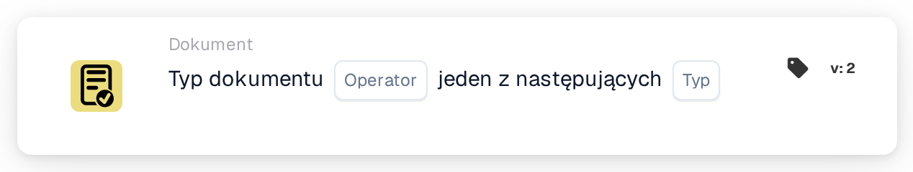

# Typ dokumentu Operacja jedna z

<figure><figcaption>
Wersja 2
</figcaption></figure>

## **Cel:**

Ta karta służy do zarządzania akcjami na dokumentach w zależności od ich typu, wykorzystując prostą logikę warunkową (is/is not) do wyzwalania lub blokowania określonych przepływów pracy. Umożliwia to precyzyjną kontrolę nad sposobem przetwarzania różnych typów dokumentów w systemie ERP.

## **Komponenty karty:**

1. **Operatora**
   * **Opis**: Określa logikę warunkową stosowaną do typów dokumentów.
   * **Opcje**:
     * **is**: Operacja zostanie wyzwolona, jeśli typ dokumentu odpowiada jednemu z określonych typów na liście.
     * **nie jest**: Operacja zostanie wyzwolona, jeśli typ dokumentu nie odpowiada żadnemu z wymienionych typów.
2. **Lista typów dokumentów**
   * **Opis**: Określa listę typów dokumentów, do których będzie miał zastosowanie warunek.
   * **Szczegóły**: Obejmuje to różne typy dokumentów, takie jak "Invoice", "Purchase Order" itp., na podstawie których oceniany będzie warunek (is/is not).

## Funkcjonalność:

* **Ocena warunku:** System sprawdza, czy typ dokumentu spełnia warunek operatora (is lub is not) względem określonej listy typów dokumentów.
* **Wykonanie akcji:**
  * **Warunek prawdziwy:**\
    Jeśli typ dokumentu spełnia określony warunek (jest lub nie jest na liście), przepływ pracy jest kontynuowany. Może to wyzwolić procesy, takie jak zatwierdzenia dokumentów, określone walidacje lub akcje routingu.
  * **Warunek fałszywy:**\
    Jeśli typ dokumentu nie spełnia warunku, wykonywane są alternatywne akcje, takie jak odrzucenie dokumentu lub zatrzymanie przepływu pracy.

## Konfiguracja:

* Użytkownicy konfigurują kartę, wybierając pole typu dokumentu i definiując operator (is lub is not). Następnie określają listę typów dokumentów do sprawdzenia. Konfiguracja jest prosta i obejmuje menu rozwijane do wyboru pola i operatora oraz pole do wprowadzenia listy typów dokumentów.

## Podsumowanie:

Karta przepływu pracy "Document Type Condition" odgrywa kluczową rolę w zarządzaniu operacjami opartymi na dokumentach z precyzją i elastycznością. Korzystając z prostej logiki warunkowej, pomaga zapewnić, że dokumenty są odpowiednio przetwarzane, zwiększając efektywność i zgodność. Jasne udokumentowanie tej karty pomoże użytkownikom zrozumieć, jak skutecznie ją wdrożyć i wykorzystać, czyniąc ją cenną częścią dokumentacji systemu ERP.

<!-- workflow-card-practical-example-20261021 -->

## Praktyczny przykład

**Kiedy używać:** Użyj tej samej walidacji dla kilku typów dokumentów.

**Konfiguracja:** Wybierz operator jest-jednym z oraz typy `Invoice` i `Credit Note`.

**Oczekiwany wynik i kontrprzykład:** `Invoice` udany; `Order` nie.

To jest ilustracyjna konfiguracja i oczekiwany wynik. Korzystaj z pól, użytkowników i grup skonfigurowanych w Twojej organizacji testowej; nie jest to twierdzenie, że ten przykład został wykonany.
