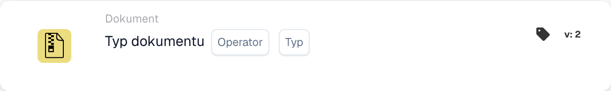

# Typ dokumentu

<figure><figcaption>
Pola karty w pokazanej wersji. Pola nie są jeszcze skonfigurowane.
</figcaption></figure>

## Cel:

Ta karta przepływu pracy służy do oceny, czy dokument odpowiada określonemu typowi. Sprawdzając, czy dokument odpowiada podanemu typowi, przepływy pracy mogą być kontynuowane lub podejmować alternatywne akcje na podstawie tego warunku. Pomaga to zautomatyzować procesy, w których typ dokumentu dyktuje kolejne kroki w przepływie pracy.

## Komponenty karty:

1. **Operatora**
   * **Opis**: Definiuje, czy dokument powinien być określonego typu, czy nie.
   * **Opcje**:
     * **Is**: Dokument musi odpowiadać określonemu typowi, aby warunek był prawdziwy.
     * **Nie jest**: Dokument nie może odpowiadać określonemu typowi, aby warunek był prawdziwy.
2. **Typ**
   * **Opis**: Określa typ dokumentu do porównania.
   * **Szczegóły**: Obejmuje to różne typy dokumentów, takie jak "Invoice", "Purchase Order" itp., na podstawie których oceniany będzie warunek (is/is not).

## Funkcjonalność:

* **Ocena warunku**: System ocenia, czy typ dokumentu w określonym polu odpowiada warunkowi zdefiniowanemu przez operator. Porównuje wartość pola z podanym typem dokumentu.
* **Wykonanie akcji**:
  * **Warunek prawdziwy**: Jeśli typ dokumentu odpowiada określonemu typowi (lub nie, w zależności od operatora), przepływ pracy jest kontynuowany z warunkiem prawdziwym. Może to wyzwolić akcje, takie jak dalsze przetwarzanie dokumentu, wysłanie go do zatwierdzenia lub zastosowanie określonych reguł na podstawie typu dokumentu.
  * **Warunek fałszywy**: Jeśli typ dokumentu nie odpowiada określonemu typowi, przepływ pracy jest kontynuowany z warunkiem fałszywym. Może to wyzwolić alternatywne akcje, takie jak przekierowanie dokumentu do innego procesu lub zatrzymanie dalszych akcji.

## Konfiguracja:

* Użytkownicy konfigurują kartę, wybierając pole dokumentu zawierające typ dokumentu z listy dostępnych pól. Następnie wybierany jest operator definiujący, czy dokument musi być określonego typu, czy nie. Na koniec użytkownicy ustawiają warunek kontynuacji (true lub false), który określa kolejną akcję na podstawie typu dokumentu.

## Podsumowanie:

Karta przepływu pracy "Document Type Comparison" jest niezbędna do zapewnienia, że przepływy pracy są kontynuowane na podstawie typu przetwarzanego dokumentu. Porównując typ dokumentu, pomaga organizacjom zautomatyzować zadania routingu i przetwarzania dokumentów, zapewniając, że dokumenty są odpowiednio obsługiwane na podstawie ich typu.

<!-- workflow-card-practical-example-20261021 -->

## Praktyczny przykład

**Kiedy używać:** Przeprowadź kontrolę dotyczącą konkretnej faktury.

**Konfiguracja:** Wybierz typ dokumentu `Invoice` i operator równości.

**Oczekiwany wynik i kontrprzykład:** Faktura przechodzi. Nota kredytowa nie spełnia tego warunku.

To jest ilustracyjna konfiguracja i oczekiwany wynik. Korzystaj z pól, użytkowników i grup skonfigurowanych w Twojej organizacji testowej; nie jest to twierdzenie, że ten przykład został wykonany.
