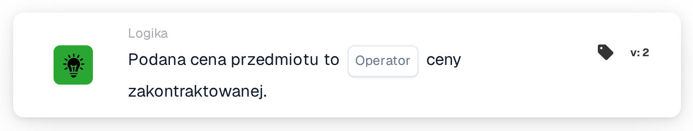
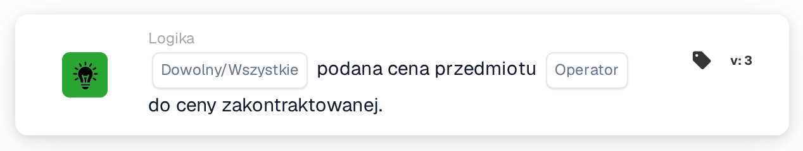

# Podana cena przedmiotu

<figure><figcaption>
Wersja 2
</figcaption></figure>

<figure><figcaption>
Wersja 3
</figcaption></figure>

## **Cel:**

Ta karta DocBits porównuje podaną cenę przedmiotu z jego umowną ceną, umożliwiając przepływom pracy wyzwalanie działań w oparciu o to, czy te dwie wartości są zgodne, czy różne. Pomaga zapewnić spójność cenową i zgodność z warunkami umowy.

## **Funkcjonalność:**

* **Porównanie cen:** Ta karta ocenia, czy podana cena przedmiotu spełnia określony warunek w stosunku do ceny kontraktowej.
* **Operatory:** Można zastosować następujące warunki:
  * **Równa się (=):** Sprawdza, czy podana cena jest zgodna z ceną zakontraktowaną.
  * **Nie równa się (≠):** Zapewnia, że podana cena różni się od ceny kontraktowej.

## **Użycie:**

Karta ta jest szczególnie przydatna w przepływach pracy związanych z zaopatrzeniem, sprzedażą lub zarządzaniem umowami, gdzie przed przystąpieniem do zatwierdzania lub przetwarzania zamówień kluczowe jest sprawdzenie, czy podane ceny są zgodne z uzgodnionymi warunkami umowy.

## **Przykładowy scenariusz:**

* Użytkownik konfiguruje kartę w celu sprawdzenia, czy **kwotowana cena jest równa (=)** **kontraktowanej cenie**. Jeśli ceny są zgodne, przepływ pracy przechodzi do zatwierdzenia; jeśli nie, uruchamia powiadomienie o ręcznym sprawdzeniu w celu usunięcia rozbieżności.

Korzystając z karty „Cena przedmiotu a cena umowna”, organizacje mogą egzekwować politykę cenową, utrzymywać zgodność z umową i ograniczać błędy w transakcjach finansowych.

## Wersja 3: Dowolna lub Wszystkie

Wersja 3 dodaje `match_any` i `match_all`. Dowolny wymaga co najmniej jednej udanej porównywalnej linii; Wszystko wymaga, aby każda porównywana linia spełniała wymagania wybranego operatora. Wersja 2 zachowuje wszystko. Nieustawiony wybór w wersji 3 ma wartość domyślną Wszystkie i jest rejestrowany. W żadnej porównywalnej linii nie brakuje danych, co nie oznacza udanego dopasowania. Zobacz [Karty porównawcze cytatów](../../cards-overview/quote-comparison-guide.md), aby zapoznać się z mieszanymi wynikami, pominiętymi wierszami i testami.
