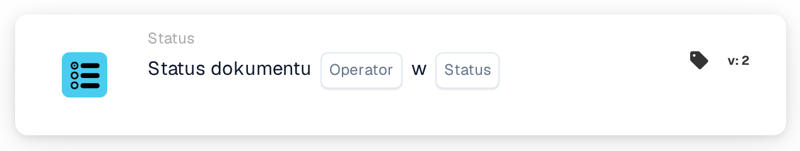

# Lista warunków statusu dokumentu

<figure><figcaption>
Wersja 2
</figcaption></figure>

**Cel**

Ta karta służy do kontrolowania akcji przepływu pracy na podstawie bieżącego statusu dokumentu, używając logiki warunkowej do wyzwalania lub ograniczania określonych procesów. Zapewnia, że dokumenty przechodzą przez przepływy pracy tylko wtedy, gdy spełniają predefiniowane kryteria statusu.

**Komponenty karty**

1. **Operatora**
   * **Opis**: Określa, w jaki sposób status dokumentu będzie oceniany względem określonego warunku.
   * **Opcje**:
     * **is**: Wyzwala powiązane akcje, jeśli bieżący status dokumentu odpowiada jednemu z określonych statusów.
     * **nie jest**: Wyzwala akcje, jeśli status dokumentu nie odpowiada żadnemu z określonych statusów.
2. **Stan (Lista)**
   * **Opis**: Wymienia konkretne statusy, względem których porównywany będzie bieżący status dokumentu.
   * **Przykłady**: "Error", "Export Error", "Ready in Validation", "Ready in Review", "Pending Approval", "Pending Second Approval". Reprezentują one różne etapy lub stany, w których dokument może się znajdować w ramach procesu przepływu pracy.

**Funkcjonalność**

* **Identyfikacja statusu**: Automatycznie identyfikuje bieżący status dokumentu w miarę jego przemieszczania się przez przepływ pracy systemu ERP.
* **Ocena warunku**: Stosuje wybrany operator (is lub is not) do statusu dokumentu w porównaniu z wymienionymi statusami:
  * Jeśli **is**, sprawdza, czy status dokumentu odpowiada dowolnemu statusowi z listy.
  * Jeśli **nie jest**, sprawdza, czy status dokumentu nie pojawia się na liście.
* **Wykonanie akcji**: W zależności od wyniku oceny warunku:
  * **True**: Wykonuje predefiniowane akcje lub przepływy pracy, jeśli warunek jest spełniony.
  * **False**: Pomija lub wyzwala alternatywne przepływy pracy, jeśli warunek nie jest spełniony.
* **Integracja z przepływem pracy**: Bezproblemowo integruje się z innymi komponentami przepływu pracy, zapewniając skoordynowaną obsługę dokumentów w całym systemie.

**Interakcje użytkownika**

* **Konfiguracja**: Użytkownicy konfigurują kartę, wybierając operator i określając odpowiednie statusy. Konfiguracja ta może obejmować proste menu rozwijane lub pola wyboru do wybierania statusów i operatorów.
* **Monitorowanie i zarządzanie**: Użytkownicy mogą śledzić aktywność karty za pośrednictwem pulpitu, który dostarcza informacji o monitorowanych warunkach statusu oraz akcjach podejmowanych na podstawie tych warunków.
* **Obsługa błędów i alerty**: Obsługuje konfigurowanie alertów dla niepowodzeń procesów lub niezgodności w oczekiwanych statusach dokumentów, umożliwiając szybką reakcję na problemy operacyjne.

#### Podsumowanie

Karta przepływu pracy "Document Status Condition" jest kluczowa dla zapewnienia, że dokumenty są prawidłowo przetwarzane zgodnie z ich bieżącym statusem, zwiększając kontrolę i efektywność w systemie ERP. Jasne udokumentowanie tej karty w instrukcji systemu pomoże użytkownikom skutecznie ją wdrożyć i zarządzać nią, wykorzystując jej funkcjonalność do utrzymania płynnych i zgodnych przepływów pracy dokumentów. Karta ta jest szczególnie przydatna w zarządzaniu cyklami życia dokumentów i zapewnianiu, że tylko dokumenty spełniające określone kryteria przechodzą do kolejnych etapów procesów biznesowych.

<!-- workflow-card-complete-example-20261021 condition_doc_status_is_isnot_in_list -->

### Przykład listy statusów

**Konfiguracja:** Wybierz operatora, który wymaga, aby bieżący stan znajdował się na liście. Wybierz `Pending Approval` i `Pending Second Approval` na liście statusów.

**Oczekiwany wynik i kontrprzykład:** Warunek jest prawdziwy dla dokumentu o dowolnym wybranym statusie. Dla dokumentu o statusie `Ready in Validation` jest to fałsz. W przypadku operatora, który wymaga, aby status znajdował się poza listą, wyniki tych warunków są odwrotne. Sprawdź rzeczywistą listę, zamiast porównywać wartość w postaci wolnego tekstu oddzieloną przecinkami.

To jest ilustracyjna konfiguracja testu i oczekiwany wynik; nie zostało ono wykonane. Skorzystaj z danych i odbiorców skonfigurowanych w Twojej organizacji testowej.
