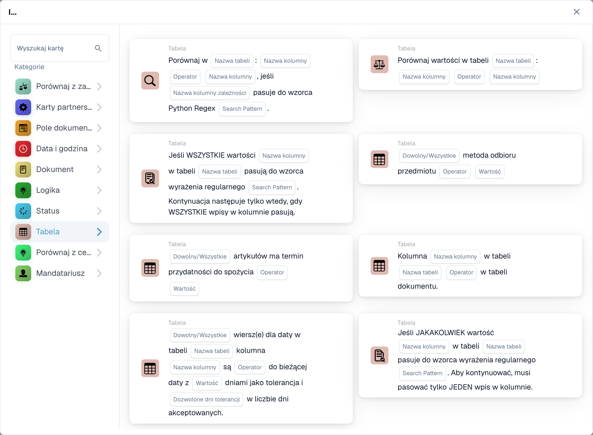
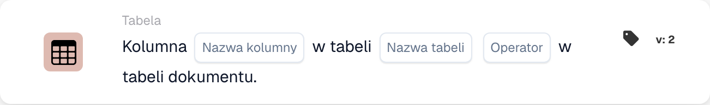
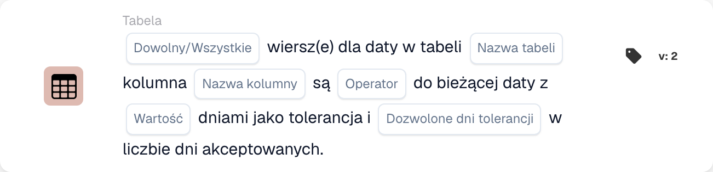

# Tabela

Karty tej kategorii w przeglądarce **Dodaj kartę** Kreatora przepływów:

<figure><figcaption>
Karty dostępne w wybranej kategorii. Uzupełnij pola przed użyciem. Niektóre etykiety tej wersji interfejsu nie są jeszcze przetłumaczone lub mają nieprawidłowe tłumaczenie. Objaśnienia na tej stronie używają właściwych terminów; obraz przedstawia rzeczywisty interfejs.
</figcaption></figure>

<!-- workflow-card-example-condition_table_column_exists-20261021 -->

### Tabela dokumentów zawiera kolumnę

<figure><figcaption>
Pola karty w pokazanej wersji. Pola nie są jeszcze skonfigurowane.
</figcaption></figure>

`CONDITION_TABLE_COLUMN_EXISTS` · wersja 2

Wybierz tabelę `lines`, kolumnę `article_number` i operator istnieje. Wypełniona tabela zawierająca tę kolumnę przechodzi; ta sama tabela bez kolumny nie sprawdza istnienia porównania. Brak lub pusta tabela może dawać wynik braku danych i nie jest dowodem udanego negatywnego porównania.

<!-- workflow-card-example-condition_compare_table_date_to_current_date-20261021 -->

### Daty w tabeli względem daty referencyjnej

<figure><figcaption>
Pola karty w pokazanej wersji. Pola nie są jeszcze skonfigurowane.
</figcaption></figure>

`CONDITION_COMPARE_TABLE_DATE_TO_CURRENT_DATE` · wersja 2

Dla daty referencyjnej `2026-10-21` porównaj tabelę `lines`, kolumna `delivery_date`, później niż, Wszystko i tolerancja dnia zerowego. Wiersze datowane na `2026-10-22` i `2026-10-23` spełniają kryteria porównania. Wiersz z datą `2026-10-20` powoduje niepowodzenie opcji All. Przetestuj oddzielnie brakujące i nieprawidłowe daty.
