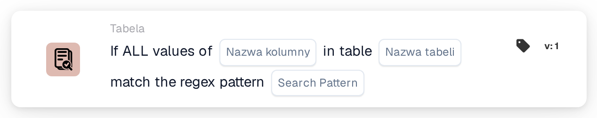
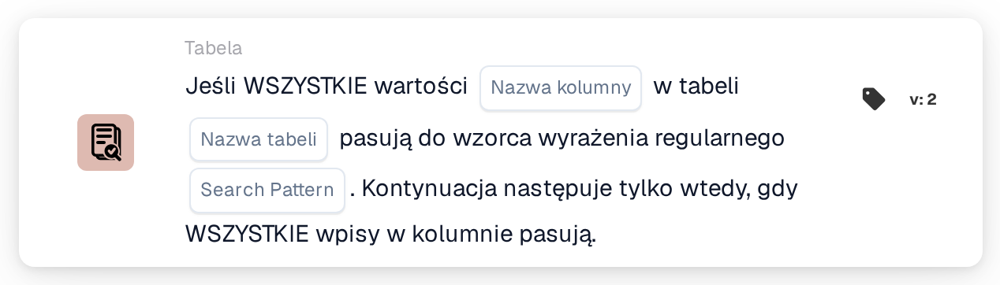

# Cała wartość

<figure><figcaption>
Wersja 1
</figcaption></figure>

<figure><figcaption>
Wersja 2
</figcaption></figure>

## **Cel:**

Ta karta DocBits służy do walidacji, czy **wszystkie wartości** w określonej kolumnie tabeli odpowiadają podanemu wzorcowi regex. Aby przepływ pracy mógł być kontynuowany, każdy wpis w kolumnie musi spełniać warunek, co czyni tę kartę idealną do zapewnienia spójności i integralności danych we wszystkich wpisach.

## **Funkcjonalność:**

* **Walidacja wzorca regex:** Ta karta sprawdza, czy **wszystkie wartości** w określonej kolumnie tabeli odpowiadają podanemu wzorcowi wyrażenia regularnego. Przepływ pracy będzie kontynuowany tylko wtedy, gdy każdy wpis w kolumnie spełnia warunek.
* **Operator:** Użytkownicy definiują kolumnę i określają wzorzec regex. Dostępny warunek obejmuje:
  * **Matches Regex Pattern:** Weryfikuje, czy każda wartość w określonej kolumnie odpowiada wzorcowi regex.
* **Wybór tabeli i kolumny:** Użytkownicy określają tabelę i kolumnę, które chcą sprawdzić pod kątem pełnego dopasowania wzorca regex.

## **Zastosowanie:**

Ta karta jest idealna w przypadkach, gdy wymagana jest jednolitość danych, na przykład w celu zapewnienia, że wszystkie numery telefonów, identyfikatory produktów lub inne wpisy pól są zgodne z określonym formatem. Zapewnia, że przepływy pracy są kontynuowane tylko wtedy, gdy każdy istotny wpis jest zgodny z wzorcem.

## **Przykładowy scenariusz:**

* Użytkownik ustawia kartę, aby sprawdzić kolumnę "Phone Number" w tabeli "Contacts", używając wzorca regex do walidacji formatów numerów telefonów. Jeśli każdy wpis numeru telefonu w kolumnie odpowiada wzorcowi, karta wyzwoli kolejny krok w przepływie pracy, potwierdzając jednolite formatowanie danych.

Korzystając z karty "All Values Regex Pattern Matching", organizacje mogą egzekwować ścisłe standardy danych i zwiększyć dokładność przepływu pracy, zapewniając, że każdy wpis w określonej kolumnie spełnia wymagany format przed kontynuowaniem.
