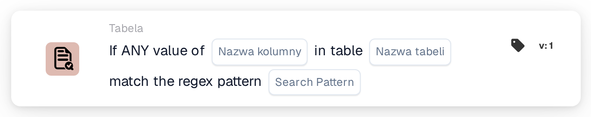
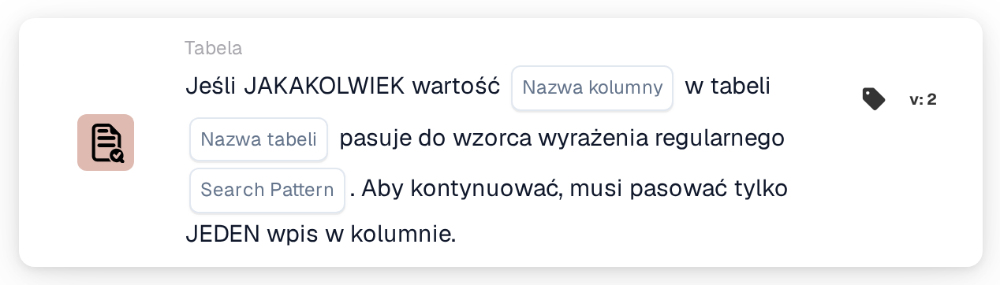

# Dowolna wartość

<figure><figcaption>
Wersja 1
</figcaption></figure>

<figure><figcaption>
Wersja 2
</figcaption></figure>

## **Cel:**

Ta karta DocBits służy do walidacji, czy dowolna wartość w określonej kolumnie tabeli odpowiada podanemu wzorcowi regex. Jeśli którykolwiek pojedynczy wpis w kolumnie odpowiada wzorcowi, przepływ pracy będzie kontynuowany, co czyni ją idealną dla przypadków użycia, w których zidentyfikowanie nawet pojedynczego dopasowania wyzwala kolejne kroki w procesie.

## **Funkcjonalność:**

* **Walidacja wzorca regex:** Ta karta sprawdza, czy dowolna wartość w danej kolumnie tabeli odpowiada podanemu wzorcowi wyrażenia regularnego. Karta zostanie wyzwolona i umożliwi kontynuację przepływu pracy, jeśli co najmniej jeden wpis w kolumnie spełnia warunek.
* **Operator:** Użytkownicy definiują kolumnę i określają wzorzec regex. Dostępny warunek obejmuje:
  * **Matches Regex Pattern:** Weryfikuje, czy co najmniej jedna wartość w określonej kolumnie odpowiada wzorcowi regex.
* **Wybór tabeli i kolumny:** Użytkownicy określają tabelę i kolumnę, które chcą sprawdzić pod kątem dopasowania wzorca regex.

## **Zastosowanie:**

Ta karta jest szczególnie przydatna w scenariuszach, w których tabela zawiera dane mogące wymagać określonych dopasowań, takich jak walidacja adresów e-mail, numerów faktur lub identyfikatorów produktów. Zapewnia, że przepływy pracy są kontynuowane, gdy dowolny istotny wpis odpowiada zdefiniowanemu wzorcowi, bez konieczności sprawdzania każdego wpisu.

## **Przykładowy scenariusz:**

* Użytkownik ustawia kartę, aby sprawdzić wpisy w kolumnie "Email Address" tabeli "Customers", używając wzorca regex dla prawidłowych formatów e-mail. Jeśli co najmniej jeden adres e-mail w kolumnie odpowiada wzorcowi, karta wyzwoli kolejny krok przepływu pracy, zapewniając, że system przetworzy prawidłowy wpis.

Korzystając z karty "Regex Pattern Matching", organizacje mogą zautomatyzować przepływy pracy na podstawie dynamicznych walidacji opartych na wzorcach, usprawniając procesy i zapewniając, że tylko istotne wpisy wyzwalają dalsze akcje.
