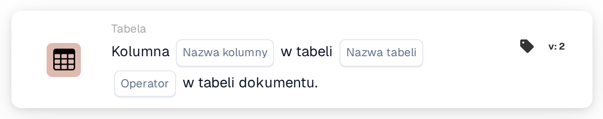

# Kolumna istnieje w tabeli

<figure><figcaption>
Wersja 2
</figcaption></figure>

## Cel:

Ta karta przepływu pracy sprawdza, czy tabela dokumentu zawiera określoną kolumnę. Można jej używać, aby kolejne karty były wykonywane tylko dla dokumentów, których tabela zawiera wymagane dane, na przykład kolumnę z datą dostawy lub numerem pozycji, albo aby kierować dokumenty o innym układzie tabeli w inne miejsce. W zależności od wyniku przepływ pracy jest kontynuowany zgodnie z warunkiem prawdziwym lub fałszywym.

## Komponenty karty:

1. **Nazwa kolumny**
   * **Opis:** Nazwa kolumny, której szuka karta.
   * **Szczegóły:** Nazwa kolumny jest porównywana bez rozróżniania wielkich i małych liter.
2. **Nazwa tabeli**
   * **Opis:** Nazwa sprawdzanej tabeli dokumentu.
   * **Szczegóły:** Nazwa tabeli jest porównywana bez rozróżniania wielkich i małych liter.
3. **Operator**
   * **Opis:** Określa, czy kolumna powinna występować w tabeli, czy nie.
   * **Opcje:**
     * **Jest:** Warunek jest prawdziwy, jeśli tabela zawiera kolumnę.
     * **Nie jest:** Warunek jest prawdziwy, jeśli tabela nie zawiera kolumny.

## Funkcjonalność:

* **Ocena warunku:** Karta wyszukuje tabelę dokumentu o podanej nazwie i sprawdza, czy pierwszy wiersz tej tabeli ma kolumnę o podanej nazwie. Znaleziona kolumna lub kolumny, które występowały zamiast niej, są odnotowywane w dzienniku przepływu pracy.
* **Wykonanie akcji:**
  * **Warunek prawdziwy:**\
    Przy **Jest** kolumna znajduje się w tabeli. Przy **Nie jest** jej tam nie ma. Przepływ pracy jest kontynuowany zgodnie z warunkiem prawdziwym, na przykład aby wykonać porównanie na tej kolumnie.
  * **Warunek fałszywy:**\
    Jeśli warunek nie jest spełniony, przepływ pracy jest kontynuowany zgodnie z warunkiem fałszywym.
* **Brakujące dane:** Karta nie ocenia warunku i zgłasza brakujące dane w dzienniku przepływu pracy, jeśli na karcie nie ustawiono nazwy kolumny lub nazwy tabeli, jeśli dokument nie ma tabeli o podanej nazwie albo jeśli ta tabela nie ma wierszy lub jej pierwszy wiersz nie ma kolumn.
* **Błędy:** Jeśli nie ustawiono operatora lub ustawiono operator inny niż **Jest** albo **Nie jest**, karta zgłasza błąd konfiguracji.

## Instalacja i konfiguracja:

* Kartę można dodać z kategorii **Tabela**. Następnie można ustawić nazwę kolumny, nazwę tabeli i operator (**Jest** lub **Nie jest**). Na koniec ustawia się warunek kontynuacji (prawda lub fałsz), który określa następny krok przepływu pracy.

## Podsumowanie:

Karta przepływu pracy „Column Exists in Table” sprawdza układ tabeli dokumentu, zanim jej dane zostaną użyte. Umieszczona przed innymi kartami tabel pomaga zapewnić, że te karty są wykonywane tylko na dokumentach zawierających oczekiwaną kolumnę.
