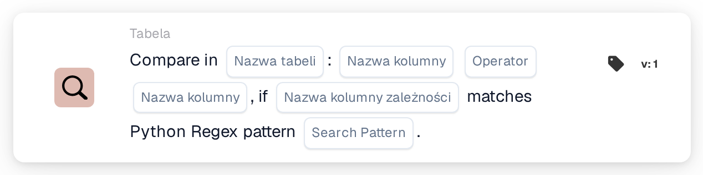
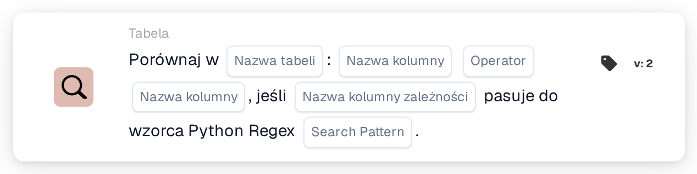

# Porównaj w

<figure><figcaption>
Wersja 1
</figcaption></figure>

<figure><figcaption>
Wersja 2
</figcaption></figure>

## **Cel:**

Ta karta DocBits wykonuje porównanie między dwiema kolumnami w określonej tabeli, umożliwiając użytkownikom ustawienie warunków na podstawie wartości w każdej kolumnie. Dodatkowo karta ta zawiera funkcję zależności, w której porównanie odbędzie się tylko wtedy, gdy wartość w trzeciej kolumnie odpowiada określonemu wzorcowi regex Pythona. Taka konfiguracja jest przydatna dla kontroli warunkowych zależnych od wielu punktów danych w zbiorze danych.

## **Funkcjonalność:**

* **Porównanie kolumn z zależnością:** Ta karta porównuje wartości w dwóch określonych kolumnach na podstawie ustawionego warunku, który jest stosowany tylko wtedy, gdy wartość w trzeciej kolumnie "zależności" odpowiada zdefiniowanemu wzorcowi regex Pythona.
* **Operatorzy:** Użytkownicy mogą wybrać następujące operatory do porównania kolumn:
  * **Równa się (=):** Sprawdza, czy wartości w dwóch kolumnach są dokładnie równe.
  * **Nie równa się (≠):** Zapewnia, że wartości w dwóch kolumnach nie są równe.
  * **Większy niż (>):** Potwierdza, że wartości w pierwszej kolumnie są większe niż w drugiej kolumnie.
  * **Większe lub równe (≥):** Zapewnia, że wartości w pierwszej kolumnie są większe lub równe wartościom w drugiej kolumnie.
  * **Mniejszy niż (<):** Sprawdza, czy wartości w pierwszej kolumnie są mniejsze niż w drugiej kolumnie.
  * **Mniejszy lub równy (≤):** Zapewnia, że wartości w pierwszej kolumnie są mniejsze lub równe wartościom w drugiej kolumnie.
* **Regex Dependency:** Ta karta zawiera funkcję zależności, która umożliwia użytkownikom zdefiniowanie wzorca regex dla trzeciej kolumny. Warunek porównania jest stosowany tylko wtedy, gdy co najmniej jedna wartość w kolumnie zależności odpowiada wzorcowi regex.

## **Zastosowanie:**

Ta karta jest szczególnie przydatna w scenariuszach wymagających złożonej logiki warunkowej, takich jak kontrole jakości zależne od relacji między punktami danych, z dodatkowymi warunkami opartymi na formatowaniu danych lub określonych wzorcach.

***

## **Przykładowy scenariusz:**

* Użytkownik konfiguruje kartę, aby porównać kolumny "Quantity" i "Threshold" w tabeli "Stock" z warunkiem **Ilość ≥ próg**. Porównanie to odbywa się tylko wtedy, gdy kolumna "Item Code" odpowiada wzorcowi regex dla określonych formatów kodów, takich jak **^A\d{3}$** (wskazujący kod pozycji zaczynający się od "A", po którym następują trzy cyfry).

Korzystając z karty "Conditional Column Comparison", organizacje mogą tworzyć zaawansowane, zależne od wzorców porównania w zbiorach danych, umożliwiając precyzyjne przetwarzanie danych i zwiększoną dokładność w warunkowych przepływach pracy.
