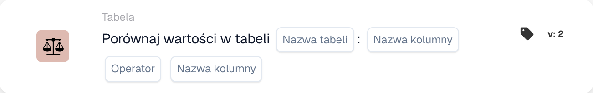

# Porównaj wartości w tabeli

<figure><figcaption>
Pola karty w pokazanej wersji. Pola nie są jeszcze skonfigurowane.
</figcaption></figure>

## **Cel:**

Ta karta DocBits wykonuje porównanie wartości w dwóch określonych kolumnach w tabeli, na podstawie wybranego warunku. Jest przydatna w scenariuszach wymagających walidacji relacji między punktami danych, takich jak kontrola jakości, kontrole spójności danych lub weryfikacja zgodności.

## **Funkcjonalność:**

* **Porównanie kolumn:** Ta karta umożliwia użytkownikom ustawienie warunków porównania wartości między dwiema kolumnami w tej samej tabeli.
* **Operatorzy:** Dostępne są następujące operatory do zdefiniowania porównania:
  * **Równa się (=):** Sprawdza, czy wartości w dwóch kolumnach są dokładnie równe.
  * **Nie równa się (≠):** Zapewnia, że wartości w dwóch kolumnach nie są równe.
  * **Większy niż (>):** Potwierdza, że wartości w pierwszej kolumnie są większe niż w drugiej kolumnie.
  * **Większe lub równe (≥):** Zapewnia, że wartości w pierwszej kolumnie są większe lub równe wartościom w drugiej kolumnie.
  * **Mniejszy niż (<):** Sprawdza, czy wartości w pierwszej kolumnie są mniejsze niż w drugiej kolumnie.
  * **Mniejszy lub równy (≤):** Zapewnia, że wartości w pierwszej kolumnie są mniejsze lub równe wartościom w drugiej kolumnie.
* **Wybór tabeli i kolumny:** Użytkownicy określają tabelę i dwie kolumny, które chcą porównać.

## **Zastosowanie:**

Ta karta jest idealna dla analityków danych, zespołów kontroli jakości lub specjalistów ds. zgodności, którzy muszą zapewnić, że wartości w jednej kolumnie odnoszą się do wartości w innej zgodnie z określonymi regułami, umożliwiając zaawansowaną walidację danych.

## **Przykładowy scenariusz:**

* Użytkownik konfiguruje kartę, aby sprawdzić, czy wartości w kolumnie "Current Stock" są **większe lub równe (≥)** wartościom w kolumnie "Minimum Stock Level" w tabeli "Inventory". Jeśli wszystkie wartości spełniają ten warunek, przepływ pracy jest kontynuowany, potwierdzając, że poziomy zapasów są wystarczające.

Korzystając z karty "Column Value Comparison", organizacje mogą zapewnić spójność danych, utrzymać standardy jakości i zweryfikować relacje danych w tabelach.
