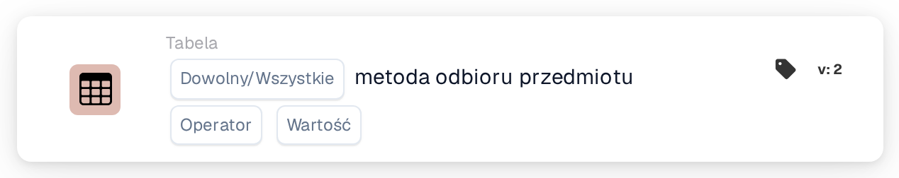

# Sposób odbioru przedmiotu

<figure><figcaption>
Wersja 2
</figcaption></figure>

## **Cel:**

Ta karta DocBits sprawdza, czy pozycje w zbiorze danych mają określoną metodę przyjęcia. Użytkownicy mogą wybrać walidację **dowolnej** pozycji lub **wszystkich** pozycji w zbiorze danych na podstawie wybranego warunku, co czyni ją odpowiednią dla scenariuszy, w których przepływy pracy zależą od metod przyjęcia pozycji, takich jak zarządzanie łańcuchem dostaw lub śledzenie zapasów.

## **Funkcjonalność:**

* **Walidacja metody przyjęcia:** Ta karta weryfikuje metodę przyjęcia pozycji względem określonego warunku. Użytkownicy mogą wybrać między **dowolną** pozycją a **wszystkimi** pozycjami w zbiorze danych i ustawić warunek jako **equals** lub **nie jest równy**.
* **Wybór przedmiotu:** Użytkownicy mogą określić:
  * **Any Item:** Karta jest wyzwalana, jeśli co najmniej jedna pozycja spełnia określony warunek metody przyjęcia.
  * **Wszystkie przedmioty:** Karta jest wyzwalana tylko wtedy, gdy wszystkie pozycje spełniają określony warunek metody przyjęcia.
* **Operatorzy:** Dostępne są następujące operatory do zdefiniowania warunku:
  * **Równa się (=):** Sprawdza, czy metoda przyjęcia odpowiada określonej wartości.
  * **Nie równa się (≠):** Zapewnia, że metoda przyjęcia nie odpowiada określonej wartości.

## **Zastosowanie:**

Ta karta jest idealna dla menedżerów magazynów, koordynatorów zapasów lub personelu logistycznego, którzy muszą zweryfikować metody przyjęcia pozycji przed umożliwieniem dalszych akcji, takich jak przetwarzanie, magazynowanie lub wysyłka.

## **Przykładowy scenariusz:**

* Użytkownik konfiguruje kartę, aby sprawdzić, czy **wszystkie pozycje** mają metodę przyjęcia **równa się „Dostawa bezpośrednia”**. Jeśli każda pozycja spełnia ten warunek, przepływ pracy jest kontynuowany, potwierdzając, że wszystkie pozycje są przeznaczone do dostawy bezpośredniej.

Korzystając z karty "Receiving Method Validation", organizacje mogą zapewnić zgodność z protokołami przyjęcia, poprawić przepływy pracy logistyki i utrzymać dokładność obsługi pozycji na podstawie określonych metod przyjęcia.
