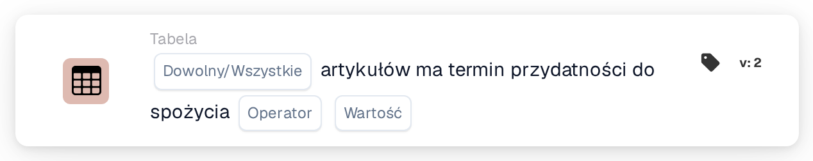

# Przedmioty mają okres przydatności do spożycia

<figure><figcaption>
Wersja 2
</figcaption></figure>

## **Cel:**

Ta karta DocBits weryfikuje, czy pozycje w zbiorze danych spełniają określone warunki na podstawie ich okresu przydatności (shelf life). Karta umożliwia użytkownikom wybór między "any" a "all" pozycjami do walidacji i obsługuje różne operatory porównania. Jest idealna dla scenariuszy, w których decyzje przepływu pracy zależą od okresu przydatności pozycji, takich jak kontrola jakości, zarządzanie zapasami lub kontrole zgodności.

## **Funkcjonalność:**

* **Walidacja okresu przydatności:** Ta karta sprawdza okres przydatności pozycji względem określonego warunku. Użytkownicy mogą wybrać walidację **dowolnej** pozycji lub **wszystkich** pozycji w zbiorze danych i zastosować różne operatory porównania do zdefiniowania warunku.
* **Wybór przedmiotu:** Użytkownicy mogą wybrać między:
  * **Any Item:** Karta jest wyzwalana, jeśli co najmniej jedna pozycja spełnia określony warunek okresu przydatności.
  * **Wszystkie przedmioty:** Karta jest wyzwalana tylko wtedy, gdy wszystkie pozycje spełniają określony warunek okresu przydatności.
* **Operatorzy:** Dostępne są następujące operatory do ustawienia warunku okresu przydatności:
  * **Równa się (=):** Sprawdza, czy okres przydatności jest dokładnie równy określonej wartości.
  * **Nie równa się (≠):** Zapewnia, że okres przydatności nie jest równy określonej wartości.
  * **Większy niż (>):** Potwierdza, że okres przydatności jest większy niż określona wartość.
  * **Większe lub równe (≥):** Zapewnia, że okres przydatności jest większy lub równy określonej wartości.
  * **Less Than (<):** Sprawdza, czy okres przydatności jest mniejszy niż określona wartość.
  * **Mniejszy lub równy (≤):** Zapewnia, że okres przydatności jest mniejszy lub równy określonej wartości.

## **Zastosowanie:**

Ta karta jest odpowiednia dla zespołów kontroli jakości, menedżerów zapasów lub specjalistów ds. zgodności, którzy muszą zapewnić, że pozycje spełniają określone wymagania dotyczące okresu przydatności przed kontynuowaniem dalszych akcji lub przepływów pracy.

## **Przykładowy scenariusz:**

* Użytkownik konfiguruje kartę, aby sprawdzić, czy **wszystkie pozycje** mają okres przydatności **większy lub równy 30 dni**. Jeśli każda pozycja spełnia ten warunek, przepływ pracy jest kontynuowany, potwierdzając, że wszystkie pozycje mają wystarczający okres przydatności do sprzedaży lub dystrybucji.

Korzystając z karty "Shelf Life Validation", organizacje mogą egzekwować standardy okresu przydatności, utrzymać jakość produktów i zapewnić dokładność przepływu pracy na podstawie warunków okresu przydatności pozycji.
