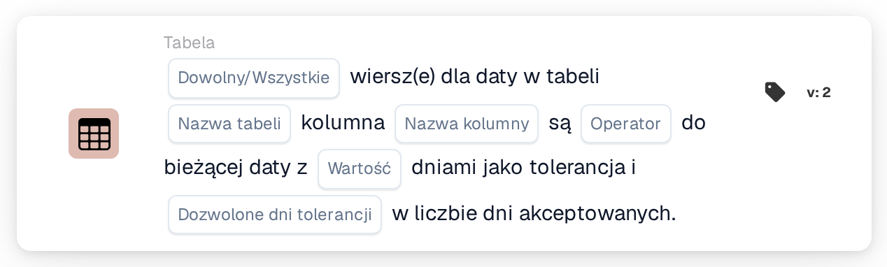

# Data w tabeli a bieżąca data

<figure><figcaption>
Wersja 2
</figcaption></figure>

Sposób obliczania okna tolerancji, wraz z przykładami takimi jak „dziś lub jutro”, wyjaśniono na stronie [Date Tolerances](../date-tolerances.md).

## Cel:

Ta karta przepływu pracy porównuje datę w każdym wierszu tabeli dokumentu, na przykład datę dostawy, z bieżącą datą. Można ustawić tolerancję w dniach oraz wybrać dni tygodnia, które są liczone, tak aby na przykład uwzględniane były tylko dni robocze. Można jej używać do sprawdzania, czy daty w dokumencie leżą w przeszłości, przypadają na dziś, mieszczą się w ciągu kilku dni czy leżą w przyszłości. W zależności od wyniku przepływ pracy jest kontynuowany zgodnie z warunkiem prawdziwym lub fałszywym.

## Komponenty karty:

1. **Dowolny/Wszystkie**
   * **Opis:** Określa, czy warunek powinien spełniać jeden wiersz, czy każdy wiersz tabeli.
   * **Opcje:**
     * **Każdy:** Warunek jest prawdziwy, jeśli co najmniej jeden wiersz spełnia warunek.
     * **Wszystko:** Warunek jest prawdziwy tylko wtedy, gdy każdy wiersz spełnia warunek.
2. **Nazwa tabeli**
   * **Opis:** Nazwa tabeli dokumentu, która zawiera daty.
3. **Nazwa kolumny**
   * **Opis:** Kolumna tabeli, która zawiera datę.
4. **Operator**
   * **Opis:** Określa, jak data w tabeli jest porównywana z bieżącą datą z uwzględnieniem tolerancji.
   * **Opcje:**
     * **Równa się:** Data mieści się w zakresie tolerancji wokół bieżącej daty.
     * **Nie równe:** Data leży poza zakresem tolerancji.
     * **Większy niż:** Data przypada po zakresie tolerancji.
     * **Większy lub równy:** Data mieści się w zakresie tolerancji lub przypada po nim.
     * **Mniej niż:** Data przypada przed zakresem tolerancji.
     * **Mniej lub Równe:** Data mieści się w zakresie tolerancji lub przypada przed nim.
5. **Wartość**
   * **Opis:** Tolerancja w dniach.
   * **Szczegóły:** Zakres tolerancji obejmuje tę liczbę dni przed bieżącą datą i po niej. Liczone są tylko dni wybrane w polu **Dozwolone dni tolerancji**. Jeśli nie ustawiono wartości, używana jest tolerancja 0 dni, więc zakres obejmuje tylko bieżącą datę.
6. **Dozwolone dni tolerancji**
   * **Opis:** Dni tygodnia, które są uznawane za dni akceptowane.
   * **Opcje:** Od poniedziałku do niedzieli, można wybrać kilka dni.

## Funkcjonalność:

* **Ocena warunku:** Karta odczytuje datę w wybranej kolumnie dla każdego wiersza pierwszej tabeli o podanej nazwie i porównuje ją z bieżącą datą (datą w UTC). Zakres tolerancji jest obliczany przez odliczenie podanej liczby dni do przodu i do tyłu od bieżącej daty. Niewybrane dni tygodnia nie są liczone, więc zakres wydłuża się poza nie, a one same pozostają wewnątrz zakresu. Na przykład przy tolerancji 2 dni, wybranych dniach od poniedziałku do piątku i piątku jako bieżącej dacie zakres trwa od środy do następnego wtorku.
* **Dni akceptowane:** Oprócz porównania data każdego wiersza powinna przypadać na jeden z wybranych dni tygodnia. Wiersz spełnia warunek tylko wtedy, gdy obie kontrole zakończą się powodzeniem. Wyniki wszystkich wierszy są następnie łączone za pomocą **Każdy** lub **Wszystko**.
* **Wykonanie akcji:**
  * **Warunek prawdziwy:**\
    Daty spełniają wybrany operator i przypadają na dni akceptowane, dla dowolnego lub wszystkich wierszy. Przepływ pracy jest kontynuowany zgodnie z warunkiem prawdziwym.
  * **Warunek fałszywy:**\
    Jeśli warunek nie jest spełniony, przepływ pracy jest kontynuowany zgodnie z warunkiem fałszywym, na przykład aby przesłać dokument do ręcznej weryfikacji.
* **Brakujące dane:** Karta nie ocenia warunku i zgłasza brakujące dane w dzienniku przepływu pracy, jeśli na karcie nie ustawiono nazwy tabeli, nazwy kolumny lub dni akceptowanych, jeśli dokument nie ma tabeli o podanej nazwie, jeśli wiersz tabeli nie ma tej kolumny albo jeśli tabela nie ma wierszy. Jeśli nie ustawiono opcji **Dowolny/Wszystkie**, karta odnotowuje to w dzienniku i używa **Wszystko**.
* **Błędy:** Jeśli wartości w kolumnie daty nie można odczytać jako daty, karta kończy się błędem.

## Instalacja i konfiguracja:

* Kartę można dodać z kategorii **Tabela**. Następnie można ustawić **Każdy** lub **Wszystko**, nazwę tabeli, nazwę kolumny, operator, tolerancję w dniach oraz dni akceptowane tygodnia. Na koniec ustawia się warunek kontynuacji (prawda lub fałsz), który określa następny krok przepływu pracy.

## Podsumowanie:

Karta przepływu pracy „Table Date to Current Date” sprawdza daty pozycji względem dzisiejszej daty, z tolerancją, którą można ograniczyć do dni roboczych lub dowolnego innego zestawu dni tygodnia. Pomaga to oznaczać dokumenty z datami zbyt wczesnymi, zbyt późnymi lub przypadającymi na dni, które nie są akceptowane.
