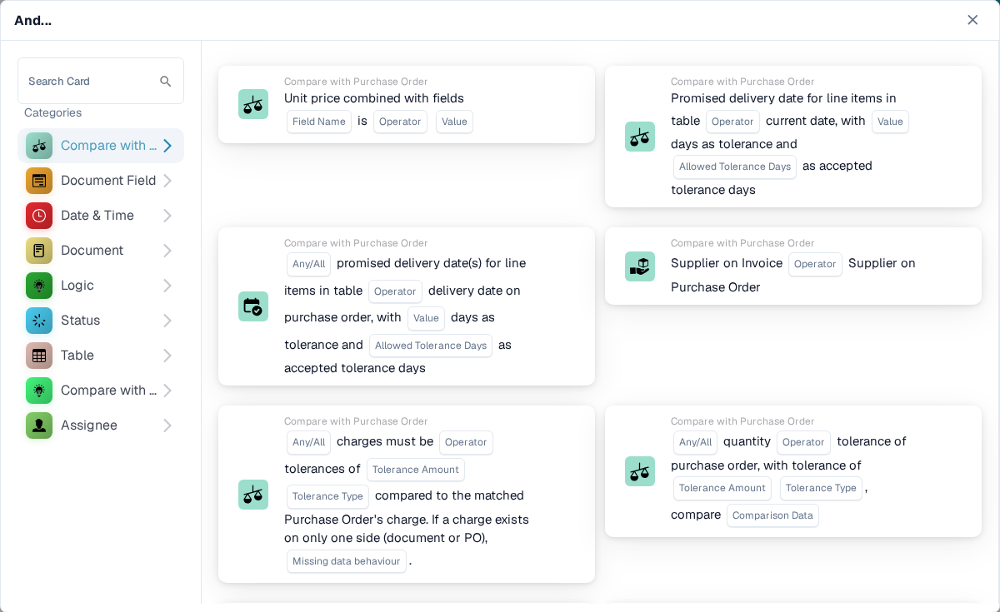
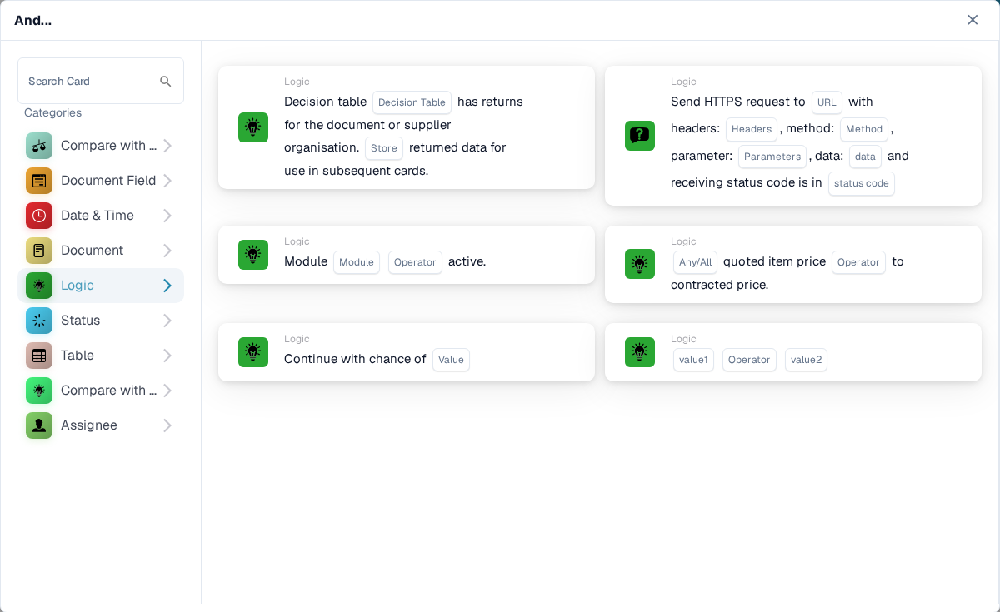
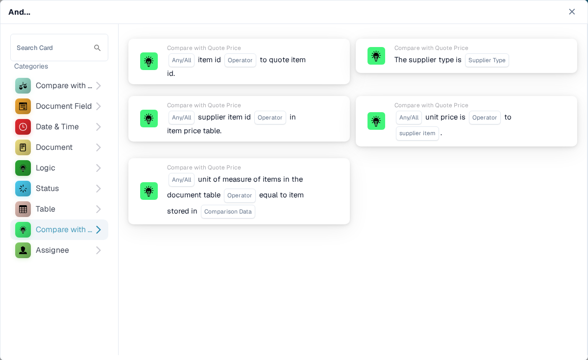

# And

Użyj karty **And**, aby zdecydować, czy przepływ pracy ma być kontynuowany po wyzwalaczu **When**. Dodaj kontrole, których potrzebujesz, przed akcją **Then**. Każda karta pokazuje pola do wypełnienia, takie jak **Operator**, **Field Name** lub **Value**; zrzuty ekranu przedstawiają dostępne szablony kart, a nie gotowe reguły.

W **Workflow Builder** wybierz **Add Card** pod **And...**. Wybierz kategorię po lewej stronie lub wpisz nazwę karty w polu **Search Card**. Wybierz podgląd karty, aby dodać ją do przepływu pracy. Możesz przewijać listę podglądów, aby zobaczyć więcej kart. Użyj **×**, aby zamknąć selektor bez wybierania kolejnej karty. Po skonfigurowaniu kart zapisz przepływ pracy. Zobacz [Workflow](../../), aby poznać otaczające kroki **When**, **And** i **Then**.

## Compare with Purchase Order

Użyj tych kart, aby porównać dane zamówienia lub faktury z zamówieniem zakupu, na przykład cenę jednostkową, obiecaną datę dostawy, opłaty lub ilość. Wybierz pola, operator i ewentualną tolerancję, o którą prosi wybrana karta. Poszczególne karty opisano w [Compare with Purchase Order](compare-with-purchase-order/).

<figure><figcaption>
Kategoria Compare with Purchase Order w angielskim środowisku Sandbox.
</figcaption></figure>

## Document Field

Wybierz tę kategorię, aby sprawdzić pole wyboru lub status pola, porównać pole z wartością albo porównać dwa pola. Wypełnij pola zastępcze **Field Name** i **Operator** na wybranej karcie. Niektóre porównania wymagają także podania tolerancji. Zobacz [Document Field](document-field/).

<figure><figcaption>
Kontrole Document Field korzystają z wartości z bieżącego dokumentu.
</figcaption></figure>

## Date & Time

Użyj **Date & Time**, aby porównać datę lub godzinę z zakresem albo porównać **Today** z wybraną datą. Wybierz **Operator** i wartości dat na karcie. Zobacz [Date & Time](date-and-time/).

<figure><figcaption>
Date &#x26; Time oferuje kontrolę zakresu i kontrolę względem dzisiejszej daty.
</figcaption></figure>

## Document

Użyj tych kart, gdy przepływ pracy ma zależeć od **typu dokumentu** lub **podorganizacji**. Wybierz typ lub organizację wskazaną na karcie. Zobacz [Document](document/).

<figure><figcaption>
Warunki Document sprawdzają typ lub podorganizację.
</figcaption></figure>

## Logic

Ta kategoria obejmuje kontrole z użyciem tabeli decyzyjnej, odpowiedzi HTTPS, dostępności modułu, ceny z oferty, wartości szansy lub dwóch wartości. Otwórz konkretną kartę i wypełnij jej nazwane pola zastępcze; na przykład karta HTTPS prosi o adres URL, metodę i akceptowany kod statusu. Zobacz [Logic](logic/).

<figure><figcaption>
Logic oferuje kilka różnych typów warunków; wybierz ten, który odpowiada Twojej regule.
</figcaption></figure>

## Status

Użyj **Status**, aby sprawdzić, czy dokument ma wybrany status lub czy jego status należy do wybranego zbioru. Wybierz **Operator** i **Status** na karcie. Zobacz [Status](status/).

<figure><figcaption>
Warunki Status sprawdzają bieżący stan dokumentu.
</figcaption></figure>

## Table

Te karty badają wiersze tabeli dokumentu. Widoczne opcje obejmują kontrole dat, wzorce tekstowe, okres trwałości i porównania między kolumnami. Przed wybraniem operatora lub wzorca wybierz **Table name** i **Column Name**. Zobacz [Table](table/).

<figure><figcaption>
Warunki Table korzystają z wierszy i kolumn tabeli dokumentu.
</figcaption></figure>

## Compare with Quote Price

Użyj tych kart, aby porównać pozycję z danymi o cenie z oferty. Widoczne opcje obejmują identyfikator pozycji, typ dostawcy, identyfikator pozycji dostawcy, cenę jednostkową i jednostkę miary. **Operator** i pola zastępcze danych zależą od wybranej karty.

<figure><figcaption>
Compare with Quote Price jest osobną kategorią w bieżącym selektorze kart.
</figcaption></figure>

## Assignee

Użyj **Assignee**, gdy warunek zależy od przypisanego użytkownika lub grupy. Wybierz, czy porównywać z jednym użytkownikiem lub jedną grupą, czy z wybranym zbiorem. Zobacz [Assignee](assignee/).

<figure><figcaption>
Warunki Assignee sprawdzają użytkownika lub grupę przypisaną do dokumentu.
</figcaption></figure>
