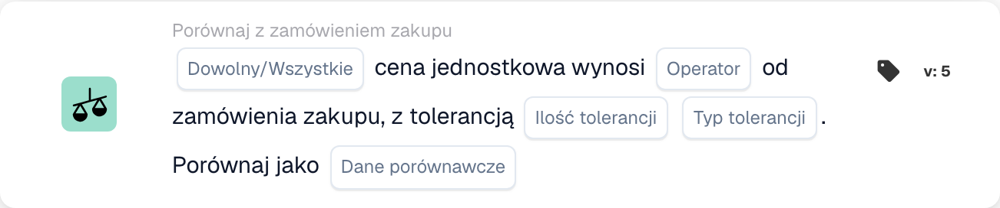

# Wersje i dostępność kart

<figure><figcaption>
Pola karty w pokazanej wersji. Pola nie są jeszcze skonfigurowane.
</figcaption></figure>

Karta w zapisanym przepływie pracy zachowuje swój identyfikator karty i wersję. Nowszy szablon może dodawać pola lub zmieniać zachowanie bez zmiany każdego wcześniej zapisanego przepływu pracy. Przed zastosowaniem instrukcji dotyczących nowszej wersji sprawdź wersję na aktualnej karcie.

## Przed zmianą zapisanej karty

1. Zapisz jego pola i bieżący wynik na reprezentatywnych danych testowych.
2. Porównaj jego wersję z odniesieniem, łącznie z wartościami domyślnymi i zachowaniem w przypadku brakujących danych.
3. Uaktualnij lub wymień kartę tylko poprzez obsługiwaną akcję konstruktora i ponownie przejrzyj jej ustawienia.
4. Zweryfikuj wykres i przetestuj przypadki pozytywne, negatywne i brakujące dane przed aktywacją zmienionego przepływu pracy.

Nie edytuj zapisanego typu karty technicznej jedynie w celu poprawienia jej pisowni. Istniejące przepływy pracy mogą zależeć od tego identyfikatora. Nieobsługiwana wersja to błąd wykonania, a nie fałszywy warunek biznesowy.

## W przypadku braku udokumentowanej karty

Sprawdź u administratora wybraną grupę Kiedy, I lub Następnie, kreator standardowy i zaawansowany, włączone moduły, uprawnienia i wdrożoną wersję. Karta wymieniona w integracji technicznej lub nowszej dokumentacji niekoniecznie jest włączona dla Twojej organizacji. Nie twórz ani nie importuj odgadniętej definicji karty, aby obejść brakujący szablon.

Dodatkowe warunki kalendarza opisane w niektórych materiałach deweloperskich nie są potwierdzonym zestawem do wyboru w każdym wydaniu. Funkcja ustawiająca zmienną dokumentu jest również zaimplementowana bez ogólnie rozstawionego szablonu interfejsu użytkownika. Skorzystaj z kart faktycznie dostępnych w Twoim środowisku i poproś o wyjaśnienie wcześniej, w zależności od niedostępnej karty.

## Referencje zależne od wersji

- [Eksportuj karty](export-cards-guide.md): status wyników i eksport natychmiastowy lub oczekujący w kolejce.
- [Karty porównawcze PO](po-comparison-versions-guide.md): kierunek porównania i podstawa tolerancji.
- [Karty porównawcze ofert](quote-comparison-guide.md): Dowolne/Wszystkie i brak porównywalnych cen.
- [Karty logiczne](logic-cards-guide.md): znaczniki, zmienne organizacyjne i typy danych wejściowych.

Użyj [Dzienników przepływu pracy](../workflow-logs.md), aby rozróżnić sukces, fałszywy warunek, brakujące dane, błąd konfiguracji i pominiętą kartę. Zapisz stan dokumentu i ustawienia karty wraz z wynikiem testu; sam zrzut ekranu selektora kart nie określa zachowania w czasie wykonywania.
