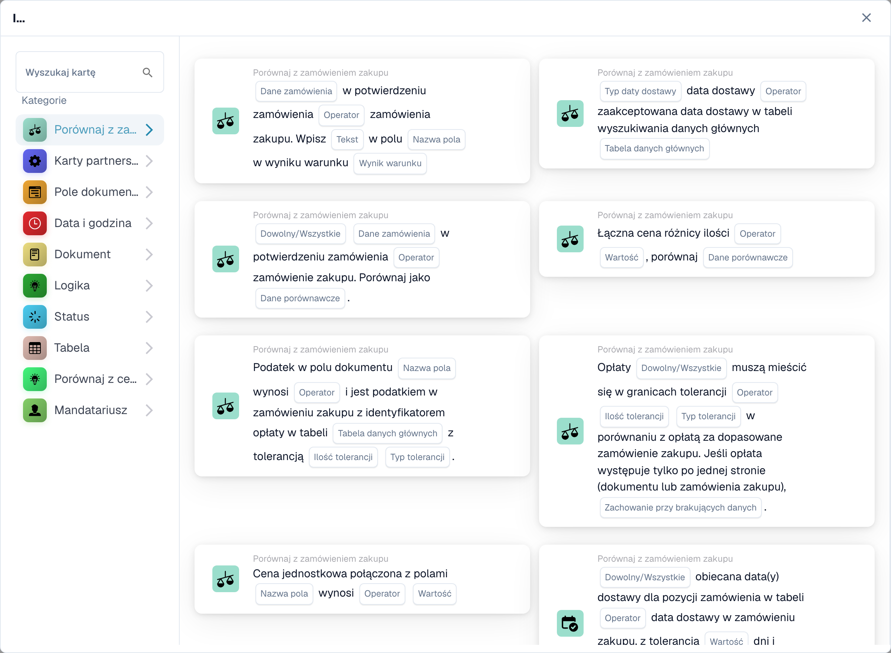

# Porównania PO: kierunek, tolerancja i wersje kart

<figure><figcaption>
Karty dostępne w wybranej kategorii. Uzupełnij pola przed użyciem. Niektóre etykiety tej wersji interfejsu nie są jeszcze przetłumaczone lub mają nieprawidłowe tłumaczenie. Objaśnienia na tej stronie używają właściwych terminów; obraz przedstawia rzeczywisty interfejs.
</figcaption></figure>

Karty porównawcze PO porównują wybraną stronę ze stroną odniesienia. Odniesienie określa podstawę tolerancji procentowej. Najpierw wykonaj dopasowanie zamówienia, następnie wybierz porównanie, operatora, Dowolne/Wszystkie i tolerancję wymaganą przez konkretną kartę.

## Kierunki porównania

| Zapisana opcja | Porównana strona | Strona referencyjna |
| --- | --- | --- |
| `po_document` | Zamówienie zakupu | Dokument |
| `received_document` | Otrzymane dane | Dokument |
| `po_received` | Zamówienie zakupu | Otrzymane dane |
| `document_po` | Dokument | Zamówienie zakupu |
| `document_received` | Dokument | Otrzymane dane |
| `received_po` | Otrzymane dane | Zamówienie zakupu |

Otrzymana strona pochodzi z dopasowanych danych zamówienia. Otrzymane porównanie na karcie cen jednostkowych może posłużyć się ilościami w celu uzyskania porównywalnej kwoty; nie jest to bezpośrednie porównanie ilości z ceną w walucie. Podczas sprawdzania obliczeń użyj wartości zarejestrowanych przez tę kartę w dzienniku.

## Dlaczego kierunek ma znaczenie

Dla odniesienia `100` i porównanej wartości `110` procentowa tolerancja `5` odpowiada `5` wokół odniesienia. Jeśli dokument jest odniesieniem i jego wartość jest edytowalna, zmiana dokumentu powoduje również zmianę podstawy tolerancji. Wybieraj referencje celowo, szczególnie w celu automatycznego zatwierdzenia.

Odwrócenie boków odwraca kolejność operatorów: `>` staje się `<`, `>=` staje się `<=` i odwrotnie. Równość i nierówność zachowują swoje znaczenie. Nie odwracaj napędu bez sprawdzenia wybranych stron.

Wersje zawierające migrację porównawczą przenoszą zapisane karty z `po_document` do `document_po` i z `received_document` do `document_received`, jednocześnie odwracając operator porządkowania. Wersje, których to dotyczy, to tolerancja ilościowa v4, potwierdzenie zamówienia do PO v4 i cena jednostkowa v4/v5. Łączna cena i różnica ilościowa są wyłączone z tej migracji zapisanych kart. Sprawdź zapisaną konfigurację i przetestuj jej wyniki biznesowe po wydaniu; nie odwracaj go ręcznie po raz drugi.

## Wersje kart jednostkowych

| Wersja | Konfiguracja |
| --- | --- |
| v3 | Używa wcześniejszego zachowania porównania. Nie zakładaj, że ujawnia to nowsze pola kierunku i tolerancji. |
| v4 | Dodaje wybór po stronie porównania. |
| v5 | Zawiera Dowolne/Wszystkie, operator, wielkość tolerancji, typ tolerancji i wybór strony porównawczej. |

Wybierz tolerancję bezwzględną dla stałej kwoty i tolerancję procentową dla odchylenia w stosunku do wybranego odniesienia. Skorzystaj z operatora oferowanego przez kartę; dokładna równość i uwzględnienie tolerancji to różne decyzje. Nie ma uniwersalnej tolerancji biznesowej odpowiedniej dla każdego dostawcy lub rodzaju dokumentu.

## Przykład weryfikacji

1. Użyj dopasowanego odniesienia do zamówienia zakupu `100` i wartości dokumentu `110`.
2. Wybierz Dokument do zamówienia, porównanie w ramach tolerancji, jeśli jest oferowane, i procent `5`. Spodziewaj się porównania poza pasmem.
3. Przetestuj dokładną granicę tolerancji, wartości po obu stronach i brakujące dopasowane PO.
4. W przypadku kilku linii zweryfikuj Dowolny kontra Wszystkie, używając jednej linii spełniającej i jednej zakończonej niepowodzeniem.
5. Sprawdź porównane wartości dziennika, wybrane strony, operatora i tolerancję, a następnie zweryfikuj wynikową gałąź przepływu pracy.

Niedopasowane zamówienie zakupu, wartość nieliczbowa i fałszywy warunek biznesowy to różne wyniki. Nie traktuj brakujących danych jako udanego dopasowania. W przypadku opłat użyj opcji [Wszystkie/Wszystkie opłaty](../and/compare-with-purchase-order/any-all-charges.md), która osobno wyjaśnia zachowanie braku ładunku oraz wersję 2/v3.

Kontynuuj, korzystając z [Przewodnika dopasowywania PO](../and/compare-with-purchase-order/po-matching-complete-guide.md) i indywidualnego odniesienia do karty w pozostałych polach.
