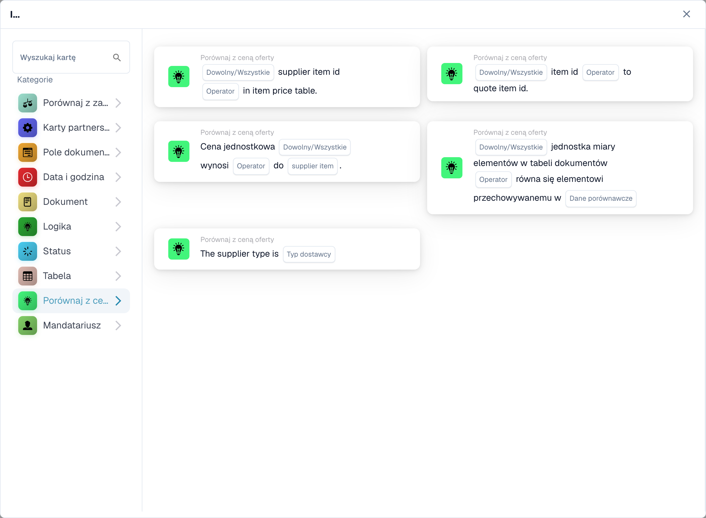

# Karty porównawcze cytatów

<figure><figcaption>
Karty dostępne w wybranej kategorii. Uzupełnij pola przed użyciem. Niektóre etykiety tej wersji interfejsu nie są jeszcze przetłumaczone lub mają nieprawidłowe tłumaczenie. Objaśnienia na tej stronie używają właściwych terminów; obraz przedstawia rzeczywisty interfejs.
</figcaption></figure>

W tych warunkach I wykorzystywane są dane dotyczące oferty lub pozycji dostawcy dostępne w dokumencie. Skonfiguruj je i przetestuj po załadowaniu wymaganych danych ofertowych. Pasujący identyfikator produktu sam w sobie nie dowodzi, że jego cena lub jednostka miary jest prawidłowa.

## Wybierz czek

| Typ karty | Sprawdź i skonfiguruj |
| --- | --- |
| `CONDITION_QUOTES_ITEM_NUMBER_COMPARISON` | Sprawdza identyfikator przedmiotu względem danych o cenie przedmiotu. Wybierz porównanie i pola Dowolne/Wszystkie oferowane przez kartę. |
| `CONDITION_SPECIFY_SUPPLIER_TYPE` | Porównuje typ dostawcy z danych oferty z `supplier_type`. To jest sprawdzenie klasyfikacji dostawcy, a nie porównanie cen. |
| `CONDITION_QUOTE_SUPPLIER_ITEM_NUMBER_EXISTS` | Sprawdza, czy identyfikator pozycji dostawcy jest obecny w danych o cenie towaru; wybierz operator i opcję Dowolny/Wszystkie. Brakujące dane dotyczące wyceny lub pozycji należy sprawdzić w dzienniku. |
| `CONDITION_QUOTE_PRICE_MATCH` | Porównuje cenę jednostkową z ceną wybranego dostawcy: `ManagedPrice` lub `LastPrice`. Wybierz Dowolne/Wszystkie i numeryczny operator porównania. Linie bez porównywalnego numeru po obu stronach są pomijane i rejestrowane; jeśli żadna linia nie jest porównywalna, karta zgłasza brak danych dokumentu. |
| `CONDIITON_UNIT_OF_MEASURE_EQUAL` | Sprawdza jednostkę miary z powiązanymi danymi. Typ techniczny zawiera zachowany błąd ortograficzny; nie zmieniaj tego w przechowywanym przepływie pracy JSON. Odrębnej uwagi wymaga cena wyrażona w przeliczeniu na różne jednostki. |
| `CONDITION_ITEM_QUOTES_TO_CONTRACTED_PRICE` | Porównuje ceny podane i zakontraktowane. Wersja 3 dodaje Dowolne/Wszystkie; patrz poniżej. |

Widoczne etykiety mogą się różnić w zależności od wersji i języka interfejsu użytkownika. Wybierz według faktycznego sprawdzenia, a nie tylko według nazwy kategorii. Na przykład podana cena przedmiotu może pojawić się w obszarze Logika, podczas gdy inne kontrole wyceny pojawią się w polu Porównaj z ceną podaną w ofercie.

## Podana cena przedmiotu: wersja 3

Wybierz operator równości lub nierówności i czy jakakolwiek porównywana linia lub każda porównywana linia musi go spełniać:

- `match_any`: wystarczy jedna udana porównywalna linia.
- `match_all`: każda porównywana linia musi spełniać wymagania wybranego operatora.

Wersja 2 zachowuje zachowanie All. Nieskonfigurowane ustawienie Dowolne/Wszystkie w wersji 3 powraca do Wszystkie i jest rejestrowane. Karta bez porównywalnych linii zgłasza brakujące dane; brak ceny nie jest dowodem równości lub nierówności. Sprawdź pominięte linie i ich brakującą stronę w dzienniku.

Na przykład dwie porównywalne linie dają wyniki „prawda” i „fałsz” w przypadku równości. Wszelkie przepustki; Wszystko zawodzi. W przypadku nierówności najpierw zmienia się wynik porównania dla każdej linii, a następnie Dowolne/Wszystkie łączy te wyniki. Nie odwraca końcowego wyniku All, aby zaimplementować Any.

## Przypadki testowe

Użyj dokładnych identyfikatorów produktów i dostawców, zamierzonego źródła ceny i pasujących jednostek. Przetestuj dopasowanie wszystkich wierszy, mieszany wynik, brak porównywalnych cen, brak danych ofertowych i błędny identyfikator dostawcy. Sprawdź zarówno wynik porównania, jak i które linie zostały pominięte. Zachowaj zatwierdzenie lub eksport za faktycznie wymaganymi kontrolami biznesowymi; pomyślna kontrola identyfikatora nie oznacza pełnej walidacji zamówienia.

Zobacz [Dopasowanie PO](../and/compare-with-purchase-order/po-matching-complete-guide.md), aby uzyskać porównania zamówień zakupu i [Dzienniki przepływu pracy](../workflow-logs.md), aby uzyskać informacje na temat rozwiązywania problemów.

<!-- workflow-card-complete-example-20261021 condition_quotes_item_number_comparison -->

### Przykład porównania numeru pozycji

**Konfiguracja:** Przygotuj dwie porównywalne linie oferty: pozycja dostawcy `DEMO-S1` jest mapowana na pozycję `DEMO-I1` po obu stronach; Pozycja dostawcy `DEMO-S2` ma pozycję dokumentu `DEMO-I2` i pozycję macierzy `DEMO-I9`. Wybierz równość i `match_all`.

**Oczekiwany wynik i kontrprzykład:** Wynik warunku jest fałszywy w przypadku `match_all`, ponieważ jeden porównywalny numer pozycji jest inny. Wynik jest prawdziwy w przypadku `match_any`, ponieważ pierwszy numer elementu jest zgodny. Wyszukiwanie wykorzystuje numer pozycji dostawcy. Wpis macierzy bez numeru pozycji jest pomijany i rejestrowany; jeśli żadna linia nie jest porównywalna, wynik warunku jest fałszywy. Sam dziennik zakresu dat nie jest oddzielnym warunkiem ważności.

To jest ilustracyjna konfiguracja testu i oczekiwany wynik; nie zostało ono wykonane. Skorzystaj z danych i odbiorców skonfigurowanych w Twojej organizacji testowej.

<!-- workflow-card-complete-example-20261021 condition_quote_supplier_item_number_exists -->

### Przykład istnienia pozycji dostawcy

**Konfiguracja:** Dokument ma numery pozycji dostawcy `DEMO-S1` i `DEMO-S2`; załadowane dane dotyczące cen pozycji dostawcy zawierają tylko `DEMO-S1`. Wybierz operator obecności i `match_all`.

**Oczekiwany wynik i kontrprzykład:** Wynik warunku jest fałszywy w przypadku `match_all` i prawdziwy w przypadku `match_any`. W przypadku operatora nieobecności druga linia oznacza pozytywny wynik nieobecności. Istnienie nie dowodzi, że cena towaru, jednostka lub klasyfikacja dostawcy są prawidłowe. Najpierw załaduj prawidłowe dane wyceny i sprawdź błędy brakujących danych.

To jest ilustracyjna konfiguracja testu i oczekiwany wynik; nie zostało ono wykonane. Skorzystaj z danych i odbiorców skonfigurowanych w Twojej organizacji testowej.

<!-- workflow-card-complete-example-20261021 condition_quote_price_match -->

### Przykładowa cena dostawcy

**Konfiguracja:** Dla dwóch dopasowanych linii wybierz `ManagedPrice`, równość i `match_all`. Ceny dokumentów to `10` i `12`; odpowiadające im ceny zarządzane to `10` i `13`, w odpowiadających im walutach i jednostkach.

**Oczekiwany wynik i kontrprzykład:** Wynik warunku jest fałszywy w przypadku `match_all` i prawdziwy w przypadku `match_any`. Przełączenie na `LastPrice` wykorzystuje inne źródło i musi zostać przetestowane niezależnie. Wiersz bez porównywalnej ceny liczbowej jest pomijany i rejestrowany; jeśli żadna linia nie jest porównywalna, karta zgłasza brak danych dokumentu, a nie równość.

To jest ilustracyjna konfiguracja testu i oczekiwany wynik; nie zostało ono wykonane. Skorzystaj z danych i odbiorców skonfigurowanych w Twojej organizacji testowej.

<!-- workflow-card-complete-example-20261021 condition_specify_supplier_type -->

### Przykład klasyfikacji dostawców

**Konfiguracja:** Wybierz typ dostawcy `Contract`. Przygotuj dwa załadowane wpisy wyceny dostawcy z `managed_class` równym `contract`.

**Oczekiwany wynik i kontrprzykład:** Warunek jest prawdziwy, gdy każdy załadowany wpis ma tę klasyfikację. Warunek jest fałszywy, jeśli jeden wpis ma klasyfikację `managed`. Wybieralna wartość `Nonmanaged` jest normalizowana przez backend do `unmanaged`. Klasyfikacja ta nie jest powiązana z formą prawną dostawcy. Brakujące dane cytatu nie są zgodne.

To jest ilustracyjna konfiguracja testu i oczekiwany wynik; nie zostało ono wykonane. Skorzystaj z danych i odbiorców skonfigurowanych w Twojej organizacji testowej.

<!-- workflow-card-complete-example-20261021 condiiton_unit_of_measure_equal -->

### Przykład jednostki miary

**Konfiguracja:** Przygotuj dopasowane pozycje oferty z jednostką dokumentu `EA` i jednostką porównawczą dostawcy `EA`. Wybierz równość i `match_all`. Zachowaj testowaną wersję karty.

**Oczekiwany wynik i kontrprzykład:** Warunek jest prawdziwy w przypadku dopasowania porównywalnych jednostek; drugi porównywalny wiersz zawierający `KG` zamiast `EA` powoduje, że warunek jest fałszywy w przypadku `match_all`. Brakujące jednostki porównawcze są pomijane i rejestrowane; jeśli żaden nie jest porównywalny, karta zgłasza brak danych. Wersja 3 może zastosować skonfigurowane mapowanie jednostek, dlatego należy sprawdzić to mapowanie osobno. Samo dopasowanie cen nie pozwala na ustalenie pasujących jednostek.

To jest ilustracyjna konfiguracja testu i oczekiwany wynik; nie zostało ono wykonane. Skorzystaj z danych i odbiorców skonfigurowanych w Twojej organizacji testowej.
