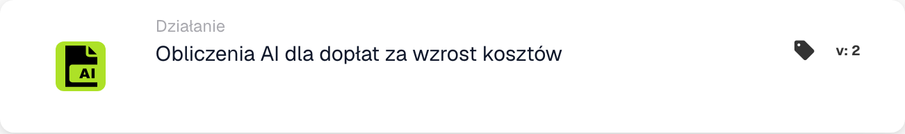

# Obliczanie AI dla dopłat za wzrost kosztów

<figure><figcaption>
Pola karty w pokazanej wersji. Pola nie są jeszcze skonfigurowane.
</figcaption></figure>

## Kiedy używać tej karty

Użyj tej akcji, aby zażądać skonfigurowanej kalkulacji dopłaty materiałowej i energetycznej MTZ/ETZ dla bieżącego dokumentu. Najpierw przygotuj dane dokumentu i konfigurację usługi obliczeniowej wymaganą przez Twoją organizację.

## Rzeczywista konfiguracja

Wyświetlana karta nie ma danych wejściowych Współczynnik wzrostu kosztu, Pole kosztu podstawowego ani Pole dopłaty. Deleguje obliczenia do skonfigurowanej usługi. Nie szukaj tych nieistniejących kontrolek kart ani nie zakładaj stałej formuły procentowej na podstawie nazwy karty.

## Wynik i weryfikacja

Pomyślna odpowiedź serwisu oznacza, że karta powiodła się. Przekroczenie limitu czasu lub nieudana odpowiedź powoduje błąd karty. Sprawdź rejestr karty i wynikające z niego dane dotyczące dopłaty; Samo pomyślne wywołanie usługi nie dokumentuje konkretnej kwoty.

W trybie testowania kart połączenie jest pomijane i symulowany jest sukces. Jest to przydatne do testowania struktury przepływu pracy, ale nie stanowi dowodu na to, że usługa została wykonana ani że naliczona została jakakolwiek dopłata.

<!-- workflow-card-practical-example-20261021 -->

## Praktyczny przykład

**Kiedy używać:** Poproś o skonfigurowaną kalkulację dopłaty materiałowej/energetycznej dla przygotowanej faktury.

**Konfiguracja:** Użyj faktury syntetycznej `DEMO-001` z danymi wymaganymi przez skonfigurowaną usługę MTZ/ETZ. Dodaj tę akcję po warunkach sprawdzania poprawności dokumentu.

**Oczekiwany wynik i kontrprzykład:** Pomyślna odpowiedź serwisu oznacza pomyślność karty; przekroczenie limitu czasu lub nieudana odpowiedź powoduje błąd karty. Sprawdź oddzielnie pola dokumentu i wynik obliczeń. Tryb testowania karty symuluje sukces i nie wywołuje serwisu, więc nie może udowodnić rzeczywistego wyniku dopłaty.

To jest ilustracyjna konfiguracja i oczekiwany wynik. Korzystaj z pól, użytkowników i grup skonfigurowanych w Twojej organizacji testowej; nie jest to twierdzenie, że ten przykład został wykonany.
