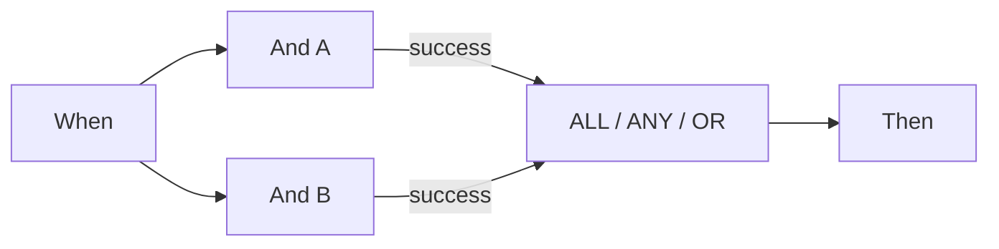

# P0: poprawne łączenie Wait ALL, Wait ANY i OR

ALL wymaga pasującego podłączonego wyjścia z **każdego odrębnego źródła**. ANY i OR wymagają co najmniej jednego pasującego źródła. Zielone i pomarańczowe połączenie z tego samego źródła nadal liczą się raz. OR nie tworzy wyłącznego rozgałęzienia ani nie anuluje innych działań. ANY nie gwarantuje też, że wygra najszybsza gałąź.

Sprawdzony harmonogram najpierw czeka na wszystkich poprzedników wejściowych. Jeśli niewybrana gałąź pozostawia poprzednika nieosiągalnym, normalne wykonanie pomija zablokowane scalenie. Tryb testowy może ocenić je na podstawie dostępnych wyników. **Zielony test częściowy nie dowodzi więc, że wykonanie dokumentu przejdzie dalej przez ten sam graf.**

Dla dwóch obowiązkowych kontroli wykonaj obie i podłącz wymagane wyjścia do ALL. Dla alternatywnych ścieżek w tej wersji użyj bezpośredniej wspólnej karty końcowej Then z przykładu v2. To połączenie dotyczy wzajemnie wykluczających się ścieżek; nie jest barierą dla kilku jednoczesnych działań.

Sprawdzaj osobno źródło, podłączone wyjście, wybrane wyjście i rzeczywistą osiągalność. Błąd źródła pozostaje błędem całości, nawet gdy ANY/OR potem się powiedzie. Niespełnione ALL zawiera w sprawdzonym kodzie również szczegół błędu; sam pomarańczowy kolor nie wystarczy.

## Karty i przykładowe parametry

Wartości opisują parametry kart, a nie pełny workflow do importu. Zastąp YOUR_* własnymi wyborami testowymi. Projektant zarządza ukrytym ID wywołującego. Katalog: Dev, DocFlow 2.10.38, 21 października 2026; osobno sprawdź wersje i uprawnienia swojej organizacji.

`node_type`: `all`, `any`, `or`

## Biznesowe przypadki testowe

| Przypadek | Wejście / konfiguracja | Oczekiwany wynik |
| --- | --- | --- |
| MERGE-01 | A=success; B=success | ALL/ANY/OR: join=success |
| MERGE-02 | A=success; B=failed_condition; B→failed_condition: — | ALL: join=failed_condition, workflow=error; ANY/OR: join=success, workflow=failed_condition |
| MERGE-03 | A=success; B=error | ANY/OR: join=success; workflow=error |
| MERGE-04 | A=success; B=nieosiągnięte | test: oceń; harmonogram: pomiń |
| MERGE-05 | A→success + A→failed_condition; B→success | sources=2 |

## Dowody i ograniczenia

Wybrane wyniki kart i węzłów sprawdzono na danych syntetycznych w Advanced Test. Odpowiedzi są w pakiecie. Działania dokumentalne są symulowane i nie dowodzą zapisanego wykonania ani zewnętrznego dostarczenia.

[Dalsza nauka](../workflow-learning-path.md) · [Pakiet ćwiczeń](../workflow-training-kit.md)
