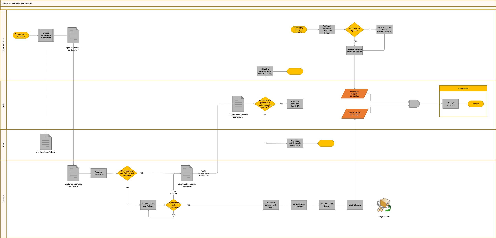

# Przepływ zamawiania i przetwarzania materiałów

Ten dokument przedstawia przepływ pracy dla zamawiania materiałów od dostawców, przyjmowania towarów oraz przetwarzania faktur, z integracją między dostawcami, systemem INFOR ERP i DocBits do zarządzania dokumentami.

### Przegląd procesu

1. **Zamawianie materiałów**
   * Zainicjuj zamówienie u dostawcy.
   * Wyślij zamówienie do dostawcy za pośrednictwem INFOR.
2. **Otrzymanie potwierdzenia zamówienia**
   * Dostawca potwierdza otrzymanie zamówienia.
   * Utworzenie i wysłanie potwierdzenia zamówienia.
3. **Przyjęcie i kontrola towarów**
   * Przyjmij towary od dostawcy.
   * Zaksięguj przyjęcie towarów w INFOR i porównaj z dowodem dostawy.
4. **Przetwarzanie faktur**
   * Otrzymaj fakturę i wyślij ją do DocBits w celu przetworzenia.
   * Sprawdź i zweryfikuj szczegóły faktury z zamówieniem i przyjęciem towarów.
5. **Kroki końcowe**
   * Zarchiwizuj zamówienie i powiązane dokumenty w DocBits.
   * Zaktualizuj INFOR o szczegóły transakcji na potrzeby księgowości finansowej.

### Punkty decyzyjne i działania

* **Czy otrzymane towary są zgodne z zamówieniem?**
  * Tak: Kontynuuj przetwarzanie faktury.
  * Nie: Wymagana ręczna kontrola i aktualizacja.
* **Czy faktura jest prawidłowa zgodnie z otrzymanymi towarami i szczegółami zamówienia?**
  * Tak: Zakończ transakcję i zaktualizuj zapisy finansowe.
  * Nie: Konieczne dalsze sprawdzenie i korekty.

### Punkty integracji

* **INFOR ERP**: Główny system do przetwarzania zamówień, przyjmowania towarów i księgowości finansowej.
* **DocBits**: Zarządzanie dokumentami do przetwarzania i archiwizacji faktur oraz potwierdzeń zamówień.

### Uwagi

* Upewnij się, że wszystkie dokumenty są zweryfikowane i zarchiwizowane na potrzeby ewidencji.
* Rozbieżności w szczegółach zamówienia lub faktury muszą zostać niezwłocznie rozwiązane, aby uniknąć opóźnień.

<figure><figcaption>
Przykładowy obieg zamówień materiałowych, potwierdzeń, przyjęć towarów i faktur między dostawcą, zakupami, IDM, DocBits i księgowością. Dostosuj kontrole i integracje do własnej konfiguracji.
</figcaption></figure>
