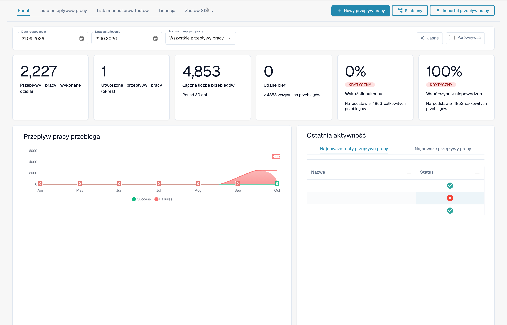
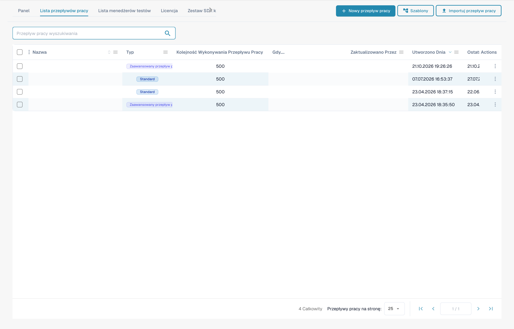
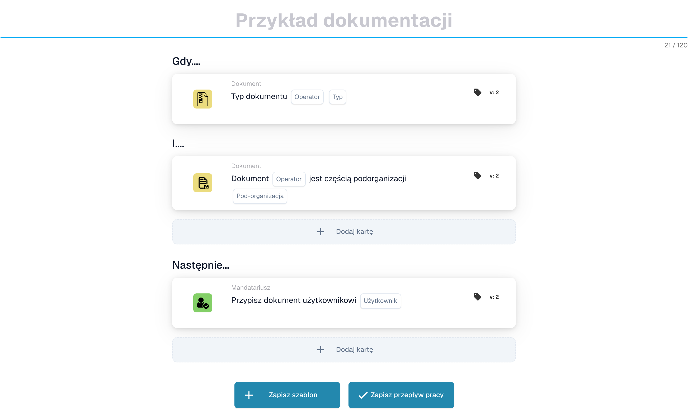
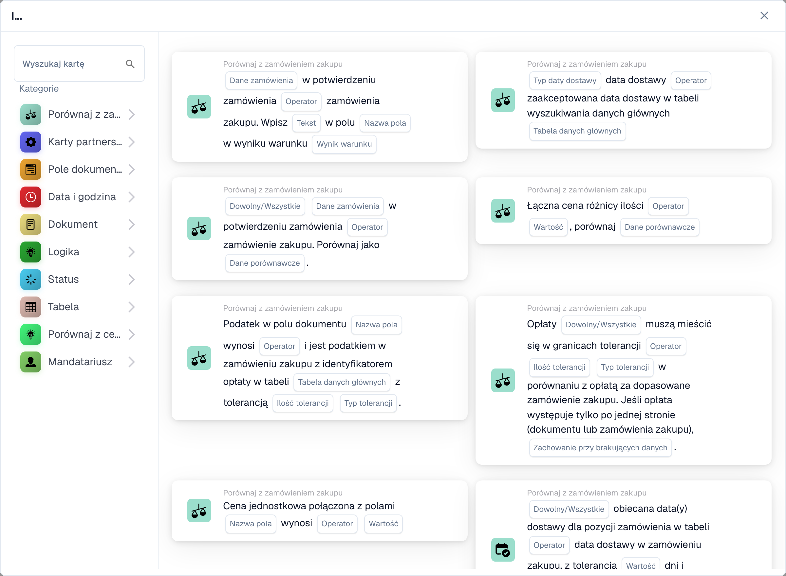

# Przewodniki po wzorach przepływu pracy

**Wersja:** 1.0 **Ostatnia aktualizacja:** 23 października 2025 r.

***

## Przegląd

Ten katalog zawiera kompleksowe przewodniki po wzorcach przepływu pracy, które pokazują, jak łączyć wiele kart przepływu pracy w celu rozwiązania typowych scenariuszy biznesowych. Każdy wzorzec zawiera instrukcje implementacji krok po kroku, pełne przykłady i najlepsze praktyki.

**Co to są wzorce przepływu pracy?**

Wzorce przepływu pracy to sprawdzone, nadające się do ponownego wykorzystania rozwiązania typowych problemów związanych z przetwarzaniem dokumentacji. Zamiast zaczynać od zera, możesz wykorzystać te wzorce jako szablony i dostosować je do swoich konkretnych potrzeb.

***

## Konstruktor przepływu pracy w skrócie

Każdy wzór na tej stronie jest montowany w **Kreatorze przepływu pracy**. Dostaniesz się do niego z **Panel przepływów pracy → Lista procesów → Dodaj przepływ pracy** (lub otwierając istniejący przepływ pracy). Pulpit nawigacyjny zawiera historię uruchomień oraz wskaźniki powodzenia/niepowodzenia dla wszystkich przepływów pracy:

<figure><figcaption><p>Workflow Dashboard — sumy uruchomień, wskaźniki sukcesu/niepowodzeń oraz ostatnia aktywność dla każdego workflow. Poufne nazwy i odwołania do dokumentów są ukryte.</p></figcaption></figure>

Zakładka **Lista przepływów pracy** zawiera listę wszystkich przepływów pracy wraz z ich typem, kolejnością wykonania i wyzwalaczem. Użyj **Dodaj przepływ pracy**, aby utworzyć nowy, lub kliknij przepływ pracy, aby otworzyć go w kreatorze:

<figure><figcaption><p>Workflow List — każdy wiersz to workflow, który możesz otworzyć, włączyć/wyłączyć lub edytować. Poufne nazwy i odwołania do dokumentów są ukryte.</p></figcaption></figure>

Przepływ pracy obejmuje trzy grupy kart: **Kiedy** (wyzwalacz), **I** (dodatkowe warunki) oraz **Wtedy** (akcje). Poniższy niezapisany przykład pokazuje tę strukturę. Typ dokumentu, podorganizacja i użytkownik wymagają jeszcze wyboru:

<figure><figcaption><p>Niezapisany przykład z kartami Kiedy, I oraz Wtedy. Uzupełnij wszystkie pola przed uruchomieniem. Niektóre etykiety tej wersji interfejsu nie są jeszcze przetłumaczone lub mają nieprawidłowe tłumaczenie. Objaśnienia na tej stronie używają właściwych terminów; obraz przedstawia rzeczywisty interfejs.</p></figcaption></figure>

Kliknij **Dodaj kartę** w dowolnej grupie, aby otworzyć bibliotekę kart. Karty są uporządkowane według kategorii (porównaj z zamówieniem zakupu, kartami partnerów, polem dokumentu, datą i godziną, dokumentem, logiką, statusem, tabelą, osobą przypisaną itp.), dzięki czemu możesz znaleźć element konstrukcyjny, którego wymaga każdy wzór:

<figure><figcaption><p>Karty dostępne w wybranej kategorii. Uzupełnij pola przed użyciem. Niektóre etykiety tej wersji interfejsu nie są jeszcze przetłumaczone lub mają nieprawidłowe tłumaczenie. Objaśnienia na tej stronie używają właściwych terminów; obraz przedstawia rzeczywisty interfejs.</p></figcaption></figure>

***

## Dostępne wzory

### 1. [Wzorzec integracji API](api-integration-pattern.md)

**Złożoność:** Średnia | **Czas konfiguracji:** 45-60 minut

Dowiedz się, jak zintegrować DocBits z zewnętrznymi interfejsami API w celu pobierania, sprawdzania poprawności i przechowywania danych z systemów zewnętrznych.

**Przypadki użycia:**

* Pobieraj ceny w czasie rzeczywistym z systemów zewnętrznych
* Zweryfikuj informacje o dostawcy w oparciu o główne bazy danych
* Wyszukaj szczegóły produktu w systemach katalogowych
* Uzyskaj kursy wymiany z serwisów walutowych
* Zweryfikuj adresy za pomocą usług geokodowania

**Wykorzystane karty:** CALL\_API, CONDITION\_HTTPS\_REQUEST\_STATUS, ACTION\_SET\_FIELD\_TO\_TEXT, CONDITION\_COMPARE\_TWO\_DOCFIELD\_VALUES

[**Wyświetl pełny wzór →**](api-integration-pattern.md)

***

### 2. [Wzorzec zarządzania zadaniami](task-management-pattern.md)

**Złożoność:** Niska-Średnia | **Czas konfiguracji:** 30-45 minut

Opanuj sztukę tworzenia, przydzielania, śledzenia i zarządzania zadaniami w ramach przepływów pracy DocBits w celu zatwierdzania i przeglądania procesów.

**Przypadki użycia:**

* Twórz przepływy pracy zatwierdzania
* Przypisz użytkownikom zadania przeglądu
* Obsługa wyjątków wymagających interwencji człowieka
* Eskaluj problemy do menedżerów
* Twórz wielopoziomowe łańcuchy zatwierdzania
* Śledź realizację zadań i terminy

**Wykorzystane karty:** tasks\_create, ACTION\_ASSIGN\_TO\_USER, ACTION\_SEND\_EMAIL\_TO\_GROUPS, CONDITION\_TASK\_STATUS

[**Wyświetl pełny wzór →**](task-management-pattern.md)

***

### 3. [Wzorzec dopasowania PO](po-matching-pattern.md)

**Złożoność:** Średnio-Wysoka | **Czas konfiguracji:** 60-90 minut

Wdrażaj kompleksowe przepływy pracy dopasowywania zamówień zakupu, aby weryfikować faktury względem zamówień zakupu za pomocą routingu opartego na tolerancji.

**Przypadki użycia:**

* Sprawdzaj faktury względem zamówień zakupu
* Wykrywaj błędy cenowe przed dokonaniem płatności
* Zidentyfikuj rozbieżności ilościowe
* Egzekwuj kontrole zamówień
* Zapobiegaj duplikacjom płatności
* Zautomatyzuj dopasowanie trójstronne

**Wykorzystane karty:** PURCHASE\_ORDER\_FULL\_MATCH, CONDITION\_DOC\_TO\_PO\_UNIT\_PRICE, CONDITION\_DOC\_TO\_PO\_QUANTITY, CONDITION\_DOC\_TO\_PO\_TAX\_LINES

[**Wyświetl pełny wzór →**](po-matching-pattern.md)

***

### 4. [Wzorzec logiki decyzji](decision-logic-pattern.md)

**Złożoność:** Średnia | **Czas konfiguracji:** 30-45 minut

Wdrażaj złożone drzewa decyzyjne i logikę routingu warunkowego, aby przetwarzać dokumenty różnymi ścieżkami w oparciu o reguły biznesowe.

**Przypadki użycia:**

* Kieruj dokumenty według progów kwotowych
* Zastosuj różne reguły dla różnych typów dokumentów
* Wdrażaj wielopoziomową logikę zatwierdzania
* Obsługuj złożone zasady biznesowe
* Twórz dynamiczne wyznaczanie tras w oparciu o wiele kryteriów
* Wdrażaj matryce zatwierdzania

**Wykorzystane karty:** CONDITION\_DOC\_FIELD\_AMOUNT, CONDITION\_DOC\_TYPE\_IS\_ISNOT, CONDITION\_SUPPLIER\_STATUS\_IS\_ISNOT, ACTION\_ASSIGN\_TO\_USER

[**Wyświetl pełny wzór →**](decision-logic-pattern.md)

***

### 5. [Wzorzec transformacji danych](data-transformation-pattern.md)

**Złożoność:** Średnia | **Czas konfiguracji:** 30-45 minut

Przekształcaj, obliczaj, formatuj i wzbogacaj dane dokumentów w celu przygotowania do eksportu, wykonywania obliczeń i standaryzacji formatów.

**Przypadki użycia:**

* Oblicz sumy, podsumy, podatki
* Konwertuj waluty lub jednostki
* Formatuj daty, liczby i tekst
* Wyprowadź wartości z istniejących pól
* Wzbogacaj dane ze źródeł zewnętrznych
* Standaryzuj formaty danych
* Zweryfikuj obliczenia

**Wykorzystane karty:** ACTION\_CALCULATE\_FIELD, ACTION\_SET\_FIELD\_TO\_TEXT, ACTION\_COPY\_FIELD\_VALUE, CALL\_API, CONDITION\_COMPARE\_TWO\_DOCFIELD\_VALUES

[**Wyświetl pełny wzór →**](data-transformation-pattern.md)

***

## Przewodnik po wyborze wzoru

### Według złożoności

| Złożoność      | Wzory                                                                                                                                                                                      | Najlepsze dla                               |
| --------------- | --------------------------------------------------------------------------------------------------------------------------------------------------------------------------------------------- | -------------------------------------- |
| **Niski-Średni**  | [Zarządzanie zadaniami](task-management-pattern.md)                                                                                                                                                 | Początkujący, proste przepływy pracy            |
| **Średni**      | <p><a href="api-integration-pattern.md">Integracja API</a><br><a href="decision-logic-pattern.md">Logika decyzyjna</a><br><a href="data-transformation-pattern.md">Transformacja danych</a></p> | Użytkownicy średniozaawansowani, standardowe przepływy pracy |
| **Średnio-wysoki** | [PO Dopasowanie](po-matching-pattern.md)                                                                                                                                                         | Zaawansowani użytkownicy, złożona walidacja     |

***

### Według przypadku użycia

| Muszę...                     | Użyj tego wzoru                                              |
| -------------------------------- | ------------------------------------------------------------- |
| Integracja z systemami zewnętrznymi  | [Wzorzec integracji API](api-integration-pattern.md)         |
| Twórz przepływy pracy zatwierdzania        | [Wzorzec zarządzania zadaniami](task-management-pattern.md)         |
| Sprawdź w odniesieniu do zamówień zakupu | [Wzorzec dopasowania PO](po-matching-pattern.md)                 |
| Trasa w oparciu o warunki        | [Wzorzec logiki decyzji](decision-logic-pattern.md)           |
| Oblicz i przekształć dane     | [Wzorzec transformacji danych](data-transformation-pattern.md) |

***

### Według branży/działu

| Przemysł/Dział    | Polecane wzory                                                                                                                        |
| ---------------------- | ------------------------------------------------------------------------------------------------------------------------------------------- |
| **Finanse/Księgowość** | [Dopasowanie PO](po-matching-pattern.md), [Zarządzanie zadaniami](task-management-pattern.md), [Transformacja danych](data-transformation-pattern.md) |
| **Zaopatrzenie**        | [Dopasowanie PO](po-matching-pattern.md), [Logika decyzyjna](decision-logic-pattern.md), [Integracja API](api-integration-pattern.md)           |
| **Operacje**         | [Zarządzanie zadaniami](task-management-pattern.md), [Logika decyzji](decision-logic-pattern.md)                                                  |
| **IT/Integracja**     | [Integracja API](api-integration-pattern.md), [Transformacja danych](data-transformation-pattern.md)                                        |
| **Wszystkie działy**    | [Logika decyzji](decision-logic-pattern.md), [Zarządzanie zadaniami](task-management-pattern.md)                                                  |

***

## Jak korzystać z tych wzorców

### Krok 1: Wybierz wzór

1. Przejrzyj powyższe opisy wzorów
2. Określ, który wzorzec pasuje do Twojego przypadku użycia
3. Sprawdź złożoność i szacowany czas konfiguracji
4. Przejrzyj sekcję „Kiedy używać” w przewodniku po wzorach

### Krok 2: Przejrzyj wymagania wstępne

Każdy przewodnik po wzorach zawiera:

* Wymagana wiedza
* Powiązane przewodniki, które należy przeczytać w pierwszej kolejności
* Karty, które będą używane
* Wymagania konfiguracyjne

### Krok 3: Postępuj zgodnie z instrukcjami krok po kroku

Każdy wzór zapewnia:

* Kompletny przykład przepływu pracy
* Przewodnik po wdrażaniu krok po kroku
* Szablony konfiguracji
* Przykłady z życia wzięte
* Wskazówki dotyczące rozwiązywania problemów

### Krok 4: Dostosuj do swoich potrzeb

* Dostosuj przykład do zasad swojej firmy
* Dostosuj progi i tolerancje
* Zmodyfikuj logikę routingu
* W razie potrzeby dodaj/usuń kroki
* Dokładnie przetestuj przed użyciem w produkcji

### Krok 5: Monitoruj i optymalizuj

* Śledź wydajność przepływu pracy
* Monitoruj wskaźniki sukcesu
* Zbierz opinie użytkowników
* Udoskonal konfigurację
* Dostosowywanie dokumentów

***

## Kombinacje wzorów

Wiele rzeczywistych scenariuszy wymaga połączenia wielu wzorców:

### Przykład 1: Zakończ przetwarzanie faktury

```
1. API Integration Pattern → Fetch current pricing
2. Data Transformation Pattern → Calculate totals
3. PO Matching Pattern → Validate against PO
4. Decision Logic Pattern → Route based on variance
5. Task Management Pattern → Create approval tasks
```

### Przykład 2: Zatwierdzenie faktury o dużej wartości

```
1. Data Transformation Pattern → Calculate amounts
2. Decision Logic Pattern → Check thresholds
3. Task Management Pattern → Multi-level approval
4. API Integration Pattern → Notify external systems
```

### Przykład 3: Obsługa wyjątków

```
1. PO Matching Pattern → Detect variances
2. Decision Logic Pattern → Classify exception severity
3. Task Management Pattern → Create review tasks
4. Data Transformation Pattern → Calculate impact
```

***

## Szablony wzorów

Każdy wzór zawiera te ustandaryzowane sekcje:

1. **Przegląd** — Co robi wzór
2. **Kiedy używać** — Odpowiednie przypadki użycia
3. **Kompletny przykład** – Scenariusz ze świata rzeczywistego
4. **Krok po kroku** - Instrukcje wdrażania
5. **Konfiguracja** - Szablony konfiguracji kart
6. **Schemat przepływu pracy** - Reprezentacja wizualna
7. **Odmiany zaawansowane** - Alternatywne implementacje
8. **Obsługa błędów** — Typowe problemy i rozwiązania
9. **Lista kontrolna testowania** - Etapy walidacji
10. **Powiązane wzorce** - Wzory uzupełniające
11. **Powiązane przewodniki** — Dokumentacja referencyjna

***

## Uzyskiwanie pomocy

### Zasoby wsparcia dotyczące wzorców

**Dokumentacja:**

* [Kompletny przewodnik dotyczący przepływu pracy Indeks](..)
* [Indywidualne przewodniki po kartach](../then/action)
* [Odniesienia do kart stanu](../and/condition-cards-complete-guide.md)
* [Mapa łącząca przepływ pracy](https://github.com/Fellow-Consulting-AG/docbits/tree/main/WORKFLOW_LINKING_MAP.md)

**Dodatkowe zasoby:**

* [Skrócony przewodnik](https://github.com/Fellow-Consulting-AG/docbits/tree/main/WORKFLOW_LINKING_QUICK_REFERENCE.md)
* [Informacje o wydaniu z października 2025 r.](https://github.com/Fellow-Consulting-AG/docbits/tree/main/readme/administration-and-setup/workflow/changelog/2025-10-october.md)
* [Odniesienie do wersji karty](../cards-overview/po-comparison-versions-guide.md)

**Kontakt:**

* Informacje zwrotne dotyczące wzorców: docs@docbits.com
* Pomoc techniczna: support@docbits.com
* Pomoc wdrożeniowa: konsulting@docbits.com

***

## Statystyki wzorców

| Metryczne                      | Wartość               |
| --------------------------- | ------------------- |
| **Wzorce ogółem**          | 5                   |
| **Wszystkie pokryte karty**     | 30+                 |
| **Dokumentacja łączona**  | \~1200 linii       |
| **Przykładowe scenariusze**       | 25+                 |
| **Szablony konfiguracji** | 15+                 |
| **Schematy przepływu pracy**       | 5 kompletnych diagramów |
| **Odsyłacze**        | Ponad 87 linków wewnętrznych  |

***

## Przyczynianie się do wzorców

Masz wzorzec przepływu pracy, który przyniesie korzyści innym?

**Wytyczne dotyczące wkładu we wzór:**

1. **Udokumentuj swój przepływ pracy**
   * Jasny scenariusz biznesowy
   * Realizacja krok po kroku
   * Przykłady konfiguracji roboczych
   * Wyniki testów w świecie rzeczywistym
2. **Śledź szablon wzorca**
   * Użyj standardowej struktury sekcji
   * Uwzględnij wszystkie wymagane elementy
   * Podaj schematy/przykłady
   * Dodaj przewodnik rozwiązywania problemów
3. **Prześlij do sprawdzenia**
   * Wyślij e-mail na adres: docs@docbits.com
   * Dołącz: opis wzorca, przypadki użycia, przewodnik po implementacji
   * Sprawdzimy i potencjalnie uzupełnimy oficjalną dokumentację

**Korzyści:**

* Pomóż innym użytkownikom DocBits
* Daj się rozpoznać w dokumentacji
* Popraw ogólną bazę wiedzy o produktach
* Otrzymuj informację zwrotną na temat swojego wdrożenia

***

## Dziennik zmian

### Wersja 1.0 (23 października 2025 r.)

* Pierwsza wersja 5 kompleksowych wzorców przepływu pracy
* Dodano wzorzec integracji API
* Dodano wzorzec zarządzania zadaniami
* Dodano wzorzec dopasowania PO
* Dodano wzorzec logiki decyzji
* Dodano wzorzec transformacji danych
* Zaimplementowano odsyłacze (87 linków)
* Utworzono przewodnik wyboru wzoru

***

## Następne kroki

**Nie znasz jeszcze wzorców przepływu pracy?**

1. Zacznij od [Wzorzec zarządzania zadaniami](task-management-pattern.md) – najłatwiejszy do zrozumienia
2. Przejrzyj [Wzorzec logiki decyzji](decision-logic-pattern.md) – podstawowy dla wszystkich przepływów pracy
3. Poznaj [Wzorzec integracji API](api-integration-pattern.md) – częstą potrzebę integracji

**Gotowy do wdrożenia?**

1. Wybierz swój wzór z powyższej listy
2. Przeczytaj pełny przewodnik po wzorach
3. Przejrzyj wymagania wstępne i powiązane przewodniki
4. Postępuj zgodnie z instrukcjami krok po kroku
5. Przetestuj na przykładowych dokumentach
6. Wdróż w środowisku produkcyjnym
7. Monitoruj i optymalizuj

**Potrzebujesz dodatkowej pomocy?**

* Przejrzyj [Przegląd dokumentacji przepływu pracy](..)
* Sprawdź [Skrócony przewodnik](https://github.com/Fellow-Consulting-AG/docbits/tree/main/WORKFLOW_LINKING_QUICK_REFERENCE.md)
* Skontaktuj się z zespołem wsparcia

***

**Ostatnia aktualizacja:** 23 października 2025 r. **Obsługiwane przez:** Zespół dokumentacyjny **Wersja:** 1.0
