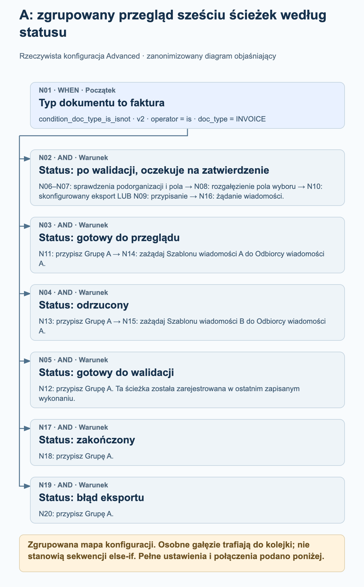
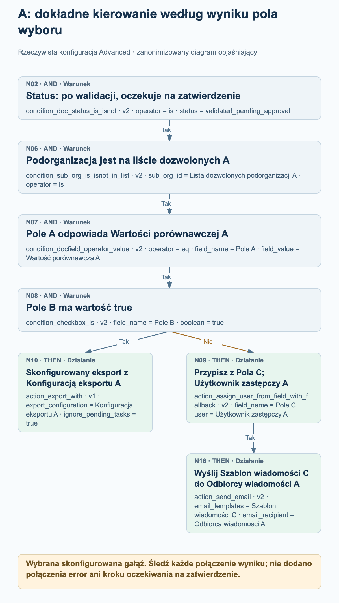
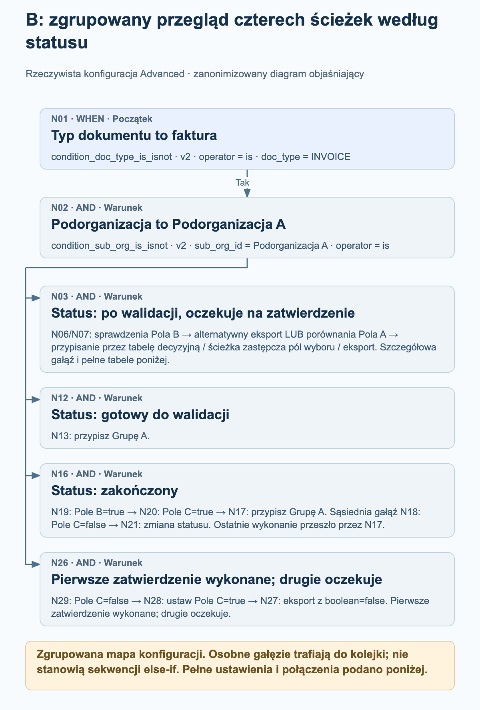
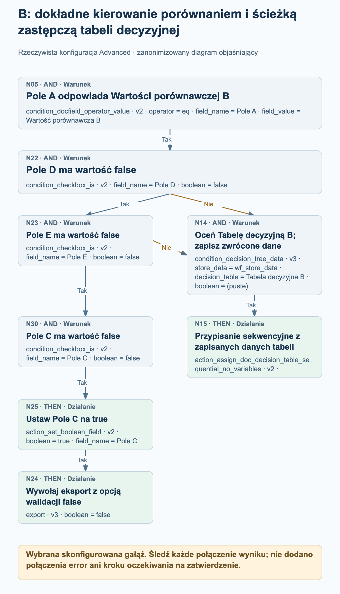

# Przykłady workflow Advanced ze środowiska produkcyjnego

Dwa aktywne workflow Advanced ze środowiska produkcyjnego pokazują, jak rzeczywiste kierowanie faktur łączy gałęzie zależne od statusu, decyzje oparte na polach wyboru, przypisania i skonfigurowane działania eksportu. Cztery diagramy procesu wyjaśniają wybrane części każdego grafu; pełne ustawienia węzłów i połączenia podano osobno.

Przegląd źródeł w trybie tylko do odczytu z 27 października 2026 r.: obie bieżące konfiguracje odpowiadają danym węzłów, kart, wersji, ustawień i połączeń zapisanym wraz z ostatnimi zarejestrowanymi wykonaniami. Przykład A ma 20 węzłów i 19 połączeń; przykład B ma 30 węzłów i 30 połączeń. Oba zarejestrowane wykonania mają ogólny status failed_condition, choć każde zawiera działanie przypisania do grupy z wynikiem success. Są to zaobserwowane konfiguracje i zapisane rejestry wykonań, a nie nowo uruchomione testy. Wartości organizacji, pól, użytkowników, grup, tabel, szablonów i odbiorców są zanonimizowane. Aliasy zachowują rozróżnienia w obrębie każdego przykładu i nie oznaczają tej samej rzeczywistej jednostki w różnych przykładach.

## Jak czytać te grafy

Każde połączenie odpowiada określonemu wynikowi: success, failed_condition lub error. Te przykłady zawierają połączenia success i failed_condition; żaden z grafów nie ma skonfigurowanego połączenia error. Niespełniony warunek jest zwykłym wynikiem warunku i nie należy go odczytywać jako błędu technicznego.

Kilka wychodzących połączeń success dodaje kilka miejsc docelowych do kolejki wykonania. Nie tworzą one łańcucha else-if i nie oznaczają równoległego wykonywania działań. Miejsce docelowe jest przetwarzane najwyżej raz podczas jednego wykonania grafu. Należy śledzić rzeczywiste połączenia, zamiast wnioskować o przepływie sterowania z położenia karty.

Miejsce docelowe z kilkoma połączeniami przychodzącymi nie jest automatycznie złączeniem oczekującym na wszystkie gałęzie. W przykładzie B dowolne ze skonfigurowanych połączeń failed_condition może dodać do kolejki zwykłą kartę warunku N14; nie jest to osobna bramka ALL ani ANY.

Przypisania nie dowodzą, że osoba zatwierdziła dokument. Z przypisania ani ze skonfigurowanej karty eksportu nie można wywnioskować kroku oczekiwania, zakończenia zatwierdzania ani odbioru przez system zewnętrzny. Diagramy nie dodają takich kroków.

Zgrupowane przeglądy podsumowują ścieżki według statusu i jawnie grupują kolejne węzły. Diagramy szczegółowe rozwijają wybrane ścieżki pól wyboru lub ścieżki alternatywne. Pełny skonfigurowany graf należy analizować na podstawie kompletnych list węzłów i połączeń.

## A. Kierowanie według statusu ze ścieżką eksportu lub przypisania sterowaną polem wyboru

Faktura rozgałęzia się na sześć sprawdzeń statusu. Gałąź po walidacji i oczekująca na zatwierdzenie dodatkowo sprawdza listę dozwolonych podorganizacji, porównuje Pole A i sprawdza Pole B. Wynik pola wyboru wybiera skonfigurowaną kartę eksportu albo działanie przypisania z pola, po którym następuje wiadomość. Pozostałe ścieżki według statusu przypisują Grupę A, a dwie z nich wysyłają następnie skonfigurowaną wiadomość.

### A: zgrupowany przegląd sześciu ścieżek według statusu

<figure><figcaption>N01 rozgałęzia się na sześć osobnych sprawdzeń statusu. Przegląd grupuje dłuższą gałąź N02 i przedstawia skonfigurowane ścieżki przypisania oraz wiadomości dla pozostałych statusów. Jest to zgrupowana mapa konfiguracji, a nie ślad wykonania ani sekwencja else-if.</figcaption></figure>

### A: dokładne kierowanie według wyniku pola wyboru

<figure><figcaption>Rozwinięta gałąź N02 → N06 → N07 → N08. Pole B=true podąża po success do skonfigurowanej karty eksportu N10 z ignore_pending_tasks=true. Połączenie failed_condition prowadzi do karty przypisania z pola N09, której wynik success prowadzi do karty wiadomości N16. Nie oznacza to wyniku eksportu, zatwierdzenia przez człowieka ani kroku oczekiwania.</figcaption></figure>

### Co rzeczywiście pokazuje ostatnie zapisane wykonanie

Zapisane wykonanie: 26 października 2026 r., 12:01:54 UTC. N01 i sprawdzenie ready_for_validation N05 zwróciły success; następnie przypisanie N12 również zwróciło success. Pozostałych pięć sprawdzeń statusu zwróciło failed_condition, a pozostałe węzły nie mają zarejestrowanego wyniku w tym wykonaniu. Ogólny zapis to failed_condition. To wykonanie potwierdza więc ścieżkę przypisania do grupy N01 → N05 → N12; nie potwierdza ścieżek pola wyboru, eksportu ani wiadomości.

- Po wyniku success z N01 sprawdzenia statusu N02, N03, N04, N05, N17 i N19 trafiają do kolejki przez osobne połączenia success. Nie tworzą łańcucha else-if.
- Szczegółowa gałąź zatwierdzania to N02 → N06 → N07 → N08 przy wyniku success. N08 sprawdza Pole B względem true. Jego połączenie success prowadzi do N10; połączenie failed_condition prowadzi do N09.
- N10 to action_export_with v1 z ustawieniami Konfiguracja eksportu A i ignore_pending_tasks=true. Diagram przedstawia konfigurację i nie stwierdza udanego eksportu ani odbioru w systemie zewnętrznym. W tej karcie ignore_pending_tasks=true wyłącza sprawdzanie oczekujących zadań dla żądania eksportu; jest to opcja właściwa dla tego przykładu.
- N09 jest skonfigurowany do przypisania z Pola C z Użytkownikiem zastępczym A. Tylko jego połączenie success prowadzi do N16 z ustawieniami Szablon wiadomości C i Odbiorca wiadomości A.
- Pole C musi zawierać identyfikator użytkownika. Identyfikator bez dopasowania może skorzystać ze skonfigurowanej opcji zastępczej; brak pola dokumentu może spowodować niepowodzenie przed osiągnięciem tej opcji. Opcja zastępcza nie gwarantuje przypisania w każdym przypadku brakującego pola.
- N11, N12, N13, N18 i N20 konfigurują tę samą Grupę A w obrębie tego przykładu. Tylko N11 i N13 mają podłączone kolejne węzły wiadomości: N14 i N15.

Pełna konfiguracja węzłów

| Węzeł | Karta | Konfiguracja |
| --- | --- | --- |
| N01 | condition_doc_type_is_isnot · v2 | operator = is; doc_type = INVOICE |
| N02 | condition_doc_status_is_isnot · v2 | operator = is; status = validated_pending_approval |
| N03 | condition_doc_status_is_isnot · v2 | operator = is; status = ready_for_review |
| N04 | condition_doc_status_is_isnot · v2 | operator = is; status = rejected |
| N05 | condition_doc_status_is_isnot · v2 | operator = is; status = ready_for_validation |
| N06 | condition_sub_org_is_isnot_in_list · v2 | sub_org_id = Lista dozwolonych podorganizacji A; operator = is |
| N07 | condition_docfield_operator_value · v2 | operator = eq; field_name = Pole A; field_value = Wartość porównawcza A |
| N08 | condition_checkbox_is · v2 | field_name = Pole B; boolean = true |
| N09 | action_assign_user_from_field_with_fallback · v2 | field_name = Pole C; user = Użytkownik zastępczy A |
| N10 | action_export_with · v1 | export_configuration = Konfiguracja eksportu A; ignore_pending_tasks = true |
| N11 | doc_group_assign · v2 | groups = Grupa A; use_decision_table = (puste) |
| N12 | doc_group_assign · v2 | groups = Grupa A; use_decision_table = (puste) |
| N13 | doc_group_assign · v2 | groups = Grupa A; use_decision_table = (puste) |
| N14 | action_send_email · v2 | email_templates = Szablon wiadomości A; email_recipient = Odbiorca wiadomości A |
| N15 | action_send_email · v2 | email_templates = Szablon wiadomości B; email_recipient = Odbiorca wiadomości A |
| N16 | action_send_email · v2 | email_templates = Szablon wiadomości C; email_recipient = Odbiorca wiadomości A |
| N17 | condition_doc_status_is_isnot · v2 | operator = is; status = finished |
| N18 | doc_group_assign · v2 | groups = Grupa A; use_decision_table = (puste) |
| N19 | condition_doc_status_is_isnot · v2 | operator = is; status = export_error |
| N20 | doc_group_assign · v2 | groups = Grupa A; use_decision_table = (puste) |

Wszystkie skonfigurowane połączenia

| Węzeł | Ścieżka wyniku | Węzeł |
| --- | --- | --- |
| N01 | success | N02 |
| N01 | success | N03 |
| N01 | success | N04 |
| N01 | success | N05 |
| N08 | failed_condition | N09 |
| N08 | success | N10 |
| N07 | success | N08 |
| N06 | success | N07 |
| N02 | success | N06 |
| N03 | success | N11 |
| N04 | success | N13 |
| N05 | success | N12 |
| N13 | success | N15 |
| N11 | success | N14 |
| N09 | success | N16 |
| N01 | success | N17 |
| N17 | success | N18 |
| N19 | success | N20 |
| N01 | success | N19 |

## B. Kierowanie przez tabele decyzyjne ze ścieżkami zastępczymi opartymi na polach wyboru i gałęziami według statusu

Faktura w Podorganizacji A rozgałęzia się na cztery sprawdzenia statusu. Ścieżka po walidacji i oczekująca na zatwierdzenie wykorzystuje Pole B, dwa alternatywne porównania Pola A, tabele decyzyjne i dodatkowe sprawdzenia pól wyboru. Ścieżka dokumentu zakończonego wykorzystuje Pola B i C przed przypisaniem Grupy A albo skonfigurowaniem zmiany statusu. Osobna ścieżka oczekująca na drugie zatwierdzenie ustawia Pole C i wywołuje eksport, gdy skonfigurowany warunek jest spełniony.

### B: zgrupowany przegląd czterech ścieżek według statusu

<figure><figcaption>N01 i N02 prowadzą do czterech osobno połączonych sprawdzeń statusu. Przegląd grupuje większą gałąź tabel decyzyjnych, zachowuje ścieżkę przypisania dokumentów gotowych do walidacji i rozgałęzienie pól wyboru dokumentów zakończonych oraz podsumowuje ścieżkę eksportu oczekującą na drugie zatwierdzenie. Pełne listy węzłów i połączeń zachowują wszystkie 30 węzłów i 30 połączeń.</figcaption></figure>

### B: dokładne kierowanie porównaniem i ścieżką zastępczą tabeli decyzyjnej

<figure><figcaption>Wybrana skonfigurowana gałąź po N01 → N02 → N03 → N07: N05 porównuje Pole A z Wartością porównawczą B. Dowolne połączenie failed_condition z N22 (Pole D=false) lub N23 (Pole E=false) może dodać do kolejki Tabelę decyzyjną B w zwykłej karcie warunku N14, a następnie przypisanie sekwencyjne N15. Wynik success z N23 prowadzi natomiast przez N30 → N25 → N24. Nie oznacza to złączenia ALL, karty ANY, zakończonego zatwierdzenia ani odbioru w systemie zewnętrznym.</figcaption></figure>

### Co rzeczywiście pokazuje ostatnie zapisane wykonanie

Zapisane wykonanie: 27 października 2026 r., 11:56:25 UTC. N01, N02, sprawdzenie statusu finished N16, sprawdzenie Pole B=true N19, sprawdzenie Pole C=true N20 i przypisanie do grupy N17 zwróciły success. N03, N12, N18 i N26 zwróciły failed_condition; pozostałe węzły nie mają zarejestrowanego wyniku w tym wykonaniu. Ogólny zapis to failed_condition. To wykonanie potwierdza ścieżkę przypisania dokumentu zakończonego, a nie ścieżki tabel decyzyjnych, zmianę statusu czy eksport.

- Po wynikach success ze sprawdzeń faktury i Podorganizacji A węzeł N02 dodaje do kolejki sprawdzenia statusu N03, N12, N16 i N26. Graf nie czeka na zakończenie jednej gałęzi według statusu przed zdefiniowaniem innej.
- Przy wyniku success z N03 węzeł N06 sprawdza Pole B=false, a N07 sprawdza Pole B=true. Wynik success z N06 prowadzi do ustawienia Pole B=true w N10, a następnie do karty alternatywnego eksportu N11. Wynik success z N07 dodaje do kolejki oba porównania Pola A, N04 i N05.
- N06 i N07 trafiają do kolejki przed aktualizacją Pola B w N10. Oba sprawdzenia są oceniane przed tą aktualizacją; ustawienie Pole B=true nie powoduje późniejszego wyniku success z N07 w tym samym przejściu. Karty dodane później do kolejki mogą obserwować wartości zwrócone przez wcześniejsze działania; gałęzie nie są odizolowanymi migawkami.
- Ścieżka Wartości porównawczej A prowadzi do Tabeli decyzyjnej A w N08 i przypisania sekwencyjnego N09. Ścieżka Wartości porównawczej B sprawdza Pole D=false w N22, Pole E=false w N23 i Pole C=false w N30 przed ustawieniem Pole C=true w N25 i wywołaniem eksportu N24.
- Wynik failed_condition z N22 albo N23 może dodać do kolejki N14, zwykłą kartę warunku dla Tabeli decyzyjnej B. N14 nie jest złączeniem oczekującym na wszystkie gałęzie ani nowo dodaną kartą ANY. Jego połączenie success prowadzi do przypisania sekwencyjnego N15.
- Dla dokumentów zakończonych N19 sprawdza Pole B=true, a następnie dodaje do kolejki zarówno N18, jak i N20. Pole C=true w N20 prowadzi do przypisania do Grupy A w N17. Pole C=false w N18 prowadzi do karty zmiany statusu N21 z ustawieniami validated_pending_approval i trigger_docflow=true. Nie jest to krok oczekiwania.
- Ścieżka approved_pending_second_approval wykonuje N29 → N28 → N27 przy wyniku success: sprawdza Pole C=false, ustawia Pole C=true, a następnie wywołuje eksport. Karty eksportu N24 i N27 zachowują boolean=false. Jest to opcja walidacji, a nie instrukcja wyłączenia wywołania eksportu.
- Obie karty warunku tabel decyzyjnych zapisują dane pod wf_store_data. Ich działania przypisania sekwencyjnego nie mają własnych ustawień. Reguły tabel i rzeczywiści odbiorcy nie są publikowani, a graf nie dowodzi zakończenia zatwierdzania.
- Alternatywny eksport N11 zależy od atrybutów eksportu typu dokumentu. Z pustych ustawień węzła nie można wywnioskować konfiguracji ani miejsca docelowego eksportu. Zmiana statusu N21 żąda późniejszego uruchomienia workflow; nie dodaje niejawnego połączenia powrotnego do tego samego przejścia.

Pełna konfiguracja węzłów

| Węzeł | Karta | Konfiguracja |
| --- | --- | --- |
| N01 | condition_doc_type_is_isnot · v2 | operator = is; doc_type = INVOICE |
| N02 | condition_sub_org_is_isnot · v2 | sub_org_id = Podorganizacja A; operator = is |
| N03 | condition_doc_status_is_isnot · v2 | operator = is; status = validated_pending_approval |
| N04 | condition_docfield_operator_value · v2 | operator = eq; field_name = Pole A; field_value = Wartość porównawcza A |
| N05 | condition_docfield_operator_value · v2 | operator = eq; field_name = Pole A; field_value = Wartość porównawcza B |
| N06 | condition_checkbox_is · v2 | field_name = Pole B; boolean = false |
| N07 | condition_checkbox_is · v2 | field_name = Pole B; boolean = true |
| N08 | condition_decision_tree_data · v3 | store_data = wf_store_data; decision_table = Tabela decyzyjna A; boolean = (puste) |
| N09 | action_assign_doc_decision_table_sequential_no_variables · v2 | — |
| N10 | action_set_boolean_field · v2 | boolean = true; field_name = Pole B |
| N11 | action_alternate_export · v2 | — |
| N12 | condition_doc_status_is_isnot_in_list · v2 | operator = is; status = ready_for_validation |
| N13 | doc_group_assign · v2 | groups = Grupa A; use_decision_table = (puste) |
| N14 | condition_decision_tree_data · v3 | store_data = wf_store_data; decision_table = Tabela decyzyjna B; boolean = (puste) |
| N15 | action_assign_doc_decision_table_sequential_no_variables · v2 | — |
| N16 | condition_doc_status_is_isnot_in_list · v2 | operator = is; status = finished |
| N17 | doc_group_assign · v2 | groups = Grupa A; use_decision_table = (puste) |
| N18 | condition_checkbox_is · v2 | field_name = Pole C; boolean = false |
| N19 | condition_checkbox_is · v2 | field_name = Pole B; boolean = true |
| N20 | condition_checkbox_is · v2 | field_name = Pole C; boolean = true |
| N21 | staus_change · v3 | status = validated_pending_approval; trigger_docflow = true |
| N22 | condition_checkbox_is · v2 | field_name = Pole D; boolean = false |
| N23 | condition_checkbox_is · v2 | field_name = Pole E; boolean = false |
| N24 | export · v3 | boolean = false |
| N25 | action_set_boolean_field · v2 | boolean = true; field_name = Pole C |
| N26 | condition_doc_status_is_isnot_in_list · v2 | operator = is; status = approved_pending_second_approval |
| N27 | export · v3 | boolean = false |
| N28 | action_set_boolean_field · v2 | boolean = true; field_name = Pole C |
| N29 | condition_checkbox_is · v2 | field_name = Pole C; boolean = false |
| N30 | condition_checkbox_is · v2 | field_name = Pole C; boolean = false |

Wszystkie skonfigurowane połączenia

| Węzeł | Ścieżka wyniku | Węzeł |
| --- | --- | --- |
| N01 | success | N02 |
| N02 | success | N03 |
| N03 | success | N06 |
| N03 | success | N07 |
| N07 | success | N04 |
| N07 | success | N05 |
| N06 | success | N10 |
| N10 | success | N11 |
| N02 | success | N12 |
| N12 | success | N13 |
| N16 | success | N19 |
| N20 | success | N17 |
| N19 | success | N20 |
| N19 | success | N18 |
| N18 | success | N21 |
| N04 | success | N08 |
| N02 | success | N16 |
| N05 | success | N22 |
| N22 | success | N23 |
| N25 | success | N24 |
| N02 | success | N26 |
| N22 | failed_condition | N14 |
| N23 | failed_condition | N14 |
| N28 | success | N27 |
| N26 | success | N29 |
| N29 | success | N28 |
| N23 | success | N30 |
| N30 | success | N25 |
| N08 | success | N09 |
| N14 | success | N15 |

## Przed dostosowaniem przykładu

Zastąp każdy neutralny alias odpowiednią wartością ze swojej organizacji. Zachowaj rozróżnienie między ustawieniami odnoszącymi się do tego samego pola i do różnych pól; nie używaj tych symboli zastępczych jako rzeczywistych identyfikatorów.

Sprawdź jawnie każde połączenie wyniku, w tym kierowanie failed_condition i miejsca docelowe z kilkoma połączeniami przychodzącymi. Wybierz obsługę błędów dla własnego procesu, zamiast zakładać, że graf obsługuje niepodłączoną ścieżkę error.

Sprawdź ustawienia eksportu, opcje walidacji i obsługę oczekujących zadań w odniesieniu do własnych wymagań. Skonfigurowane działanie eksportu ani zapis węzła z wynikiem success nie są dowodem odbioru przez system zewnętrzny.

Zweryfikuj dostosowany workflow w autoryzowanym środowisku testowym, uwzględniając każdy istotny wynik warunku oraz brakujące dane przypisania. Te przykłady produkcyjne odczytano bez zmieniania ani ponownego uruchamiania.
