# Wzór logiki decyzji

**Typ wzorca:** Routing warunkowy i logika **Złożoność:** Średnia **Szacowana konfiguracja:** 30–45 minut **Typowe przypadki użycia:** Routing wielościeżkowy, przetwarzanie warunkowe, drzewa decyzyjne, wdrażanie reguł biznesowych

***

W projektancie w trybie Standard wybierz «Dodaj kartę» w grupie «I....», a następnie otwórz kategorię «Logika». Na ekranie widoczny jest warunek oparty na tabeli decyzyjnej; tabela nie została jeszcze wybrana, a zapisywanie wyników nie jest skonfigurowane. Wybierz tabelę i skonfiguruj zapisywanie wyników zwracanych dla dokumentu lub organizacji dostawcy. Następnie skonfiguruj pozostałe warunki, działania i połączenia w przepływie pracy oraz przetestuj jego zachowanie.

<figure>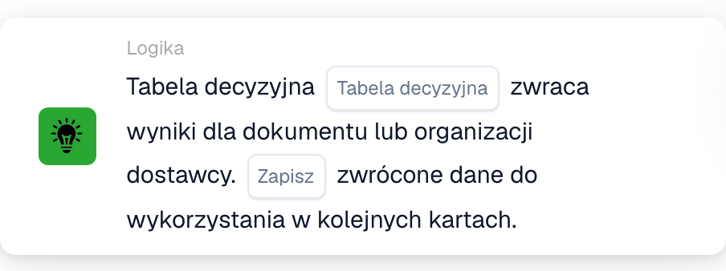<figcaption><p>Projektant w trybie Standard: kategoria «Logika» otwarta przez «Dodaj kartę» w grupie «I....»; tabela decyzyjna warunku nie została jeszcze wybrana, a zapisywanie wyników nie jest skonfigurowane.</p></figcaption></figure>

***

## Przegląd wzorca

#### Schemat: Przegląd {#schemat-przeglad}

<figure>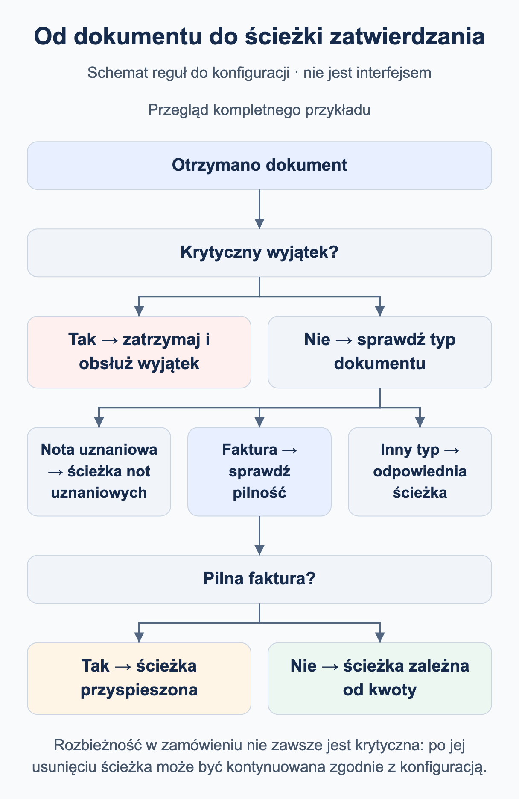<figcaption><p>Przegląd kompletnego przykładu: sprawdź krytyczne wyjątki, typ dokumentu i pilność przed wyborem ścieżki zatwierdzania. Każdy sposób obsługi i każde połączenie wymagają konfiguracji; schemat nie przedstawia automatycznego zachowania produktu.</p></figcaption></figure>

Te schematy wyjaśniają reguły biznesowe do skonfigurowania. Uzupełniają istniejący obraz biblioteki powyżej. W trybie Advanced połącz jawnie każdą ścieżkę. W liniowej sekwencji Standard określ warunki umożliwiające jej działania.

Ten wzorzec pokazuje, jak wdrożyć złożoną logikę decyzyjną w workflow DocBits. Za pomocą kart warunków routujesz dokumenty różnymi ścieżkami przetwarzania w oparciu o atrybuty dokumentu, wartości pól i reguły biznesowe.

**Co robi ten wzorzec:**

1. Ocenia wiele warunków kolejno lub równolegle
2. Routuje dokumenty różnymi ścieżkami na podstawie warunków
3. Wdraża reguły biznesowe i polityki
4. Obsługuje złożone drzewa decyzyjne
5. Łączy wiele kryteriów w decyzje routingu

***

## Kiedy stosować ten wzorzec

Stosuj ten wzorzec, gdy potrzebujesz:

* ✅ Routować dokumenty według progów kwotowych
* ✅ Stosować różne reguły dla różnych typów dokumentów
* ✅ Wdrażać wielopoziomową logikę zatwierdzania
* ✅ Obsługiwać złożone polityki biznesowe
* ✅ Tworzyć dynamiczny routing w oparciu o wiele kryteriów
* ✅ Wdrażać logikę obsługi wyjątków
* ✅ Tworzyć macierze zatwierdzania

**Nie stosuj tego wzorca, gdy:**

* ❌ wystarcza prosty liniowy workflow
* ❌ wszystkie dokumenty przechodzą tą samą ścieżką
* ❌ przetwarzanie warunkowe nie jest wymagane

***

## Typy logiki decyzyjnej

Poniższe przykłady IF-THEN, AND, OR i zagnieżdżenia są niezależne. Ich progi ilustrują poszczególne zasady; nie tworzą jednej macierzy zatwierdzania. Pełna macierz dalej używa czterech rozłącznych przedziałów. Nieznana wartość lub błąd oceny nie oznacza automatycznie False: określ i przetestuj ich obsługę osobno.

### 1. Prosta logika IF-THEN

#### Schemat: Prosty warunek {#schemat-prosty-warunek}

<figure>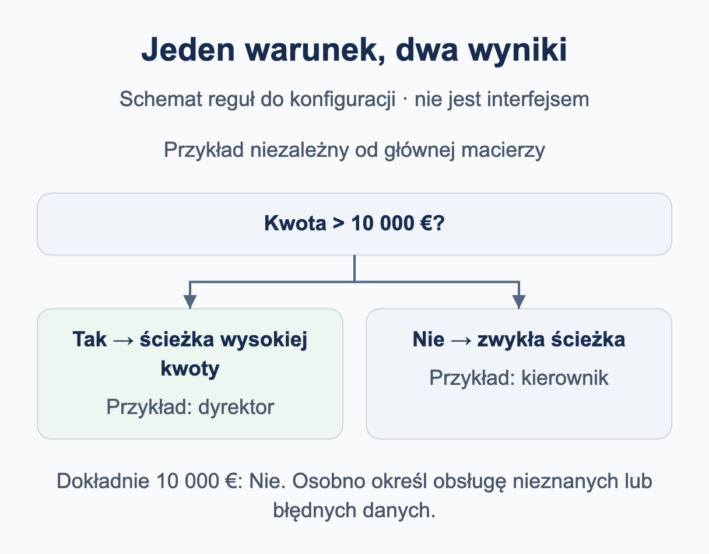<figcaption><p>Niezależny przykład IF-THEN: kwota ściśle większa niż 10 000 € wybiera dyrektora; w przeciwnym razie kierownika. Równość pozostaje w drugiej gałęzi. Miejsca docelowe wymagają konfiguracji.</p></figcaption></figure>

<details>
<summary>Zasada IF-THEN: jeden warunek, dwa wyniki</summary>

```
IF condition:
  → Działanie A
ELSE:
  → Działanie B
```

</details>

**Przykład:**

Wyjaśnienie wizualne: [prosty warunek](#schemat-prosty-warunek).

<details>
<summary>Przykład IF-THEN: próg kwoty</summary>

```
IF Amount > €10,000:
  → Przypisz do dyrektora
ELSE:
  → Przypisz do kierownika
```

</details>

#### Schemat: Kryteria I oraz LUB {#schemat-kryteria-i-oraz-lub}

<figure>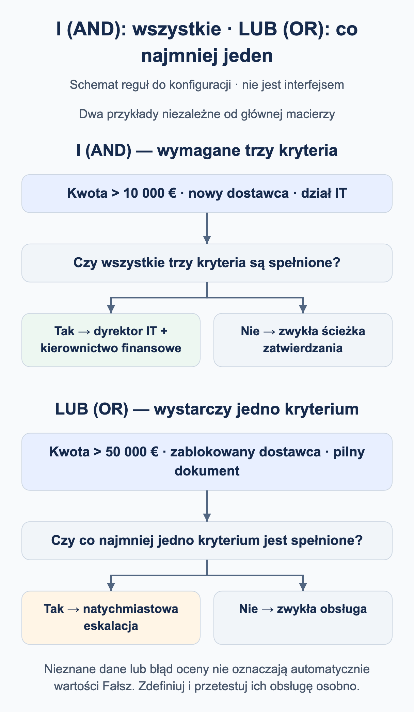<figcaption><p>Dwa niezależne przykłady: I (AND) wymaga wszystkich trzech kryteriów; LUB (OR) wymaga co najmniej jednego. Ich przykładowe progi nie zastępują przedziałów pełnej macierzy. Wyjścia oraz obsługa nieznanych danych i błędów wymagają konfiguracji.</p></figcaption></figure>

### 2. Wiele kryteriów (logika AND)

<details>
<summary>Zasada AND: wszystkie kryteria</summary>

```
IF condition1 AND condition2 AND condition3:
  → Działanie A
ELSE:
  → Działanie B
```

</details>

**Przykład:**

Wyjaśnienie wizualne: [kryteria i oraz lub](#schemat-kryteria-i-oraz-lub).

<details>
<summary>Przykład AND: trzy kryteria</summary>

```
IF Amount > €10,000 AND Supplier = "New" AND Department = "IT":
  → Przypisz do dyrektora IT + CFO (dwie akceptacje)
ELSE:
  → Zwykły workflow akceptacji
```

</details>

### 3. Alternatywne kryteria (logika OR)

Wyjaśnienie wizualne: [kryteria i oraz lub](#schemat-kryteria-i-oraz-lub).

<details>
<summary>Zasada OR: co najmniej jedno kryterium</summary>

```
IF condition1 OR condition2 OR condition3:
  → Działanie A
ELSE:
  → Działanie B
```

</details>

**Przykład:**

Wyjaśnienie wizualne: [kryteria i oraz lub](#schemat-kryteria-i-oraz-lub).

<details>
<summary>Przykład OR: kwota, blokada lub pilność</summary>

```
IF Amount > €50,000 OR Supplier is "Blocked" OR Document ma znacznik "Urgent":
  → Natychmiast eskaluj
ELSE:
  → Zwykłe przetwarzanie
```

</details>

### 4. Zagnieżdżone drzewo decyzyjne

#### Schemat: Decyzje zagnieżdżone {#schemat-decyzje-zagniezdzone}

<figure>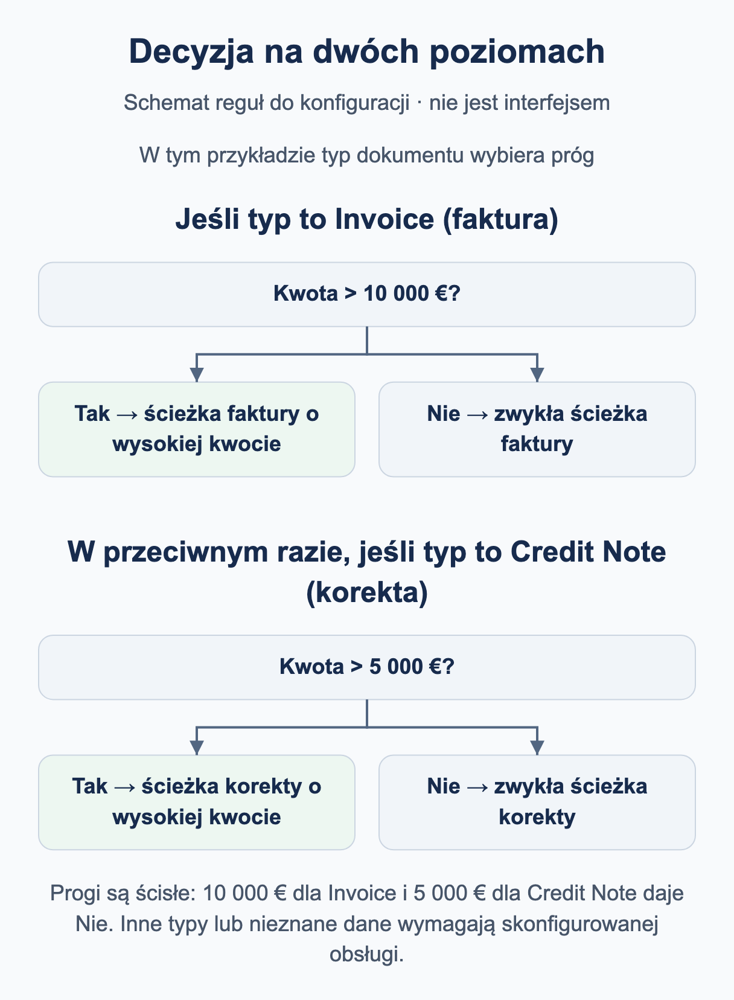<figcaption><p>Niezależny przykład zagnieżdżony: typ dokumentu wybiera test kwoty. Kwoty 10 000 € dla faktury i 5 000 € dla korekty nie spełniają warunku „większe niż”. Określ obsługę innych typów i nieznanych danych.</p></figcaption></figure>

<details>
<summary>Zasada decyzji zagnieżdżonej</summary>

```
IF condition1:
  IF condition2:
    → Działanie A
  ELSE:
    → Działanie B
ELSE:
  IF condition3:
    → Działanie C
  ELSE:
    → Działanie D
```

</details>

**Przykład:**

Wyjaśnienie wizualne: [decyzje zagnieżdżone](#schemat-decyzje-zagniezdzone).

<details>
<summary>Przykład zagnieżdżony: faktura i korekta</summary>

```
IF Document_Type = "Invoice":
  IF Amount > €10,000:
    → Workflow faktur o wysokiej wartości
  ELSE:
    → Zwykły workflow faktur
ELSE IF Document_Type = "Credit Note":
  IF Amount > €5,000:
    → Workflow not kredytowych o wysokiej wartości
  ELSE:
    → Zwykły workflow not kredytowych
```

</details>

***

## Kompletny przykład workflow

### Scenariusz: Macierz zatwierdzania faktur

**Reguły biznesowe:**

1. Przed kierowaniem według kwoty zatrzymaj i obsłuż krytyczne wyjątki, w tym zablokowanego dostawcę. Niezgodność zamówienia nie zawsze jest krytyczna: po rozwiązaniu przez zakupy ścieżka może być kontynuowana zgodnie z konfiguracją. Następnie sprawdź typ dokumentu.
2. Dla pilnej faktury zastosuj przyspieszoną ścieżkę tego przykładu zamiast zwykłych przedziałów kwot.
3. Dla niepilnej faktury z poprawną kwotą:
   * kwota < 1000 €: automatyczne zatwierdzenie;
   * 1000 € ≤ kwota < 10 000 €: zgoda kierownika;
   * 10 000 € ≤ kwota < 50 000 €: kontrole dostawcy i zgoda dyrektora; niezablokowany dostawca ze stażem poniżej 180 dni wymaga zgody dyrektora, a następnie CFO; inni dostawcy przechodzą także kontrolę ryzyka;
   * kwota ≥ 50 000 €: zgoda kierownictwa opisana w ścieżce D.
4. Brakująca lub błędna kwota prowadzi w tym przykładzie do jawnie skonfigurowanego ręcznego przeglądu. To przykładowa polityka, a nie automatyczne zachowanie awaryjne produktu.
5. Po utworzeniu zadania czekaj na jego wynik. Odrzucenie zatrzymuje łańcuch i uruchamia skonfigurowaną obsługę; wynik oczekujący nie umożliwia kontynuacji. Zadanie CFO utwórz dopiero po pozytywnej zgodzie dyrektora.

#### Schemat: Przedziały kwot {#schemat-przedziay-kwot}

<figure>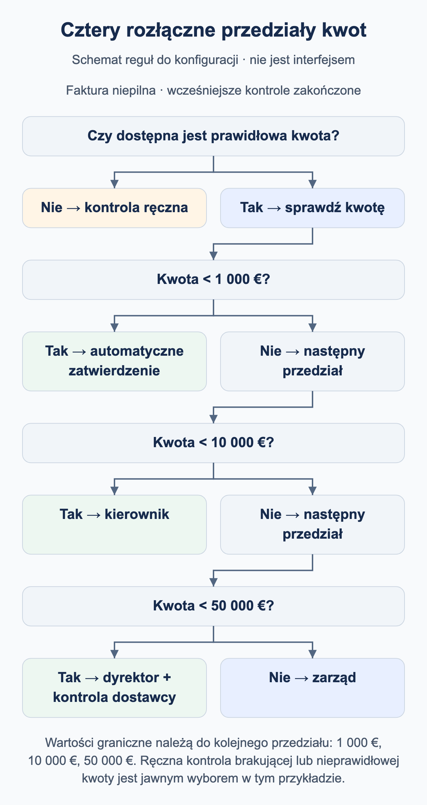<figcaption><p>Progi na poziomie 2: poniżej 1 000 €; od 1 000 € włącznie do 10 000 € wyłącznie; od 10 000 € włącznie do 50 000 € wyłącznie; 50 000 € lub więcej. Każdy test następuje po negatywnym wyniku poprzedniego. Ręczną kontrolę brakującej lub nieprawidłowej kwoty należy jawnie skonfigurować.</p></figcaption></figure>

Wartości graniczne 1000 €, 10 000 € i 50 000 € należą do wyższego przedziału. Skonfiguruj i przetestuj wcześniejsze kontrole, oczekiwanie na wyniki i połączenia ścieżek. Utworzenie zadania nie dowodzi zgody ani eksportu dokumentu.

**Przykładowa implementacja:** Dostosuj nazwy techniczne i pseudokod do kart faktycznie dostępnych w swojej wersji. Bloki opisują przykład do skonfigurowania, a nie plik do importu. Sprawdź wyniki wykonania i skutki uboczne.

Wyjaśnienie wizualne: [przegląd](#schemat-przeglad), [przedziały kwot](#schemat-przedziay-kwot), [analiza dostawcy](#schemat-analiza-dostawcy), [ścieżka automatyczna](#schemat-sciezka-automatyczna), [zadanie kierownika](#schemat-zadanie-kierownika), [zgoda kierownictwa](#schemat-zgoda-kierownictwa), [zapis reguły](#schemat-zapis-reguy).

<details>
<summary>Pseudokod pełnej macierzy</summary>

```
KONTROLA WSTĘPNA: wyjątki krytyczne
  IF Critical_Exception = TRUE OR Supplier_Status = "BLOCKED":
    → Zatrzymaj i obsłuż wyjątek przed skierowaniem do ścieżki

KROK 1: sprawdź rozbieżność z zamówieniem
  IF PO_Match_Status = "FAIL":
    → Skieruj do działu zakupów w celu wyjaśnienia rozbieżności z zamówieniem
    → Po rozwiązaniu kontynuuj poniżej zgodnie z konfiguracją

KROK 1b: sprawdź typ dokumentu
  IF Document_Type = "Credit Note":
    → Skonfigurowany workflow not kredytowych
  ELSE IF Document_Type is not "Invoice":
    → Skonfigurowany workflow dla tego typu dokumentu
  ELSE:
    → Kontynuuj poniżej

KROK 2: sprawdź znacznik pilności
  IF Urgent_Flag = TRUE:
    → Pomiń sprawdzanie kwoty
    → Skieruj do osoby zatwierdzającej na najwyższym poziomie
    → Ustaw priorytet = URGENT
    → Termin: 1 dzień

KROK 3: wybór ścieżki według kwoty (Invoice, jeśli nie jest pilna)
  IF brak wartości Amount lub wartość nieprawidłowa:
    → Weryfikacja ręczna (jawna polityka przykładowa)
    → Nie przechodź do przedziałów kwotowych

  ELSE IF Amount < €1,000:
    → Zatwierdź automatycznie
    → Eksportuj natychmiast

  ELSE IF Amount < €10,000:
    → Utwórz zadanie dla kierownika
    → Priority: Medium
    → Deadline: 3 dni

  ELSE IF Amount < €50,000:
    SPRAWDŹ status i ryzyko dostawcy:
      IF Supplier_Status = "BLOCKED":
        → Zatrzymaj i obsłuż wyjątek
      ELSE IF Supplier_Age < 180 dni (nowy):
        → Utwórz zadanie dla dyrektora (zadanie 1)
        → Czekaj na pozytywną akceptację dyrektora przed utworzeniem zadania dla CFO (zadanie 2)
        → Czekaj na pozytywną akceptację CFO przed kontynuacją
        → Każde odrzucenie: zatrzymaj łańcuch i obsłuż odrzucenie zgodnie z konfiguracją
        → Oczekuje: nie kontynuuj
        → Priority: High
        → Deadline: po 2 dni na zadanie
      ELSE IF Supplier_Risk_Rating = "HIGH":
        → Dodatkowe kontrole i wstępna akceptacja kierownika
        → Czekaj na pozytywną akceptację kierownika przed akceptacją dyrektora
        → Oczekiwanie lub odrzucenie: nie kontynuuj łańcucha akceptacji
      ELSE (dotychczasowy dostawca):
        → Utwórz zadanie wyłącznie dla dyrektora
        → Priority: High
        → Deadline: 2 dni

  ELSE (Amount ≥ €50,000):
    → Ścieżka akceptacji kierownictwa (zobacz ścieżkę D)
```

</details>

***

## Wdrożenie krok po kroku

### Krok 1: Zdefiniuj karty warunków

**Warunek 1: Próg kwotowy**

#### Schemat: Niezależne parametry {#schemat-niezalezne-parametry}

<figure>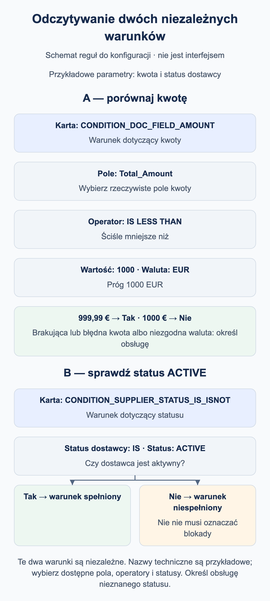<figcaption><p>Dwa niezależne warunki: kwota ściśle poniżej 1000 EUR oraz dostawca ze statusem ACTIVE. Równość kwoty daje Nie; nieaktywny dostawca nie musi być zablokowany. Parametry techniczne są przykładowe i wymagają dostosowania do rzeczywistej konfiguracji.</p></figcaption></figure>

<details>
<summary>Przykładowe parametry: próg kwoty</summary>

```
Card: CONDITION_DOC_FIELD_AMOUNT
Field: Total_Amount
Operator: IS LESS THAN
Value: 1000
Currency: EUR
```

</details>

**Warunek 2: Sprawdzenie typu dokumentu**

#### Schemat: Typy dokumentów {#schemat-typy-dokumentow}

<figure>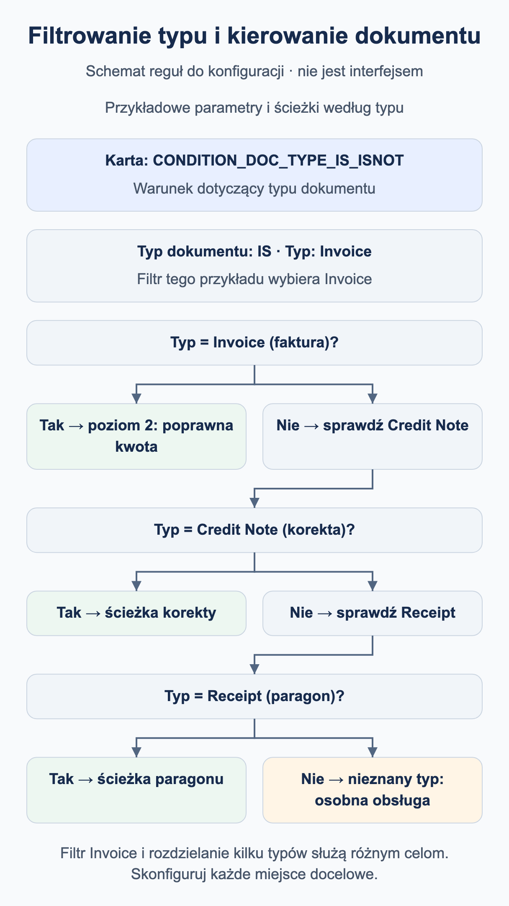<figcaption><p>Filtr Invoice i rozdzielanie według typu pokazują uzupełniające się aspekty przykładu. Rozróżniane są faktury, korekty, paragony i nieznane typy. Nazwy kart i przepływów są przykładowe; skonfiguruj każde miejsce docelowe.</p></figcaption></figure>

<details>
<summary>Przykładowe parametry: typ dokumentu</summary>

```
Card: CONDITION_DOC_TYPE_IS_ISNOT
Document Type: IS
Type: Invoice
```

</details>

**Warunek 3: Status dostawcy**

Wyjaśnienie wizualne: [niezależne parametry](#schemat-niezalezne-parametry).

<details>
<summary>Przykładowe parametry: status aktywny</summary>

```
Card: CONDITION_SUPPLIER_STATUS_IS_ISNOT
Supplier Status: IS
Status: ACTIVE
```

</details>

**Warunek 4: Sprawdzenie nowego dostawcy**

W tym przykładzie oblicz datę przypadającą 180 dni przed datą oceny, następnie porównaj datę pierwszej transakcji z tą granicą. „IS AFTER” oznacza ściśle później: równość daje Nie. Wybierz rzeczywiste pole i oblicz lub wpisz datę graniczną; nazwy karty, pola i znacznik {{TODAY_MINUS_180_DAYS}} są przykładowe. Osobno sprawdź poprawność daty pierwszej transakcji i to, czy nie przekracza daty oceny; skonfiguruj obsługę brakujących lub błędnych wartości.

#### Schemat: Warunek 180 dni {#schemat-warunek-180-dni}

<figure>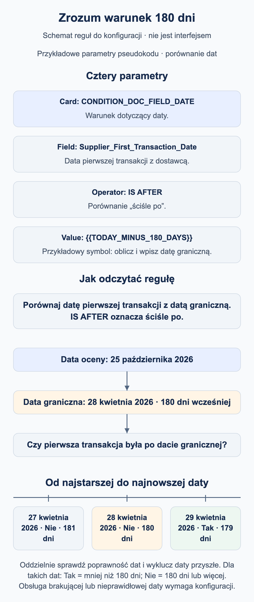<figcaption><p>Przykład porównania: dla 25 października 2026 datą graniczną jest 28 kwietnia 2026. „IS AFTER” wyklucza równość: 29 kwietnia daje wynik Tak, a 28 i 27 kwietnia — Nie. Nazwy karty i pola oraz symbol {{TODAY_MINUS_180_DAYS}} są przykładowe i nie stanowią potwierdzenia dostępnych opcji produktu: wybierz rzeczywiste pole i oblicz lub wpisz datę graniczną. Oddzielnie sprawdź, czy daty są prawidłowe i nie są przyszłe; obsługa brakującej lub nieprawidłowej daty wymaga konfiguracji.</p></figcaption></figure>

<details>
<summary>Kopiuj przykładowe parametry</summary>

```
Card: CONDITION_DOC_FIELD_DATE
Field: Supplier_First_Transaction_Date
Operator: IS AFTER
Value: {{TODAY_MINUS_180_DAYS}}
```

</details>


**Referencja przewodnika:** [Przewodnik po kartach warunków (kompletny)](../and/condition-cards-complete-guide.md)

***

### Krok 2: Zbuduj drzewo decyzyjne

**Poziom 1: Typ dokumentu**

Wyjaśnienie wizualne: [typy dokumentów](#schemat-typy-dokumentow).

<details>
<summary>Przykładowe kierowanie według typu dokumentu</summary>

```
Workflow: "Invoice Processing"

IF Document_Type = "Invoice":
  → Przejdź do poziomu 2

ELSE IF Document_Type = "Credit Note":
  → Przejdź do ścieżki "Credit Note Processing"

ELSE IF Document_Type = "Receipt":
  → Przejdź do ścieżki "Receipt Processing"

ELSE:
  → Skieruj do obsługi "Unknown Document Type"
```

</details>

**Poziom 2: progi kwot (niepilne faktury, poprawna kwota)**

Wyjaśnienie wizualne: [przedziały kwot](#schemat-przedziay-kwot).

<details>
<summary>Cztery przedziały kwot: pseudokod</summary>

```
IF Amount < €1,000:
  → Przejdź do ścieżki "Auto-Approve Path"

ELSE IF Amount < €10,000:
  → Przejdź do ścieżki "Manager Approval Path"

ELSE IF Amount < €50,000:
  → Przejdź do ścieżki "Director Approval Path"
  → Sprawdź warunki poziomu 3

ELSE (Amount ≥ €50,000):
  → Przejdź do ścieżki "Executive Approval Path"
  → Wymagane dwie lub trzy akceptacje
```

</details>

**Poziom 3: Analiza dostawcy (dla faktur o wysokiej wartości)**

#### Schemat: Analiza dostawcy {#schemat-analiza-dostawcy}

<figure>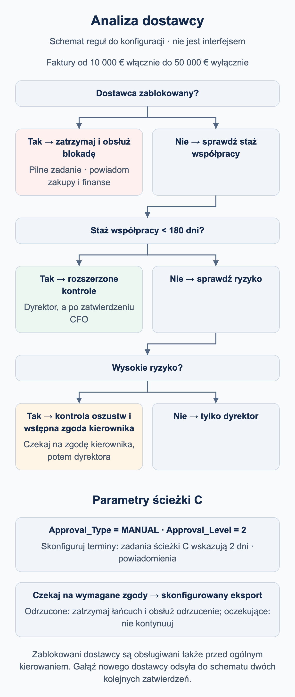<figcaption><p>Szczegóły ścieżki dostawcy: najpierw blokada, potem staż współpracy, następnie ryzyko. Gałąź dla stażu poniżej 180 dni odsyła do schematu dwóch kolejnych zatwierdzeń. Zadania ścieżki C, terminy, powiadomienia i działania wymagają konfiguracji.</p></figcaption></figure>

<details>
<summary>Analiza dostawcy: blokada, staż i ryzyko</summary>

```
IF Supplier_Status = "BLOCKED":
  → ZATRZYMAJ przetwarzanie
  → Utwórz pilne zadanie eskalacyjne
  → Powiadom działy zakupów i finansów

ELSE IF Supplier_Age < 180 dni (nowy):
  → Wymagana dodatkowa akceptacja
  → Dodaj CFO do łańcucha akceptacji
  → Wzmożona weryfikacja

ELSE IF Supplier_Risk_Rating = "HIGH":
  → Wymagane dodatkowe kontrole
  → Weryfikacja pod kątem oszustw
  → Wstępna akceptacja kierownika; czekaj na pozytywną akceptację
  → Akceptacja dyrektora; czekaj na pozytywną akceptację

ELSE:
  → Zwykły workflow dla wysokich kwot
```

</details>

***

### Krok 3: Utwórz akcje routingu

**Ścieżka A: Automatyczne zatwierdzenie (kwota < 1 000 €)**

#### Schemat: Ścieżka automatyczna {#schemat-sciezka-automatyczna}

<figure>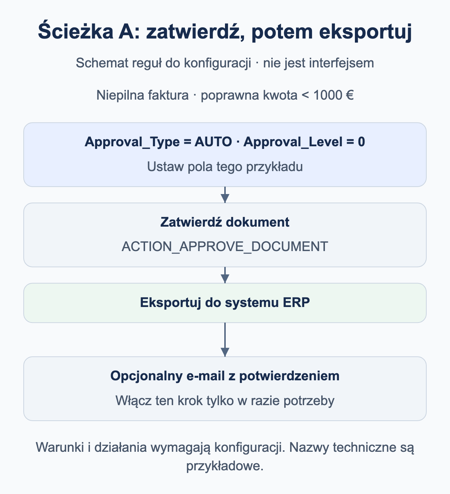<figcaption><p>Przykład ścieżki A: ustaw pola zatwierdzania, zatwierdź dokument, następnie eksportuj. E-mail z potwierdzeniem jest opcjonalny. Schemat opisuje działania do skonfigurowania, a nie zaobserwowane wykonanie.</p></figcaption></figure>

<details>
<summary>Działania ścieżki A: automatyczne zatwierdzenie</summary>

```
Działania:
1. Ustaw pole "Approval_Type" = "AUTO"
2. Ustaw pole "Approval_Level" = "0"
3. ACTION_APPROVE_DOCUMENT
4. Eksportuj do ERP
5. Wyślij email z potwierdzeniem (opcjonalnie)
```

</details>

**Ścieżka B: zgoda kierownika (1000 € ≤ kwota < 10 000 €)**

#### Schemat: Zadanie kierownika {#schemat-zadanie-kierownika}

<figure>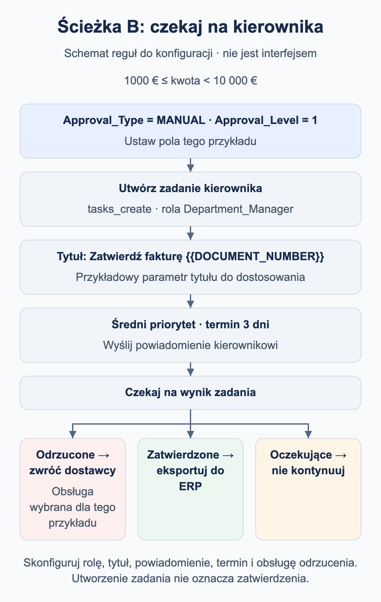<figcaption><p>Przykład ścieżki B: utwórz zadanie kierownika, powiadom go i czekaj na wynik. Tylko zgoda umożliwia eksport; odrzucenie zwraca tutaj dokument dostawcy. Termin trzech dni i odbiorcy są elementami konfiguracji.</p></figcaption></figure>

<details>
<summary>Działania ścieżki B: zadanie kierownika</summary>

```
Działania:
1. Ustaw pole "Approval_Type" = "MANUAL"
2. Ustaw pole "Approval_Level" = "1"
3. tasks_create:
   - Title: "Zatwierdź fakturę {{DOCUMENT_NUMBER}}"
   - Assign to: Department_Manager
   - Priority: Medium
   - Deadline: 3 dni
4. Wyślij powiadomienie email do kierownika
5. Czekaj na zakończenie zadania
6. Po zatwierdzeniu: eksportuj do ERP
7. Po odrzuceniu: zwróć dostawcy
```

</details>

**Ścieżka C: zgoda dyrektora (10 000 € ≤ kwota < 50 000 €)**

Wyjaśnienie wizualne: [analiza dostawcy](#schemat-analiza-dostawcy), [kolejne zatwierdzenia](#schemat-kolejne-zatwierdzenia).

<details>
<summary>Działania ścieżki C: kontrole i wymagane zgody</summary>

```
Działania:
1. Ustaw pole "Approval_Type" = "MANUAL"
2. Ustaw pole "Approval_Level" = "2"
3. Sprawdź Supplier_Age i Supplier_Risk_Rating:
   IF nowy (< 180 dni):
     - Utwórz zadanie 1: akceptacja dyrektora
     - Czekaj na pozytywną akceptację zadania 1 przed utworzeniem zadania 2: akceptacja CFO
     - Czekaj na pozytywną akceptację zadania 2 przed kontynuacją
     - Oczekuje: nie kontynuuj
     - Każde odrzucenie: zatrzymaj łańcuch i obsłuż odrzucenie zgodnie z konfiguracją
     - Wymagane obie pozytywne akceptacje
   ELSE IF Supplier_Risk_Rating = "HIGH":
     - Dodatkowe kontrole ryzyka i wstępna akceptacja kierownika
     - Czekaj na pozytywną akceptację kierownika przed akceptacją dyrektora
     - Czekaj na pozytywną akceptację dyrektora przed eksportem
     - Oczekiwanie lub odrzucenie: zatrzymaj przechodzenie dalej i obsłuż wynik zgodnie z konfiguracją
   ELSE:
     - Utwórz zadanie: wyłącznie akceptacja dyrektora
4. Priority: High
5. Deadline: 2 dni na zadania akceptacyjne ścieżki C; terminy kontroli ryzyka skonfiguruj osobno
6. Wyślij powiadomienia email
7. Czekaj na zakończenie
8. Po wszystkich akceptacjach: eksportuj
9. Po dowolnym odrzuceniu: zwróć dostawcy
```

</details>

#### Schemat: Kolejne zatwierdzenia {#schemat-kolejne-zatwierdzenia}

<figure>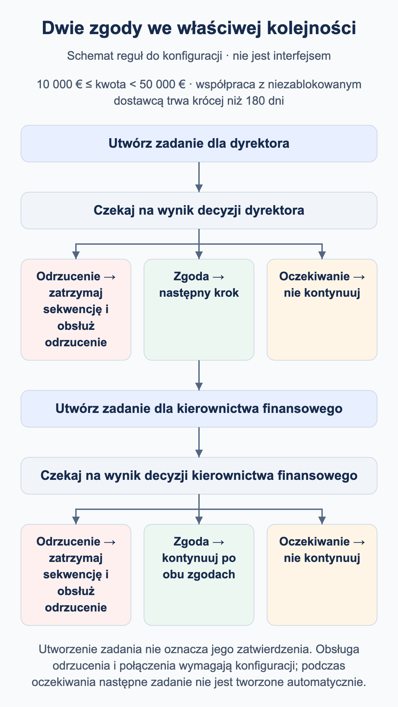<figcaption><p>Przykład kolejnych zatwierdzeń: utwórz zadanie dla kierownictwa finansowego dopiero po zgodzie dyrektora, a następnie czekaj na wynik jego decyzji. Kontynuuj wyłącznie po uzyskaniu obu zgód. Odrzucenie zatrzymuje sekwencję i podlega skonfigurowanej obsłudze; wynik oczekujący nie pozwala kontynuować.</p></figcaption></figure>

Zależnie od konfiguracji odrzucenie może zwrócić dokument dostawcy lub uruchomić inną ścieżkę. Schemat wymaga jedynie zatrzymania tego łańcucha zgód; nie narzuca ręcznego przeglądu w każdym przypadku.

**Ścieżka D: Zatwierdzenie przez zarząd (≥ 50 000 €)**

#### Schemat: Zgoda kierownictwa {#schemat-zgoda-kierownictwa}

<figure>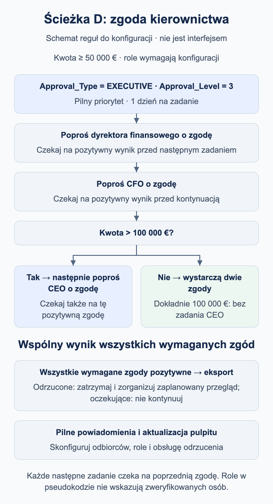<figcaption><p>Przykład ścieżki D: dwie kolejne zgody od 50 000 €, trzecia wyłącznie powyżej 100 000 €. Każde następne zadanie czeka na poprzednią zgodę. Skonfiguruj role, terminy, powiadomienia i obsługę odrzucenia.</p></figcaption></figure>

<details>
<summary>Działania ścieżki D: zgoda kierownictwa</summary>

```
Działania:
1. Ustaw pole "Approval_Type" = "EXECUTIVE"
2. Ustaw pole "Approval_Level" = "3"
3. Kolejne akceptacje:
   - Zadanie 1: dyrektor finansowy
   - Zadanie 2: CFO
   - Zadanie 3: CEO (jeśli > €100,000)
4. Priority: Urgent
5. Deadline: po 1 dniu na zadanie
6. Wyślij pilne powiadomienia
7. Aktualizacja panelu kierownictwa
8. Czekaj na wszystkie akceptacje
9. Po wszystkich akceptacjach: eksportuj
10. Po dowolnym odrzuceniu: spotkanie weryfikacyjne kierownictwa
```

</details>

***

## Zaawansowane wzorce logiki decyzyjnej

Poniższe wzorce są niezależnymi wariantami. Punktacja, progi działów i reguły czasowe nie dołączają automatycznie do pełnej macierzy powyżej; wybierz i skonfiguruj reguły odpowiednie dla swojego przypadku.

### Wzorzec 1: Routing oparty na punktacji

**W tym przykładzie oblicz całkowity wynik ryzyka i wybierz odpowiednią ścieżkę:**

#### Schemat: Punkty ryzyka {#schemat-punkty-ryzyka}

<figure>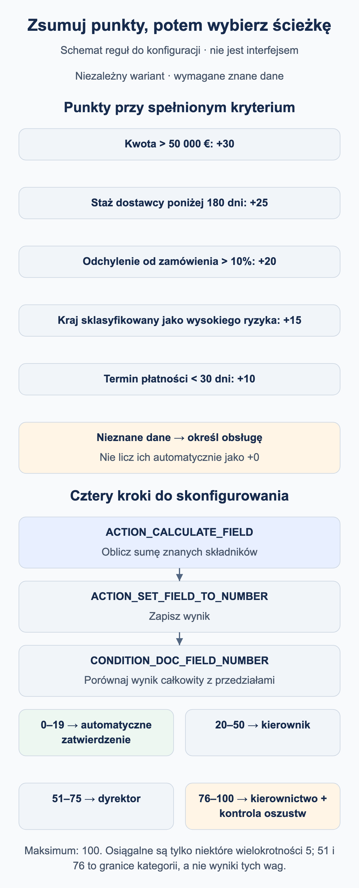<figcaption><p>Niezależny wariant: pięć znanych składników daje całkowity wynik od 0 do 100, a następnie ścieżkę. Granice 51 i 76 określają kategorie; te pięć wag faktycznie nie daje takich wyników. Osobno określ obsługę nieznanych danych.</p></figcaption></figure>

<details>
<summary>Obliczanie punktów ryzyka i przedziały</summary>

```
Obliczanie wyniku ryzyka:
  Score = 0

  IF Amount > €50,000: Score += 30
  IF Supplier_Age < 180 dni: Score += 25
  IF PO_Variance > 10%: Score += 20
  IF Supplier_Country = "High Risk Country": Score += 15
  IF Payment_Terms < 30 dni: Score += 10

  Całkowity zakres Score: 0-100

Wybór ścieżki:
  IF Score < 20: Zatwierdź automatycznie
  IF Score 20-50: Akceptacja kierownika
  IF Score 51-75: Akceptacja dyrektora
  IF Score > 75: Akceptacja kierownictwa + kontrola pod kątem oszustw
```

</details>

**Wdrożenie:**

Wyjaśnienie wizualne: [punkty ryzyka](#schemat-punkty-ryzyka).

<details>
<summary>Przykładowa implementacja punktacji</summary>

```
1. ACTION_CALCULATE_FIELD: Oblicz wynik ryzyka
2. ACTION_SET_FIELD_TO_NUMBER: Zapisz wynik
3. CONDITION_DOC_FIELD_NUMBER: Sprawdź progi wyniku
4. Wybierz ścieżkę na podstawie wyniku
```

</details>

***

### Wzorzec 2: Macierz oparta na dziale

**Różne reguły zatwierdzania w zależności od działu:**

#### Schemat: Macierz działów {#schemat-macierz-dziaow}

<figure>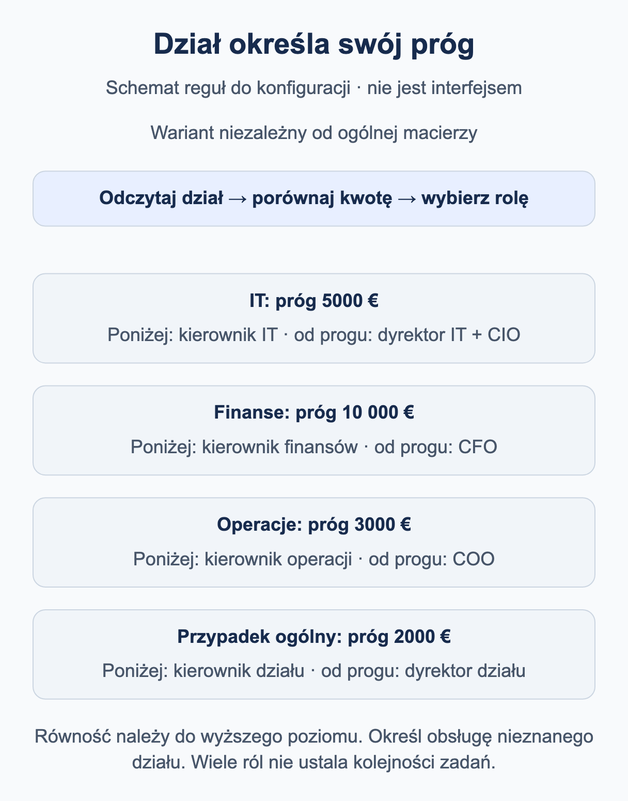<figcaption><p>Niezależna macierz działów: progi są różne dla IT, finansów, operacji i przypadku ogólnego. Równość wybiera wyższy przedział. Wiele ról wymaga konfiguracji; ich obecność nie dowodzi kolejnego zatwierdzania.</p></figcaption></figure>

<details>
<summary>Macierz progów według działu</summary>

```
Macierz działów:

  Dział IT:
    Amount < €5,000: Kierownik IT
    Amount ≥ €5,000: Dyrektor IT + CIO

  Dział finansów:
    Amount < €10,000: Kierownik finansowy
    Amount ≥ €10,000: CFO

  Dział operacyjny:
    Amount < €3,000: Kierownik operacyjny
    Amount ≥ €3,000: COO

  Przypadek ogólny:
    Amount < €2,000: Kierownik działu
    Amount ≥ €2,000: Dyrektor działu
```

</details>

**Wdrożenie:**

Wyjaśnienie wizualne: [macierz działów](#schemat-macierz-dziaow).

<details>
<summary>Przykładowa implementacja macierzy działów</summary>

```
1. Sprawdź pole Department
2. Na podstawie działu sprawdź próg kwotowy
3. Skieruj do odpowiedniej osoby zatwierdzającej
4. Różne progi dla poszczególnych działów
```

</details>

***

### Wzorzec 3: Logika oparta na czasie

**Różne reguły w zależności od momentu:**

#### Schemat: Warianty czasowe {#schemat-warianty-czasowe}

<figure>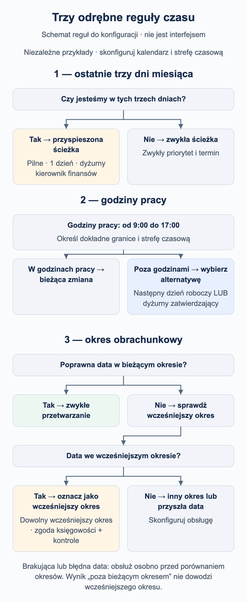<figcaption><p>Trzy niezależne warianty: koniec miesiąca, godziny pracy i okres obrachunkowy. Kolejka i dyżurny zatwierdzający to alternatywy do wyboru. Data poza bieżącym okresem nie musi być wcześniejsza; sprawdź jej przypadek osobno.</p></figcaption></figure>

<details>
<summary>Trzy niezależne warianty czasowe</summary>

```
Przetwarzanie na koniec miesiąca (ostatnie 3 dni miesiąca):
  IF Today przypada na ostatnie 3 dni miesiąca:
    - Priority: URGENT
    - Deadline: 1 dzień
    - Osoba zatwierdzająca: dyżurny kierownik finansowy
    - Przyspieszony workflow
  ELSE:
    - Zwykły priorytet
    - Zwykły termin
    - Zwykły workflow

W godzinach pracy i poza nimi:
  IF Time przypada między 9.00 a 17.00:
    - Przypisz do bieżącej zmiany
  ELSE:
    - Umieść w kolejce na następny dzień roboczy
    - OR skieruj do dyżurnej osoby zatwierdzającej

Okres rozliczeniowy (niezależna polityka przykładowa):
  IF brak wartości Document_Date lub wartość nieprawidłowa:
    - Obsłuż nieprawidłową lub nieznaną datę zgodnie z konfiguracją
  ELSE IF Document_Date in Current_Fiscal_Period:
    - Zwykłe przetwarzanie
  ELSE IF Document_Date przypada na dowolny Fiscal_Period wcześniejszy niż Current_Fiscal_Period:
    - Oznacz jako "Prior Period"
    - Wymagaj akceptacji księgowości
    - Dodatkowe kontrole
  ELSE:
    - Przyszły lub inny okres rozliczeniowy: obsłuż zgodnie z konfiguracją
```

</details>

***

### Wzorzec 4: Routing oparty na wyjątkach

**Routowanie wyjątków osobno:**

#### Schemat: Waga wyjątków {#schemat-waga-wyjatkow}

<figure>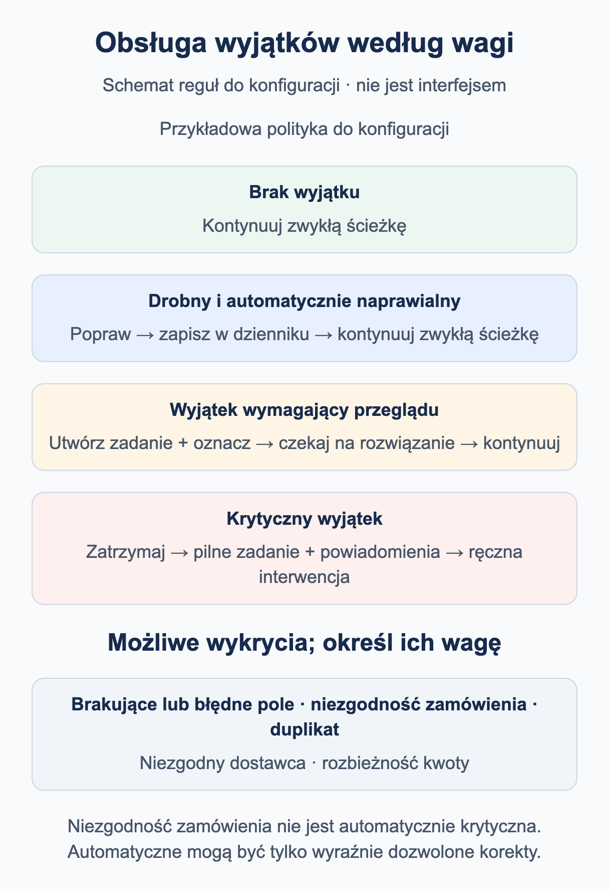<figcaption><p>Przykładowa polityka wagi wyjątków: kontynuuj dopiero po skonfigurowanej korekcie lub oczekiwanym rozwiązaniu. Krytyczny wyjątek zatrzymuje przetwarzanie. Same przykłady wykrycia nie określają wagi.</p></figcaption></figure>

<details>
<summary>Polityka wagi wyjątków</summary>

```
Wykrywanie wyjątków:

  Brak wyjątku:
    → Zwykły workflow

  Drobny wyjątek (możliwa automatyczna korekta):
    → Skoryguj automatycznie
    → Zarejestruj korektę
    → Kontynuuj zwykły workflow

  Średni wyjątek (wymaga weryfikacji):
    → Utwórz zadanie weryfikacyjne
    → Oznacz dokument
    → Po rozwiązaniu: kontynuuj workflow

  Poważny wyjątek (wymaga eskalacji):
    → Zatrzymaj przetwarzanie
    → Utwórz pilne zadanie
    → Powiadom wiele poziomów
    → Wymagana ręczna interwencja

Typy wyjątków:
  - Brak wymaganego pola
  - Nieprawidłowa wartość pola
  - Rozbieżność z zamówieniem
  - Duplikat faktury
  - Niezgodność dostawcy
  - Rozbieżność kwoty
```

</details>

***

## Kompletny diagram logiki decyzyjnej

Schematy pokazują najważniejsze kroki. Szczegółowe drzewo tekstowe poniżej zachowuje przykład techniczny; miejsca docelowe nadal wymagają konfiguracji.


Wyjaśnienie wizualne: [przegląd](#schemat-przeglad), [przedziały kwot](#schemat-przedziay-kwot), [analiza dostawcy](#schemat-analiza-dostawcy), [kolejne zatwierdzenia](#schemat-kolejne-zatwierdzenia), [ścieżka automatyczna](#schemat-sciezka-automatyczna), [zadanie kierownika](#schemat-zadanie-kierownika), [zgoda kierownictwa](#schemat-zgoda-kierownictwa).

<details>
<summary>Pełny przykład: szczegółowe drzewo tekstowe</summary>

```
WPŁYWA FAKTURA
│
├─ POZIOM 1: KONTROLA WYJĄTKÓW
│  │
│  ├─ Wyjątek krytyczny lub dostawca ze statusem BLOCKED?
│  │  (Krytyczność trzeba skonfigurować; nie każda rozbieżność z zamówieniem jest krytyczna.)
│  │  │
│  │  ├─ TAK → zatrzymaj i eskaluj
│  │  │        Utwórz pilne zadanie
│  │  │        Powiadom administratora
│  │  │        → KONIEC (obsługa wyjątku)
│  │  │
│  │  └─ NIE → przejdź do poziomu 2
│
├─ POZIOM 2: TYP DOKUMENTU
│  │
│  ├─ Type = Invoice?
│  │  └─ TAK → przejdź do poziomu 3
│  │
│  ├─ Type = Credit Note?
│  │  └─ TAK → przejdź do workflow not kredytowych
│  │           → KONIEC (ścieżka not kredytowych)
│  │
│  └─ Inny typ?
│     └─ TAK → przejdź do odpowiedniego workflow
│              → KONIEC (ścieżka innego typu)
│
├─ POZIOM 3: KONTROLA PILNOŚCI (dla faktur)
│  │
│  ├─ Znacznik pilności = TRUE?
│  │  │
│  │  ├─ TAK → przyspieszony workflow
│  │  │        Priority: URGENT
│  │  │        Deadline: 1 dzień
│  │  │        Przypisz do: osoby zatwierdzającej wyższego szczebla
│  │  │        → KONIEC (ścieżka przyspieszona)
│  │  │
│  │  └─ NIE → przejdź do poziomu 4
│
├─ POZIOM 4: PROGI KWOTOWE
│  │
│  ├─ Brak wartości Amount lub wartość nieprawidłowa?
│  │  ├─ TAK → weryfikacja ręczna (jawna polityka przykładowa)
│  │  └─ NIE → przejdź do poniższych progów kwotowych
│  │
│  ├─ Amount < €1,000?
│  │  │
│  │  ├─ TAK → ŚCIEŻKA AUTOMATYCZNEJ AKCEPTACJI
│  │  │        Ustaw Approval_Type = "AUTO"
│  │  │        Zatwierdź natychmiast
│  │  │        Eksportuj do ERP
│  │  │        → KONIEC (zatwierdzono automatycznie)
│  │  │
│  │  └─ NIE → kontynuuj
│  │
│  ├─ Amount < €10,000?
│  │  │
│  │  ├─ TAK → ŚCIEŻKA AKCEPTACJI KIEROWNIKA
│  │  │        Utwórz zadanie dla kierownika
│  │  │        Priority: Medium
│  │  │        Deadline: 3 dni
│  │  │        → CZEKAJ na wynik; przy oczekiwaniu nie wolno kontynuować
│  │  │           → Zatwierdzono: kontynuuj skonfigurowane przetwarzanie
│  │  │           → Odrzucono: zatrzymaj łańcuch i obsłuż odrzucenie zgodnie z konfiguracją
│  │  │
│  │  └─ NIE → kontynuuj
│  │
│  ├─ Amount < €50,000?
│  │  │
│  │  ├─ TAK → ŚCIEŻKA AKCEPTACJI DYREKTORA
│  │  │        Przejdź do poziomu 5 (kontrola dostawcy)
│  │  │
│  │  └─ NIE → kontynuuj
│  │
│  └─ Amount ≥ €50,000?
│     │
│     └─ TAK → ŚCIEŻKA AKCEPTACJI KIEROWNICTWA
│              Utwórz kolejne zadania:
│              - Dyrektor finansowy
│              - CFO
│              - CEO (jeśli > €100,000)
│              Priority: URGENT
│              Deadline: po 1 dniu na zadanie
│              → CZEKAJ na wszystkie wymagane wyniki
│                 → Wszystko zatwierdzono: kontynuuj skonfigurowane przetwarzanie
│                 → Oczekuje: nie kontynuuj
│                 → Każde odrzucenie: zatrzymaj łańcuch i obsłuż odrzucenie zgodnie z konfiguracją
│
├─ POZIOM 5: ANALIZA DOSTAWCY (€10,000 ≤ Amount < €50,000)
│  │
│  ├─ Supplier Status = "BLOCKED"?
│  │  │
│  │  ├─ TAK → ZABLOKUJ I ESKALUJ
│  │  │        Zatrzymaj przetwarzanie
│  │  │        Utwórz pilne zadanie
│  │  │        Powiadom działy zakupów i finansów
│  │  │        → KONIEC (zablokowany dostawca)
│  │  │
│  │  └─ NIE → kontynuuj
│  │
│  ├─ Supplier Age < 180 dni (nowy)?
│  │  │
│  │  ├─ TAK → WYMAGANE DWIE AKCEPTACJE
│  │  │        Zadanie 1: dyrektor (2 dni)
│  │  │        → CZEKAJ na zadanie 1
│  │  │           IF zadanie 1 zatwierdzono:
│  │  │             Zadanie 2: CFO (2 dni)
│  │  │             → CZEKAJ na zadanie 2
│  │  │                → Oczekuje: nie kontynuuj
│  │  │                → Zatwierdzono: kontynuuj dopiero po obu pozytywnych akceptacjach
│  │  │                → Odrzucono: zatrzymaj łańcuch i obsłuż odrzucenie zgodnie z konfiguracją
│  │  │           IF zadanie 1 odrzucono:
│  │  │             → Zatrzymaj łańcuch i obsłuż odrzucenie zgodnie z konfiguracją
│  │  │           IF zadanie 1 oczekuje:
│  │  │             → Nie twórz zadania 2 i nie kontynuuj
│  │  │
│  │  └─ NIE → kontynuuj
│  │
│  ├─ Supplier Risk Rating = "HIGH"?
│  │  │
│  │  ├─ TAK → WZMOŻONA AKCEPTACJA
│  │  │        Dodatkowe kontrole pod kątem oszustw
│  │  │        Wstępna akceptacja kierownika, następnie akceptacja dyrektora
│  │  │        Czekaj na każdy pozytywny wynik; przy oczekiwaniu lub odrzuceniu nie wolno kontynuować
│  │  │        Skonfiguruj terminy kontroli ryzyka; zadania akceptacyjne ścieżki C wskazują 2 dni
│  │  │        → KONIEC (ścieżka wzmożona)
│  │  │
│  │  └─ NIE → ZWYKŁA AKCEPTACJA DYREKTORA
│  │           Utwórz zadanie dla dyrektora
│  │           Priority: High
│  │           Deadline: 2 dni
│  │           → CZEKAJ na wynik; przy oczekiwaniu nie wolno kontynuować
│  │              → Zatwierdzono: kontynuuj skonfigurowane przetwarzanie
│  │              → Odrzucono: zatrzymaj łańcuch i obsłuż odrzucenie zgodnie z konfiguracją
│  │
│  └─ [Analiza dostawcy zakończona]
│
└─ [Wszystkie poziomy decyzyjne przetworzone]
```

</details>


***

## Najlepsze praktyki konfiguracji

### 1. Utrzymuj logikę jasną i łatwą w utrzymaniu

Poniższe porównanie przedstawia prosty warunek, złożony warunek oraz odrębną politykę etapową. Schemat rozróżnia ich cele bez twierdzenia o równoważności.

#### Schemat: Czytelne decyzje {#schemat-czytelne-decyzje}

<figure>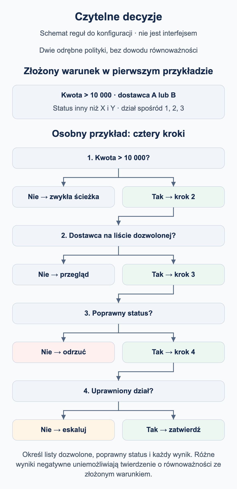<figcaption><p>Przykład czterech kroków pokazuje politykę odrębną od złożonego warunku. Uwidacznia każdy wynik negatywny; nie jest udowodnionym równoważnym przekształceniem logicznym. Określ listy dozwolone i obsługę wyjść.</p></figcaption></figure>

✅ **Dobrze:**

Wyjaśnienie wizualne: [prosty warunek](#schemat-prosty-warunek).

<details>
<summary>Prosty przykład: ścieżka wysokich kwot</summary>

```
IF Amount > 10000:
  → Ścieżka wysokiej wartości
ELSE:
  → Zwykła ścieżka
```

</details>

❌ **Źle (zbyt złożone):**

Wyjaśnienie wizualne: [czytelne decyzje](#schemat-czytelne-decyzje).

<details>
<summary>Przykład złożonego warunku</summary>

```
IF (Amount > 10000 AND (Supplier = "A" OR Supplier = "B") AND NOT (Status = "X" OR Status = "Y") AND Department IN [1,2,3]):
  → Złożona ścieżka
```

</details>

**Inny przykład: odrębna polityka czterech etapów:**

Ten przykład rozróżnia wyniki na każdym etapie. Nie jest logicznie równoważnym przepisaniem złożonego warunku powyżej: listy dostawców, poprawne statusy, dozwolone działy i obsługę wyników negatywnych trzeba określić dla tego drugiego przykładu.

Wyjaśnienie wizualne: [czytelne decyzje](#schemat-czytelne-decyzje).

<details>
<summary>Inny przykład: polityka czterech kroków</summary>

```
Krok 1: IF Amount > 10000: Kontynuuj, ELSE: Zwykła ścieżka
Krok 2: IF Supplier znajduje się na liście dozwolonych: Kontynuuj, ELSE: Zweryfikuj
Krok 3: IF Status jest prawidłowy: Kontynuuj, ELSE: Odrzuć
Krok 4: IF Department jest uprawniony: Zatwierdź, ELSE: Eskaluj
```

</details>

***

### 2. Dokumentuj logikę decyzyjną

**Zawsze uwzględnij:**

* Cel każdego punktu decyzyjnego
* Wdrożoną regułę biznesową
* Oczekiwane wyniki
* Obsługę wyjątków

**Przykładowa dokumentacja:**

#### Schemat: Zapis reguły {#schemat-zapis-reguy}

<figure>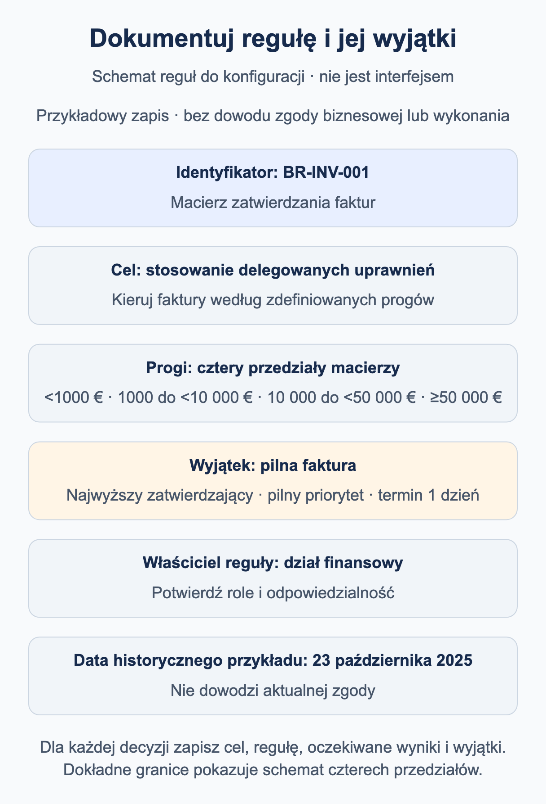<figcaption><p>Przykładowy zapis reguły BR-INV-001: cel, progi, wyjątek, właściciel i data odniesienia. Odwołanie do czterech przedziałów zapobiega powielaniu reguły; zapis nie dowodzi zgody ani wykonania.</p></figcaption></figure>

<details>
<summary>Przykładowy zapis reguły BR-INV-001</summary>

```
Punkt decyzyjny: kontrola progu kwotowego
Reguła biznesowa: BR-INV-001 (macierz akceptacji faktur)
Cel: kieruj faktury według progów kwotowych zgodnie z polityką firmy
Progi:
  < €1,000: Zatwierdź automatycznie (próg zatwierdzony przez CFO w tym przykładzie)
  €1,000 ≤ Amount < €10,000: Akceptacja kierownika (macierz delegowania uprawnień)
  €10,000 ≤ Amount < €50,000: Akceptacja dyrektora z kontrolą dostawcy
  Amount ≥ €50,000: Akceptacja kierownictwa
Wyjątki: pilne faktury przechodzą od razu na najwyższy poziom
Zaktualizowano: 2025-10-23
Właściciel: dział finansów
```

</details>

***

### 3. Przetestuj wszystkie ścieżki

**Proponowana macierz testów — wyniki oczekiwane, bez wykonanych testów:**

Sprawdź te oczekiwane wyniki w swojej konfiguracji i zapisz obserwacje.

| Przypadek | Kwota | Typ | Dostawca | Oczekiwana ścieżka | Weryfikacja |
| --- | --- | --- | --- | --- | --- |
| TC1 | 500 € | Faktura | Istniejący | Automatyczne zatwierdzenie | Do testu |
| TC2 | 5000 € | Faktura | Istniejący | Kierownik | Do testu |
| TC3 | 15 000 € | Faktura | Nowy | Dyrektor, potem CFO | Do testu |
| TC4 | 60 000 € | Faktura | Istniejący | Kierownictwo | Do testu |
| TC5 | 2000 € | Korekta | Istniejący | Ścieżka korekty | Do testu |
| TC6 | 100 000 € | Faktura | Zablokowany | Zatrzymanie i eskalacja | Do testu |
| TC7 | 999,99 € | Faktura | Istniejący | Automatyczne zatwierdzenie | Do testu |
| TC8 | 1000 € | Faktura | Istniejący | Kierownik | Do testu |
| TC9 | 9999,99 € | Faktura | Istniejący | Kierownik | Do testu |
| TC10 | 10 000 € | Faktura | Istniejący | Dyrektor i kontrole dostawcy | Do testu |
| TC11 | 49 999,99 € | Faktura | Istniejący | Dyrektor i kontrole dostawcy | Do testu |
| TC12 | 50 000 € | Faktura | Istniejący | Kierownictwo | Do testu |
| TC13 | Brakująca lub błędna | Faktura | Istniejący | Ręczny przegląd wybrany w tym przykładzie | Do testu |
| TC14 | 15 000 € | Faktura | Nowy | Zgoda dyrektora oczekuje: nie twórz następnego zadania | Do testu |
| TC15 | 15 000 € | Faktura | Nowy | Dyrektor lub CFO odrzucił: zatrzymaj łańcuch i obsłuż odrzucenie | Do testu |
| TC16 | 15 000 € | Faktura | Nowy | Obie zgody pozytywne: kontynuuj skonfigurowane przetwarzanie | Do testu |

***

### 4. Monitoruj wskaźniki decyzyjne

**Śledź:**

* Rozkład na ścieżki decyzyjne
* Wskaźnik automatycznego zatwierdzania
* Wskaźnik przeglądu ręcznego
* Średni czas przetwarzania na ścieżkę
* Wskaźniki wyjątków
* Wykorzystanie ścieżek

**Fikcyjne przykładowe wskaźniki:** Wartości ilustrują raport; nie dowodzą aktualnej wydajności ani wykonania tego przepływu.

#### Schemat: Fikcyjne wskaźniki {#schemat-fikcyjne-wskazniki}

<figure>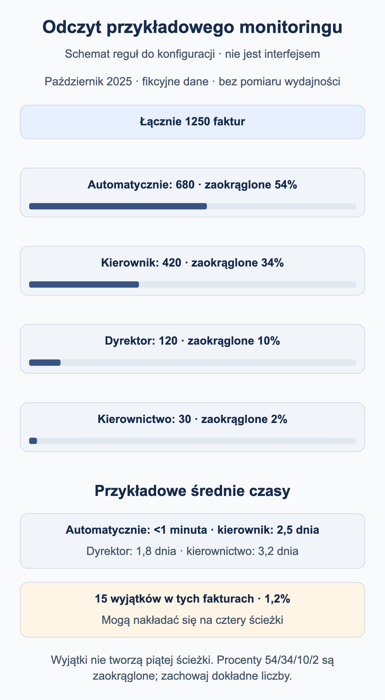<figcaption><p>Fikcyjny przykład: cztery ścieżki obejmują łącznie 1250 faktur. Procenty są zaokrąglone. Te same faktury mogą obejmować 15 wyjątków, czyli 1,2%; nie tworzą one piątej ścieżki. Czasy nie są zmierzoną wydajnością DocBits.</p></figcaption></figure>

<details>
<summary>Fikcyjny przykład rozkładu i czasów</summary>

```
Miesiąc: październik 2025
Łączna liczba faktur: 1250

Rozkład ścieżek decyzyjnych:
- Zatwierdzone automatycznie (< €1k): 680 (54%)
- Ścieżka kierownika (€1k ≤ Amount < €10k): 420 (34%)
- Ścieżka dyrektora (€10k ≤ Amount < €50k): 120 (10%)
- Ścieżka kierownictwa (Amount ≥ €50k): 30 (2%)

Czas przetwarzania:
- Zatwierdź automatycznie: < 1 minuta
- Ścieżka kierownika: średnio 2,5 dnia
- Ścieżka dyrektora: średnio 1,8 dnia
- Ścieżka kierownictwa: średnio 3,2 dnia

Wyjątki: 15 (1,2%)
```

</details>

***

## Powiązane wzorce

### Wzorce, które dobrze ze sobą współgrają:

* [**Wzorzec zarządzania zadaniami**](task-management-pattern.md) – Tworzenie zadań na podstawie decyzji
* [**Wzorzec integracji API**](api-integration-pattern.md) – Pobieranie danych do podejmowania decyzji
* [**Wzorzec PO Matching**](po-matching-pattern.md) – Wykorzystanie wyników PO w decyzjach
* [**Wzorzec transformacji danych**](data-transformation-pattern.md) – Transformacja danych przed decyzjami

***

## Powiązane przewodniki

### Wymagania wstępne

* [Przewodnik po kartach warunków (kompletny)](../and/condition-cards-complete-guide.md) – Wszystkie karty warunków
* [Przewodnik po manipulacji polami](../then/document-field/field-manipulation-guide.md) – Operacje na polach
* [Przewodnik po przypisaniu](../then/assignee/assignment-user-guide.md) – Logika routingu

### Powiązane karty

* **CONDITION\_DOC\_FIELD\_AMOUNT** – [Przewodnik po kartach warunków](../and/condition-cards-complete-guide.md)
* **CONDITION\_DOC\_TYPE\_IS\_ISNOT** – [Przewodnik po kartach warunków](../and/condition-cards-complete-guide.md)
* **CONDITION\_SUPPLIER\_STATUS\_IS\_ISNOT** – [Przewodnik po kartach warunków](../and/condition-cards-complete-guide.md)
* **ACTION\_ASSIGN\_TO\_USER** – [Przewodnik po przypisaniu](../then/assignee/assignment-user-guide.md)
* **tasks\_create** – [Przewodnik po przypisywaniu zadań](../then/task/task-assignment-guide.md)

### Następne kroki

* Twórz zadania: [Wzorzec zarządzania zadaniami](task-management-pattern.md)
* Dodaj złożone dopasowanie: [Wzorzec PO Matching](po-matching-pattern.md)
* Zintegruj API: [Wzorzec integracji API](api-integration-pattern.md)

***

**Historyczne metadane przykładu:**

**Wersja wzorca:** 1.0 **Ostatnia aktualizacja:** 23 października 2025 **Trudność:** Średnia **Szacowany czas:** 30–45 minut

[Przykłady rzeczywistych przepływów pracy](production-workflow-examples.md)
