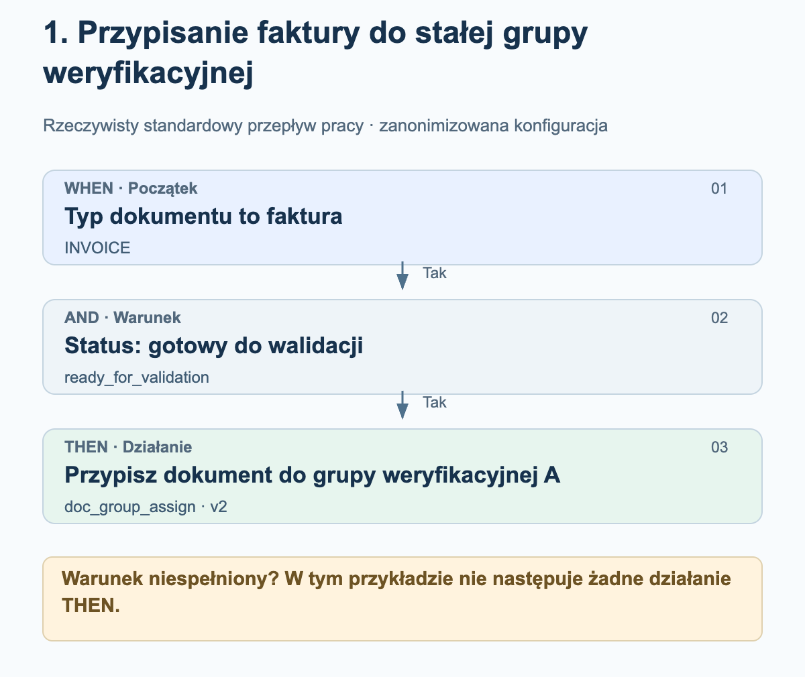
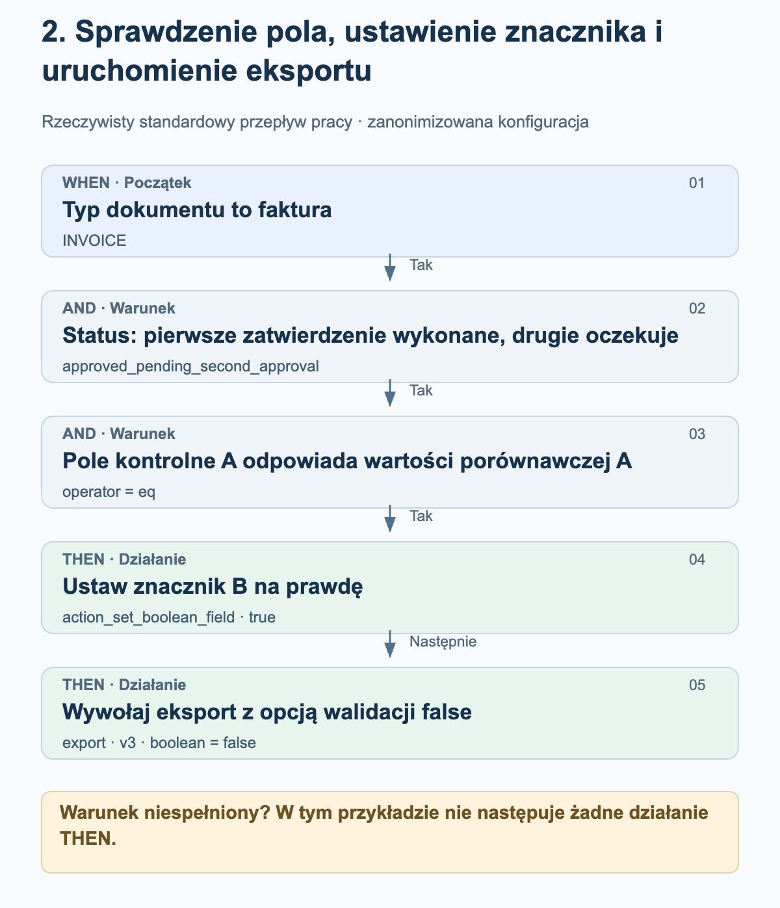
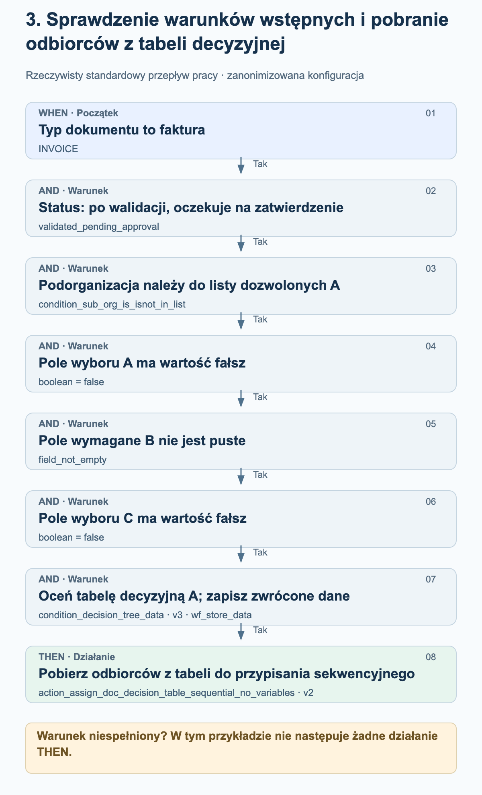

# Przykłady rzeczywistych przepływów pracy

Te trzy przykłady pochodzą z włączonych standardowych przepływów pracy w środowisku produkcyjnym. Przedstawiają rzeczywiście skonfigurowaną kolejność WHEN, AND i THEN. Grupy, organizacje, nazwy pól, wartości porównawcze i tabele decyzyjne zastąpiono neutralnymi nazwami. Grafiki objaśniają konfigurację; nie są zrzutami ekranu.

Stan na 27 października 2026 r. Użyte karty, wersje, parametry i ich kolejność porównano z zapisanymi konfiguracjami pomyślnych uruchomień produkcyjnych. Wynik success w dzienniku przepływu pracy nie potwierdza ani zatwierdzenia przez człowieka, ani odbioru w systemie ERP. Nie zmieniano żadnych przepływów pracy ani nie uruchamiano ich do testów.

## Jak czytać grafiki

Przykłady korzystają z trybu standardowego. WHEN ogranicza zakres do określonego typu dokumentu; wszystkie warunki AND muszą być spełnione, zanim nastąpią działania THEN. W tych przykładach niespełnienie warunku oznacza brak działań THEN. Strzałki między działaniami pokazują skonfigurowaną kolejność. Nie oznaczają dodatkowego kroku sprawdzania powodzenia ani zatwierdzania. Uruchomienie może również zakończyć się błędem.

## 1. Przypisanie faktury do stałej grupy weryfikacyjnej

Faktura ma trafić do weryfikacji w skonfigurowanej na stałe grupie, gdy osiągnie status „gotowa do walidacji”. Ten przykład nie wymaga tabeli decyzyjnej.

<figure><figcaption>Faktura i odpowiedni status: dokument zostaje przypisany do skonfigurowanej na stałe grupy weryfikacyjnej A. Samo przypisanie nie oznacza jeszcze zatwierdzenia.</figcaption></figure>

Karty i ustawienia

| Etap / karta | Ustawienie w przykładzie | Znaczenie |
| --- | --- | --- |
| WHEN · condition_doc_type_is_isnot_list · v2 | operator = is; doc_type = INVOICE | Tylko faktury spełniają ten warunek. |
| AND · condition_doc_status_is_isnot · v2 | operator = is; status = ready_for_validation | Dokument jest gotowy do walidacji. |
| THEN · doc_group_assign · v2 | groups = Grupa weryfikacyjna A | Wersja 2 korzysta ze skonfigurowanej grupy. Opcja tabeli decyzyjnej nie jest rozstrzygająca w tej wersji karty. |

### Co sprawdzić przy odtwarzaniu konfiguracji

- Grupa weryfikacyjna A to nazwa zanonimizowana. Wybierz grupę ze swojej organizacji i sprawdź zakres jej odpowiedzialności.
- Sprawdź osobno typ dokumentu i status: faktura o innym statusie nie spełnia warunków tego przykładu.
- Przypisanie dokumentu, zadanie i zatwierdzenie to różne czynności. Ta konfiguracja obejmuje wyłącznie przypisanie.

## 2. Sprawdzenie pola, ustawienie znacznika i uruchomienie eksportu

Faktura o określonym statusie zatwierdzania jest dalej przetwarzana tylko wtedy, gdy jej pole kontrolne A ma dokładnie wartość porównawczą A. Następnie przepływ pracy próbuje ustawić znacznik B na prawdę i wywołuje eksport. Pierwotne nazwy pól oraz wartość porównawcza zostały zanonimizowane.

<figure><figcaption>Sprawdzenie pola pozwala wykonać oba działania. Najpierw wywoływane jest ustawienie znacznika, a następnie eksport. Status i wyłączone kontrole walidacyjne są elementami tej konkretnej konfiguracji.</figcaption></figure>

Karty i ustawienia

| Etap / karta | Ustawienie w przykładzie | Znaczenie |
| --- | --- | --- |
| WHEN · condition_doc_type_is_isnot_list · v2 | operator = is; doc_type = INVOICE | Tylko faktury spełniają ten warunek. |
| AND · condition_doc_status_is_isnot · v2 | operator = is; status = approved_pending_second_approval | Skonfigurowany status oznacza „pierwsze zatwierdzenie wykonane, drugie zatwierdzenie oczekuje”. Nie zastąpiono go tutaj bardziej ogólnym statusem zatwierdzenia. |
| AND · condition_docfield_operator_value · v2 | field_name = Pole kontrolne A; operator = eq; field_value = Wartość porównawcza A | Zawartość pola musi odpowiadać skonfigurowanej wartości; warunek nie sprawdza jedynie, czy pole jest wypełnione. |
| THEN 1 · action_set_boolean_field · v2 | field_name = Znacznik B; boolean = true | Próbuje ustawić skonfigurowane pole logiczne na prawdę. |
| THEN 2 · export · v3 | boolean = false | Uruchamia eksport z ignore_field_validation_errors = true i validate_po_match = false. false wyłącza tutaj kontrole walidacyjne, a nie eksport. |

### Co sprawdzić przy odtwarzaniu konfiguracji

- Opcja eksportu false jest ustawieniem specyficznym dla klienta, a nie ogólnym zaleceniem. Przed odtworzeniem konfiguracji sprawdź w szczególności walidację pól, uzgadnianie z zamówieniem zakupu (PO) oraz wymagania dotyczące zatwierdzania.
- Między ustawieniem znacznika a eksportem nie skonfigurowano dodatkowego warunku. Sama kolejność nie gwarantuje powodzenia pierwszego działania; wyjątki i błędy działań wymagają osobnej kontroli.
- Przepływ pracy nie zawiera kroku oczekiwania na drugie zatwierdzenie przez człowieka. Pomyślne uruchomienie przepływu pracy nie zastępuje potwierdzenia odbioru w systemie ERP.

## 3. Sprawdzenie warunków wstępnych i pobranie odbiorców z tabeli decyzyjnej

Faktura ma zostać przypisana za pomocą tabeli decyzyjnej dopiero wtedy, gdy organizacja, status, dwa pola wyboru i pole wymagane spełnią odpowiednie warunki. Przepływ pracy zapisuje dane zwrócone przez tabelę decyzyjną, aby mogło z nich skorzystać kolejne działanie przypisania sekwencyjnego.

<figure><figcaption>Wszystkie sześć warunków AND musi być spełnionych. Dane zwrócone przez tabelę decyzyjną są zapisywane, a następnie wykorzystywane do sekwencyjnego przypisania dokumentu. Grafika nie dodaje fikcyjnych odbiorców ani etapów zatwierdzania.</figcaption></figure>

Karty i ustawienia

| Etap / karta | Ustawienie w przykładzie | Znaczenie |
| --- | --- | --- |
| WHEN · condition_doc_type_is_isnot_list · v2 | operator = is; doc_type = INVOICE | Ogranicza przykład do faktur. |
| AND 1 · condition_doc_status_is_isnot · v2 | operator = is; status = validated_pending_approval | Dokument przeszedł walidację i oczekuje na zatwierdzenie. |
| AND 2 · condition_sub_org_is_isnot_in_list · v2 | operator = is; sub_org_id = Lista dozwolonych A | Zakres obejmuje wyłącznie skonfigurowane podorganizacje. |
| AND 3 · condition_checkbox_is · v2 | field_name = Pole wyboru A; boolean = false | Pierwsze skonfigurowane pole wyboru musi mieć wartość fałsz. |
| AND 4 · condition_docfield_status · v2 | field_name = Pole wymagane B; field_status = field_not_empty | Skonfigurowane pole musi być wypełnione. |
| AND 5 · condition_checkbox_is · v2 | field_name = Pole wyboru C; boolean = false | Drugie pole wyboru również musi mieć wartość fałsz. |
| AND 6 · condition_decision_tree_data · v3 | decision_table = Tabela decyzyjna A; store_data = wf_store_data | Tabela jest oceniana dla dokumentu. Zwrócone dane są zapisywane do użycia przez kolejne karty. Dodatkowe starsze pole boolean jest puste i nie steruje tą wersją. |
| THEN · action_assign_doc_decision_table_sequential_no_variables · v2 | brak własnych zmiennych karty | Pobiera odbiorców z zapisanych danych zwróconych przez tabelę do przypisania sekwencyjnego. Odbiorcy i priorytety zależą od tabeli. |

### Co sprawdzić przy odtwarzaniu konfiguracji

- Pole wyboru A, pole wymagane B i pole wyboru C oznaczają trzy różne skonfigurowane pola. Neutralne nazwy zastępują nazwy pierwotne.
- Sprawdzenie, że pole nie jest puste, nie potwierdza jeszcze merytorycznej poprawności jego zawartości.
- Sprawdź rzeczywistą tabelę decyzyjną, w tym odbiorców i priorytety. Jej reguły nie zostały tutaj opublikowane; nie dodano żadnych fikcyjnych progów kwotowych ani ról.
- Pomyślna ocena tabeli nie gwarantuje jeszcze uzyskania użytecznych odbiorców. Następujące po niej przypisanie wymaga prawidłowych wyników wskazujących użytkowników lub grupy.
- Przypisanie sekwencyjne nie dowodzi zakończenia zatwierdzania przez człowieka. Ten przepływ pracy nie zawiera wywołania eksportu.

## Od przykładu do własnej konfiguracji

Określ odpowiednie pola, grupy i tabele decyzyjne we własnej organizacji. Nie traktuj neutralnych nazw jako istniejących pól produktu. W odpowiednim środowisku testowym sprawdź przypadki spełnienia i niespełnienia każdego warunku oraz błędy działań. Weryfikuj zatwierdzenia i eksporty na podstawie ich rzeczywistych wyników; włącz przepływ pracy dopiero po odbiorze merytorycznym.
