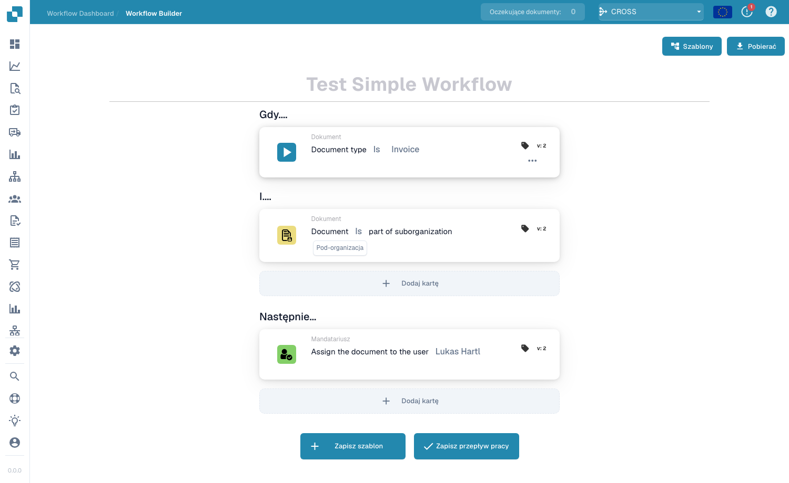
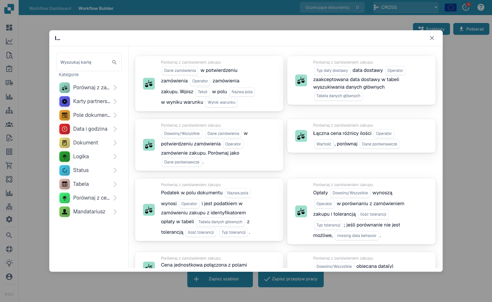

# Standard Workflow

Kreator **Standard Workflow** to liniowy, oparty na kartach edytor do automatyzacji przetwarzania dokumentów. Przepływ pracy składa się z trzech grup kart — **When** (wyzwalacz), **And** (dodatkowe warunki) oraz **Then** (akcje do wykonania). Gdy dokument spełnia warunki When/And, akcje Then są uruchamiane automatycznie.

## Tworzenie i testowanie Standard Workflow 

Utwórz kompletny Standard Workflow w prawdziwym interfejsie DocBits: wybierz fakturę, sprawdź jej numer i kwotę powyżej 1000, przypisz osobę sprawdzającą i zmień status. Zapisz regułę, uruchom trzy scenariusze testowe i potwierdź rzeczywisty wynik w dokumencie.



[Oglądaj z napisami](https://docbits-videos.fra1.cdn.digitaloceanspaces.com/settings-assistant/standard-workflow-admin/v1/pl.html) · [Otwórz film](https://docbits-videos.fra1.cdn.digitaloceanspaces.com/settings-assistant/standard-workflow-admin/v1/pl.mp4) · [Napisy (WebVTT)](https://docbits-videos.fra1.cdn.digitaloceanspaces.com/settings-assistant/standard-workflow-admin/v1/pl.vtt) · [Transkrypcja](https://docbits-videos.fra1.cdn.digitaloceanspaces.com/settings-assistant/standard-workflow-admin/v1/pl.txt) · 3:45

Rozdziały i transkrypcja

| Rozdział | Początek |
| --- | --- |
| Działanie tego workflow | [0:00](https://docbits-videos.fra1.cdn.digitaloceanspaces.com/settings-assistant/standard-workflow-admin/v1/pl.mp4#t=0.000) |
| Nadanie nazwy workflow | [0:15](https://docbits-videos.fra1.cdn.digitaloceanspaces.com/settings-assistant/standard-workflow-admin/v1/pl.mp4#t=15.000) |
| When: typ dokumentu | [0:24](https://docbits-videos.fra1.cdn.digitaloceanspaces.com/settings-assistant/standard-workflow-admin/v1/pl.mp4#t=24.875) |
| And: numer faktury | [0:36](https://docbits-videos.fra1.cdn.digitaloceanspaces.com/settings-assistant/standard-workflow-admin/v1/pl.mp4#t=36.542) |
| And: kwota powyżej 1000 | [0:49](https://docbits-videos.fra1.cdn.digitaloceanspaces.com/settings-assistant/standard-workflow-admin/v1/pl.mp4#t=49.875) |
| Then: przypisanie osoby sprawdzającej | [1:04](https://docbits-videos.fra1.cdn.digitaloceanspaces.com/settings-assistant/standard-workflow-admin/v1/pl.mp4#t=64.083) |
| Then: zmiana statusu | [1:17](https://docbits-videos.fra1.cdn.digitaloceanspaces.com/settings-assistant/standard-workflow-admin/v1/pl.mp4#t=77.833) |
| Sprawdzenie i zapisanie | [1:30](https://docbits-videos.fra1.cdn.digitaloceanspaces.com/settings-assistant/standard-workflow-admin/v1/pl.mp4#t=90.042) |
| Sprawdzenie zapisanej reguły | [1:46](https://docbits-videos.fra1.cdn.digitaloceanspaces.com/settings-assistant/standard-workflow-admin/v1/pl.mp4#t=106.083) |
| Przygotowanie scenariusza testowego | [1:58](https://docbits-videos.fra1.cdn.digitaloceanspaces.com/settings-assistant/standard-workflow-admin/v1/pl.mp4#t=118.333) |
| Uruchomienie przypadku pozytywnego | [2:19](https://docbits-videos.fra1.cdn.digitaloceanspaces.com/settings-assistant/standard-workflow-admin/v1/pl.mp4#t=139.667) |
| Test wartości granicznej | [2:39](https://docbits-videos.fra1.cdn.digitaloceanspaces.com/settings-assistant/standard-workflow-admin/v1/pl.mp4#t=159.042) |
| Test innego numeru faktury | [2:57](https://docbits-videos.fra1.cdn.digitaloceanspaces.com/settings-assistant/standard-workflow-admin/v1/pl.mp4#t=177.042) |
| Sprawdzenie wyniku w dokumencie | [3:13](https://docbits-videos.fra1.cdn.digitaloceanspaces.com/settings-assistant/standard-workflow-admin/v1/pl.mp4#t=193.583) |
| Włączenie przetestowanej reguły | [3:31](https://docbits-videos.fra1.cdn.digitaloceanspaces.com/settings-assistant/standard-workflow-admin/v1/pl.mp4#t=211.625) |

**Działanie tego workflow**

Dobrze, tworzę kompletny Standard Workflow dla faktury szkoleniowej. Powyżej tysiąca dokument ma trafić do osoby sprawdzającej i czekać na zatwierdzenie. Osobny numer faktury ogranicza przykład do właściwego dokumentu.

**Nadanie nazwy workflow**

Na liście klikam Nowy workflow. Nadaję czytelną nazwę przed dodaniem kart. Ta organizacja otwiera od razu projektanta Standard.

**When: typ dokumentu**

W sekcji Kiedy otwieram bibliotekę i wybieram kartę typu dokumentu. Ustawiam operator Jest oraz typ Faktura. Tak określam typ dokumentu sprawdzany przez regułę.

**And: numer faktury**

W sekcji I dodaję warunek pola dokumentu. Wybieram invoice_id, operator Równa się i wpisuję numer faktury szkoleniowej. Ten dodatkowy warunek ogranicza demonstrację do wskazanej faktury.

**And: kwota powyżej 1000**

Kolejny warunek I sprawdza total_amount. Wybieram Większe niż i wpisuję tysiąc. Dokładnie tysiąc nie spełnia tego warunku. Kwota i waluta muszą odpowiadać dokumentowi szkoleniowemu.

**Then: przypisanie osoby sprawdzającej**

W sekcji Wtedy wybieram przypisanie dokumentu do użytkownika. Wskazuję Docs User A2, naszego testowego recenzenta dokumentacji. Ta akcja przypisuje dokument bez tworzenia powiadomienia email.

**Then: zmiana statusu**

Druga akcja zmienia status na Oczekuje na zatwierdzenie. Wyzwalanie workflow ustawiam na fałsz. Ten przykład nie potrzebuje kolejnego uruchomienia po zmianie statusu przez własną akcję.

**Sprawdzenie i zapisanie**

Przed zapisaniem ponownie czytam całą regułę. Muszą pasować typ Faktura, dokładny numer oraz kwota powyżej tysiąca. Następnie dwie akcje wykonują się w pokazanej kolejności. Zapisuję workflow i sprawdzam potwierdzenie.

**Sprawdzenie zapisanej reguły**

Na liście sprawdzam zapisany workflow oraz jego aktywność. Zapisanie może od razu włączyć workflow. Wyłączam tę regułę szkoleniową na czas przygotowania testów.

**Przygotowanie scenariusza testowego**

W Test Manager dodaję scenariusz i wybieram zapisany workflow. Nadaję czytelną nazwę i wgrywam pliki JSON z wejściem oraz oczekiwanym wynikiem. Wejście zawiera numer faktury, kwotę tysiąc siedemset osiemdziesiąt pięć oraz status Gotowy do walidacji. Oczekiwany status to Oczekuje na zatwierdzenie.

**Uruchomienie przypadku pozytywnego**

Wysyłam scenariusz i wybieram Uruchom test z jego menu. Ponownie otwieram listę, aby wczytać zapisany wynik. Zaliczenie sprawdza oczekiwany status dokumentu. W tym sandboxie panel kart nie pokazuje wiarygodnie poszczególnych komunikatów, dlatego sprawdzam też rzeczywisty dokument.

**Test wartości granicznej**

Następnie testuję dokładnie tysiąc. Numer faktury i typ dokumentu nadal pasują, ale warunek Większe niż ma być fałszywy. W tych danych testowych oczekiwany status pozostaje Gotowy do walidacji. Zapisuję i uruchamiam osobny scenariusz, a potem sprawdzam wynik.

**Test innego numeru faktury**

Kolejny scenariusz ma inny numer faktury i kwotę powyżej tysiąca. Sama kwota nie może uruchomić akcji. Zapisuję i uruchamiam scenariusz z pierwotnym statusem jako oczekiwanym wynikiem. Te przypadki negatywne sprawdzają granice reguły.

**Sprawdzenie wyniku w dokumencie**

Na pulpicie znajduję dokument szkoleniowy. Jego rzeczywisty status to Oczekuje na zatwierdzenie, a dokument jest przypisany do Docs User A2. To potwierdza widoczny wynik obu akcji. Zmiana pochodzi z testu ręcznego i nie dowodzi działania automatycznego przetwarzania.

**Włączenie przetestowanej reguły**

Na liście workflow włączam przetestowaną regułę i sprawdzam przełącznik. Przed wdrożeniem kontroluję warunki, odbiorców i wyniki testów. Po demonstracji ponownie wyłączam regułę szkoleniową.

## Jak uzyskać dostęp

Otwórz **Workflow Dashboard → Workflow List**, a następnie kliknij **Add Workflow**, aby utworzyć nowy przepływ pracy Standard, lub kliknij istniejący przepływ pracy, aby go edytować.

<figure><figcaption>
Workflow List — każdy wiersz to przepływ pracy, który możesz otworzyć, włączyć/wyłączyć lub edytować.
</figcaption></figure>

## Model When / And / Then

<figure><figcaption>
Obszar roboczy Standard Workflow. Ten przykład wyzwala się dla faktur w sub-organizacji i przypisuje je do użytkownika.
</figcaption></figure>

- **When** — wyzwalacz, który uruchamia przepływ pracy (np. *Document type is Invoice*).
- **And** — dodatkowe warunki, które również muszą być spełnione (np. *Document is part of sub-organization*). Pozostaw puste, aby uruchamiać przy każdym dopasowaniu karty When.
- **Then** — akcje do wykonania (np. *Assign the document to the user*, utworzenie zadania, wywołanie API, wysłanie wiadomości e-mail).

## Dodawanie kart

Kliknij **Add Card** w dowolnej grupie, aby otworzyć bibliotekę kart. Karty są pogrupowane według kategorii, dzięki czemu łatwo znajdziesz potrzebny element:

<figure><figcaption>
Biblioteka <strong>Add Card</strong> — karty warunków, karty porównań, karty akcji i inne, pogrupowane według kategorii.
</figcaption></figure>

Zapisz za pomocą **Save Workflow** lub zapisz układ jako wielokrotnego użytku szablon za pomocą **Save Template**.

## Następne kroki

- Zobacz, co robi każda karta, w sekcji **Cards**.
- Łącz karty w sprawdzone rozwiązania dzięki **Workflow Pattern Guides**.
- W przypadku przepływów rozgałęzionych z równoległymi ścieżkami (Wait ALL / Wait ANY / OR) użyj kreatora **Advanced Workflow**.
