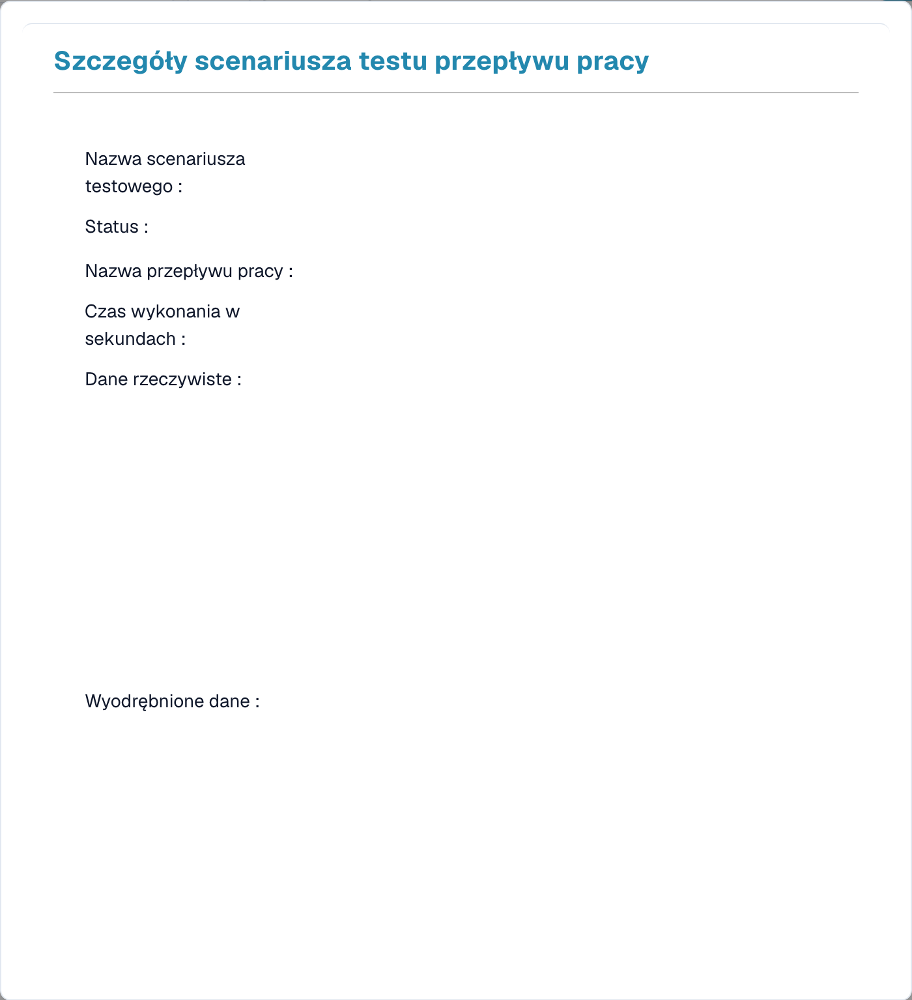

# Zarządzanie testami

**Zarządzanie testami** umożliwia zapisywanie wielokrotnego użytku **scenariuszy testowych** dla Twoich przepływów pracy i uruchamianie ich razem — dzięki czemu możesz potwierdzić, że przepływ pracy nadal działa poprawnie po wprowadzeniu w nim zmian. Działa zarówno dla przepływów Standard, jak i Advanced.

Otwórz go z poziomu **Panel przepływów → Lista testów**.

<figure><figcaption>
Test Manager List — każdy zapisany scenariusz pokazuje wynik zaliczono/niezaliczono.
</figcaption></figure>

## Czym jest scenariusz testowy

Scenariusz testowy obejmuje przepływ pracy, przykładowe dane wejściowe oraz **oczekiwany wynik**. Po uruchomieniu Test Manager odtwarza przepływ pracy na tych danych wejściowych i porównuje rezultat z tym, czego oczekiwałeś — zmieniając wiersz na **zielony** (zaliczono) lub **czerwony** (niezaliczono).

## Praca ze scenariuszami

- **Dodaj scenariusz testowy** — utwórz nowy scenariusz na podstawie przepływu pracy i przykładowego dokumentu.
- **Uruchom wszystkie testy** — uruchom wszystkie scenariusze naraz i zobacz na pierwszy rzut oka, które przepływy pracy nadal są zaliczane.
- **Zobacz szczegóły** — otwórz scenariusz, aby sprawdzić jego wynik.

<figure><figcaption>
Szczegóły scenariusza testowego z ukrytymi danymi.
</figcaption></figure>

Widok szczegółów pokazuje nazwę scenariusza i **status**, **nazwę przepływu pracy**, **czas uruchomienia** oraz **rzeczywiste** i **wyodrębnione dane** wygenerowane przez uruchomienie — dzięki czemu widzisz dokładnie, dlaczego scenariusz został zaliczony lub niezaliczony.

## Test Manager a testowanie w kreatorze

To dwie różne rzeczy:

- **Zarządzanie testami** (ta strona) — *zapisane, powtarzalne* scenariusze z oczekiwanymi wynikami, uruchamiane razem za pomocą **Uruchom wszystkie testy**. Używaj go do testów regresji po wprowadzeniu zmian.
- **Testowanie w kreatorze** — wbudowane elementy sterujące **Uprawomocnić** i **Test** wewnątrz kreatora Advanced Workflow, do szybkich kontroli podczas budowania. Zobacz [Walidacja i testowanie](advanced-workflow/validation-and-testing.md).
