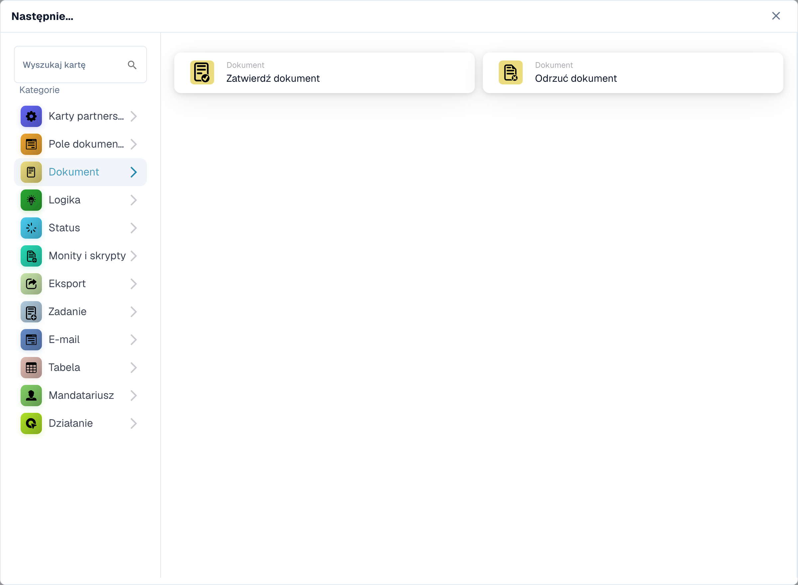
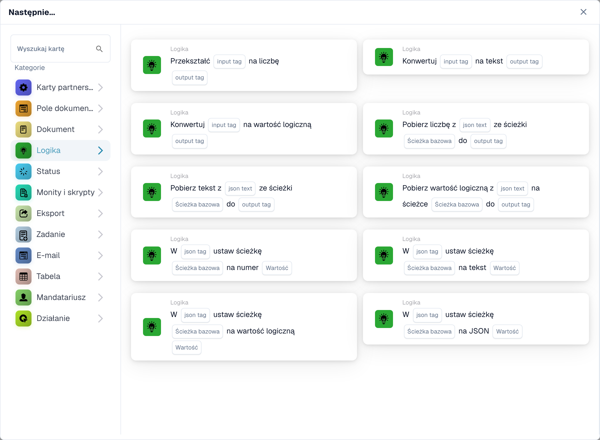
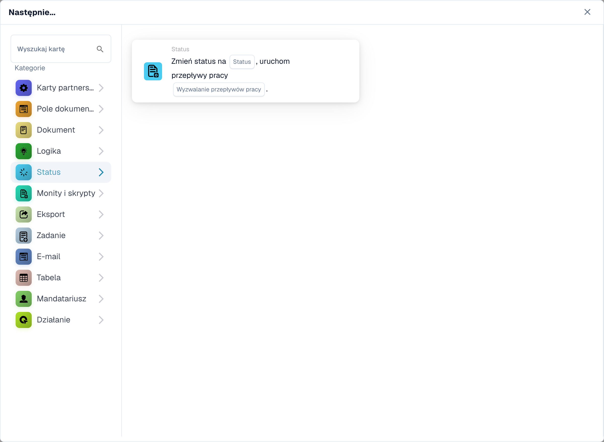
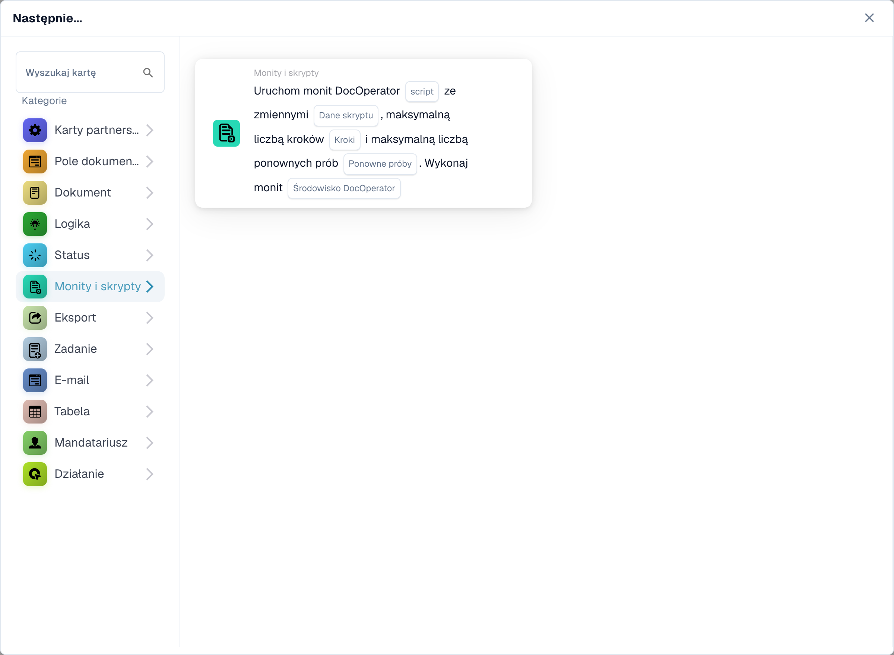
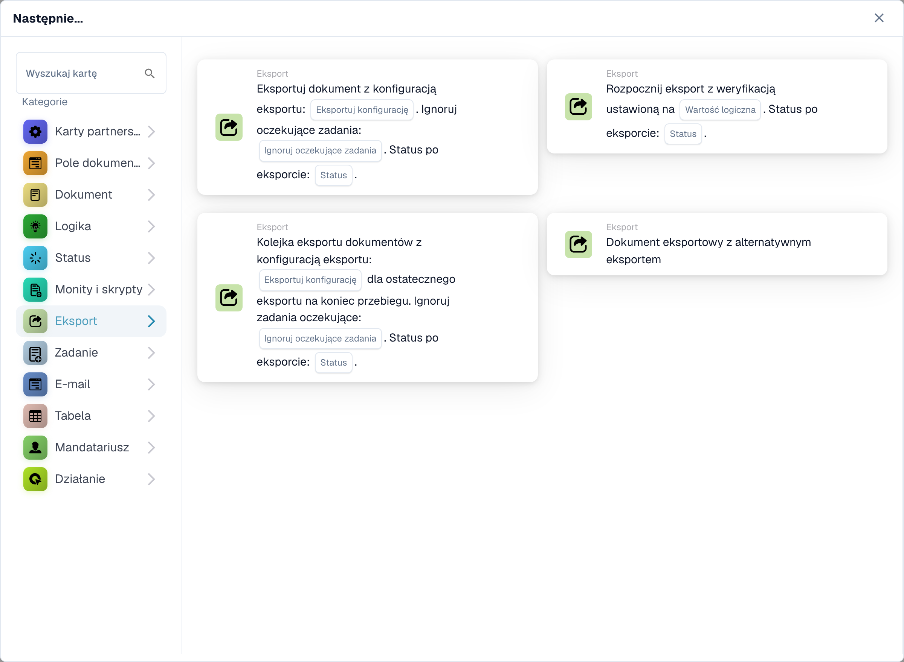
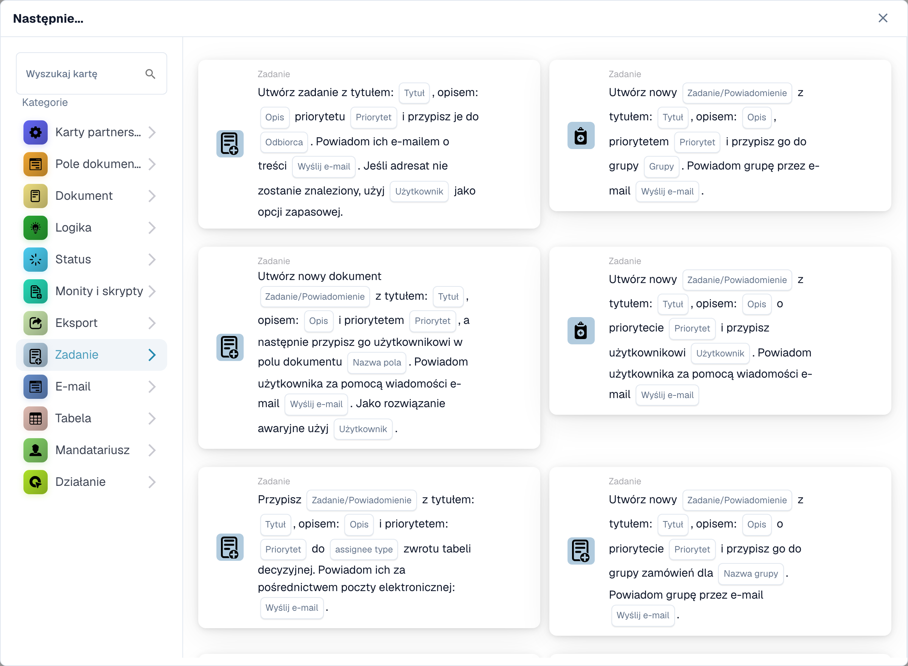
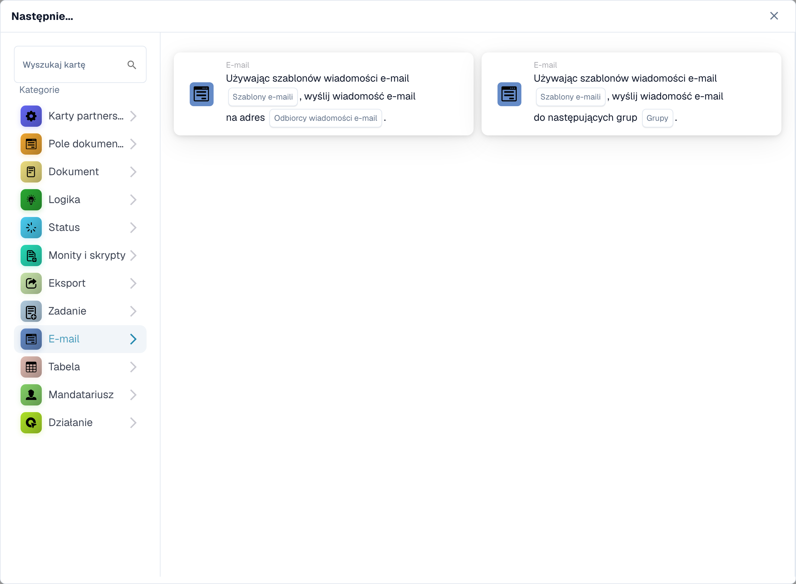
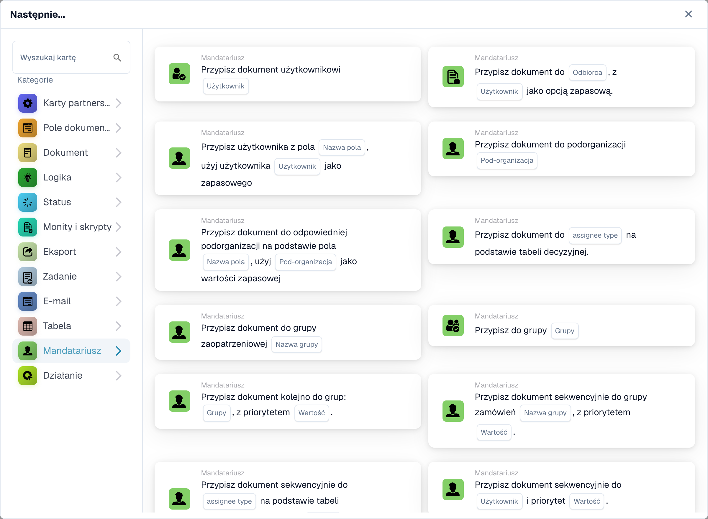
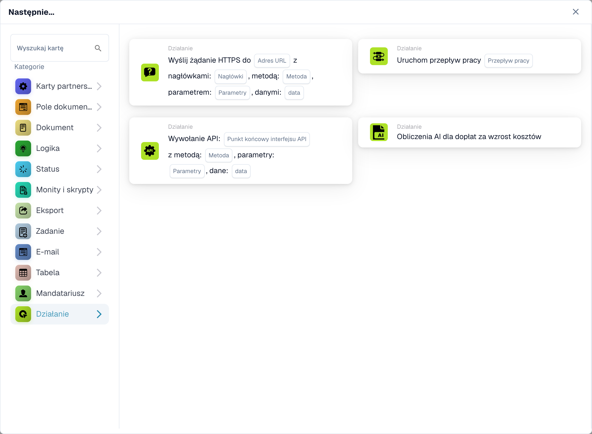

# Wtedy

Karta **Wtedy** informuje przepływ pracy, co ma zrobić po wyzwoleniu **Kiedy** i wszelkich warunkach **I**. W **Kreatorze przepływu pracy** wybierz **Dodaj kartę** w obszarze **Następnie...**. Wybierz kategorię po lewej stronie lub wpisz nazwę w **Karta wyszukiwania**. Wybierz podgląd karty, aby go dodać, wypełnij pola widoczne na karcie i zapisz przepływ pracy. Przewiń selektor, aby zobaczyć więcej kart. Wybierz **×**, aby zamknąć bez dodawania karty. Pełną sekwencję można znaleźć w [Przebieg pracy](..).

Poniższe podglądy pokazują dostępne działania, a nie ukończone ustawienia. Wybierz działanie, które odpowiada pożądanemu wynikowi.

## Pole dokumentu

Ustaw lub odwróć pole wyboru, umieść tekst w polu lub skopiuj jedno pole do drugiego. Wybierz nazwy pól i wartość wymaganą przez kartę. Zobacz [Pole dokumentu](document-field).

<figure><figcaption>
Karty dostępne w wybranej kategorii. Uzupełnij pola przed użyciem. Niektóre etykiety tej wersji interfejsu nie są jeszcze przetłumaczone lub mają nieprawidłowe tłumaczenie. Objaśnienia na tej stronie używają właściwych terminów; obraz przedstawia rzeczywisty interfejs.
</figcaption></figure>

## Dokument

Wybierz **Zatwierdź dokument** lub **Odrzuć dokument**, gdy przepływ pracy powinien podjąć tę decyzję. Jeśli zatwierdzenie ma zależeć od sprawdzenia, użyj najpierw warunku **I**. Zobacz [Dokument](document).

<figure><figcaption>
Karty dostępne w wybranej kategorii. Uzupełnij pola przed użyciem. Niektóre etykiety tej wersji interfejsu nie są jeszcze przetłumaczone lub mają nieprawidłowe tłumaczenie. Objaśnienia na tej stronie używają właściwych terminów; obraz przedstawia rzeczywisty interfejs.
</figcaption></figure>

## Logika

Użyj tych kart, aby przekonwertować wartości między formatami liczbowymi, tekstowymi i boolowskimi lub odczytać wartość z formatu JSON. Wybierz pola wejściowe i wyjściowe na wybranej karcie.

<figure><figcaption>
Karty dostępne w wybranej kategorii. Uzupełnij pola przed użyciem. Niektóre etykiety tej wersji interfejsu nie są jeszcze przetłumaczone lub mają nieprawidłowe tłumaczenie. Objaśnienia na tej stronie używają właściwych terminów; obraz przedstawia rzeczywisty interfejs.
</figcaption></figure>

## Stan

Wybierz **Zmień status**, aby przenieść dokument do wybranego statusu. Karta może także uruchomić inny przepływ pracy. Zobacz [Status](status).

<figure><figcaption>
Karty dostępne w wybranej kategorii. Uzupełnij pola przed użyciem. Niektóre etykiety tej wersji interfejsu nie są jeszcze przetłumaczone lub mają nieprawidłowe tłumaczenie. Objaśnienia na tej stronie używają właściwych terminów; obraz przedstawia rzeczywisty interfejs.
</figcaption></figure>

## Podpowiedzi i skrypty

Wybierz tę kategorię, aby uruchomić skrypt zachęty DocOperator. Wybierz skrypt i zmienne wymagane przez kartę. Karta oferuje również ustawienia wykonywania, takie jak ponowne próby.

<figure><figcaption>
Karty dostępne w wybranej kategorii. Uzupełnij pola przed użyciem. Niektóre etykiety tej wersji interfejsu nie są jeszcze przetłumaczone lub mają nieprawidłowe tłumaczenie. Objaśnienia na tej stronie używają właściwych terminów; obraz przedstawia rzeczywisty interfejs.
</figcaption></figure>

## Eksportuj

Rozpocznij eksport, eksportuj z wybraną konfiguracją lub wstaw do kolejki końcowy eksport. Wybierz opcję eksportu konfiguracji i zadania oczekującego widoczną na Twojej karcie. Zobacz [Eksport](export).

<figure><figcaption>
Karty dostępne w wybranej kategorii. Uzupełnij pola przed użyciem. Niektóre etykiety tej wersji interfejsu nie są jeszcze przetłumaczone lub mają nieprawidłowe tłumaczenie. Objaśnienia na tej stronie używają właściwych terminów; obraz przedstawia rzeczywisty interfejs.
</figcaption></figure>

## Zadanie

Utwórz zadanie lub powiadomienie i przypisz je do użytkownika lub grupy. Wprowadź tytuł, opis, priorytet i ustawienia powiadomień wymagane przez kartę. Niektóre karty przydzielane są sekwencyjnie. Zobacz [Zadanie](task).

<figure><figcaption>
Karty dostępne w wybranej kategorii. Uzupełnij pola przed użyciem. Niektóre etykiety tej wersji interfejsu nie są jeszcze przetłumaczone lub mają nieprawidłowe tłumaczenie. Objaśnienia na tej stronie używają właściwych terminów; obraz przedstawia rzeczywisty interfejs.
</figcaption></figure>

## E-mail

Wyślij wiadomość e-mail przy użyciu wybranego szablonu do odbiorców lub grup. Wybierz szablon i miejsce docelowe na karcie.

<figure><figcaption>
Karty dostępne w wybranej kategorii. Uzupełnij pola przed użyciem. Niektóre etykiety tej wersji interfejsu nie są jeszcze przetłumaczone lub mają nieprawidłowe tłumaczenie. Objaśnienia na tej stronie używają właściwych terminów; obraz przedstawia rzeczywisty interfejs.
</figcaption></figure>

## Tabela

Zmień wpisy lub oblicz wartości w tabeli dokumentu. Wybierz tabelę, kolumny, operator i kolumnę wynikową żądaną przez kartę. Zobacz [Tabela](table).

<figure><figcaption>
Karty dostępne w wybranej kategorii. Uzupełnij pola przed użyciem. Niektóre etykiety tej wersji interfejsu nie są jeszcze przetłumaczone lub mają nieprawidłowe tłumaczenie. Objaśnienia na tej stronie używają właściwych terminów; obraz przedstawia rzeczywisty interfejs.
</figcaption></figure>

## Osoba przypisana

Przypisz dokument do użytkownika, grupy, odbiorcy lub organizacji podrzędnej. Niektóre karty wykorzystują pola lub tabelę decyzyjną i oferują rozwiązanie awaryjne. Wybierz właściwe miejsce docelowe i rezerwuj na wybranej karcie. Zobacz [Cesjonariusz](assignee).

<figure><figcaption>
Karty dostępne w wybranej kategorii. Uzupełnij pola przed użyciem. Niektóre etykiety tej wersji interfejsu nie są jeszcze przetłumaczone lub mają nieprawidłowe tłumaczenie. Objaśnienia na tej stronie używają właściwych terminów; obraz przedstawia rzeczywisty interfejs.
</figcaption></figure>

## Akcja

Uruchom inny przepływ pracy, wyślij żądanie HTTPS, wywołaj API lub skorzystaj z karty kalkulacyjnej zwiększającej koszty. Działania te mogą mieć wpływ na inne systemy; zapytaj administratora, jakiego punktu końcowego i ustawień użyć. Zobacz [Akcja](action).

<figure><figcaption>
Karty dostępne w wybranej kategorii. Uzupełnij pola przed użyciem. Niektóre etykiety tej wersji interfejsu nie są jeszcze przetłumaczone lub mają nieprawidłowe tłumaczenie. Objaśnienia na tej stronie używają właściwych terminów; obraz przedstawia rzeczywisty interfejs.
</figcaption></figure>

[Szczegółowe pola karty logicznej, ścieżki JSON, wyzwalacze i testy](../cards-overview/logic-cards-guide.md).
