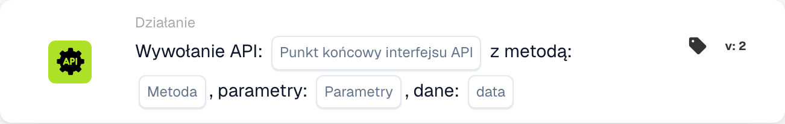

# Zadzwoń do API

<figure><figcaption>
Pola karty w pokazanej wersji. Pola nie są jeszcze skonfigurowane.
</figcaption></figure>

<!-- workflow-card-call-api-contract-20261022 -->

## Cel

Użyj `call_api`, aby wywołać punkt końcowy skonfigurowanego API DocBits. Ścieżka względna jest dołączana do adresu bazowego. Dowolny zewnętrzny URL nie konfiguruje integracji z innym API.

## Konfiguracja

Podaj ścieżkę, metodę HTTP, parametry zapytania i dane obsługiwane przez punkt końcowy. Żądanie korzysta z kontekstu bieżącego użytkownika DocBits. Brakujące wartości `org_id` i `triggered_by_docflow` są dodawane automatycznie. Obiekty parametrów i danych lub ich obsługiwana postać tekstowa muszą odpowiadać formatowi tej wersji karty. Nie ma ogólnego mapowania pól odpowiedzi JSON.

## Wynik i ograniczenia

Tekst odpowiedzi jest konwertowany na wartość logiczną: samo `true`, `1`, `yes` lub `on` daje prawdę; nierozpoznana odpowiedź, w tym dowolny obiekt JSON, domyślnie daje fałsz. Sam status HTTP nie wyznacza tej wartości. Przekroczenie czasu lub błąd żądania daje fałsz. Test karty symuluje wywołanie i zwraca prawdę bez wysłania żądania; nie potwierdza uwierzytelnienia, dostępności ani zachowania punktu końcowego.

<!-- workflow-card-practical-example-20261021 -->

## Przykład praktyczny

Użyj tej karty po wymaganych warunkach, gdy potrzebujesz wartości logicznej ze skonfigurowanego punktu końcowego API DocBits. W izolowanym teście wybierz istniejący, udokumentowany punkt tylko do odczytu z odpowiednim kontraktem odpowiedzi logicznej i właściwą metodą, np. `GET`. Używaj wyłącznie obsługiwanych parametrów demonstracyjnych.

Oczekiwany wynik i kontrprzykład: hipotetyczna odpowiedź HTTP `200` o pełnej treści `true` daje prawdę; `false` daje fałsz. Obiekt taki jak `{"approved": true}` nie jest automatycznie mapowany na prawdę. Oddzielnie sprawdź rzeczywistą odpowiedź i logi. Przykład zweryfikowano w kodzie wykonawczym; nie wykonano żądania ani przepływu.
