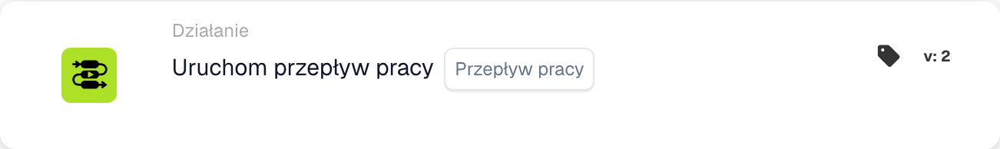

# Uruchom przepływ pracy

<figure><figcaption>
Pola karty w pokazanej wersji. Pola nie są jeszcze skonfigurowane.
</figcaption></figure>

## Cel:

Karta **„Uruchom przepływ pracy”** umożliwia użytkownikom dynamiczne wykonanie wybranego przepływu pracy z listy dostępnych przepływów pracy. Ta karta jest przydatna do automatyzacji procesów, w których wiele przepływów pracy jest ze sobą powiązanych, umożliwiając usprawnione operacje.

## Komponenty karty:

1. **Przebieg pracy**
   * **Opis:** Określa przepływ pracy, który ma zostać wykonany, gdy warunki są prawdziwe.
   * **Szczegóły:** Do wyboru udostępniana jest lista rozwijana wszystkich dostępnych przepływów pracy.

## Funkcjonalność:

* **Ocena warunku:** Karta wykonuje wybrany przepływ pracy tylko wtedy, gdy zarówno **„Kiedy”**, jak i **„I sekcje”** są prawdziwe.
  * Jeśli którykolwiek z warunków jest fałszywy, nie jest podejmowana żadna akcja, a przepływ pracy pozostaje niewyzwolony.
* **Wykonanie przepływu pracy:**
  * Gdy warunki są spełnione, określony przepływ pracy jest wyzwalany automatycznie.
  * Jeśli warunki nie są spełnione, żaden przepływ pracy nie jest wykonywany.

## Konfiguracja:

1. **Wybierz przepływ pracy:** Wybierz przepływ pracy do wyzwolenia z **listy rozwijanej** dostępnych przepływów pracy.
2. **Zdefiniuj warunki:** Skonfiguruj sekcje **„Kiedy”** i **„I sekcje”**, aby określić kryteria, które muszą zostać spełnione, aby przepływ pracy został wykonany.

## Podsumowanie:

Karta **„Uruchom przepływ pracy”** oferuje wygodny i efektywny sposób łączenia przepływów pracy, automatyzując wieloetapowe procesy z łatwością. Zapewniając, że warunki w sekcjach **„Kiedy”** i **„I sekcje”** są spełnione, użytkownicy mogą dynamicznie wykonywać przepływy pracy i redukować ręczną interwencję.

<!-- workflow-card-practical-example-20261021 -->

## Praktyczny przykład

**Kiedy używać:** Ponowne wykorzystanie istniejącego przepływu pracy walidacji.

**Konfiguracja:** Wybierz skonfigurowany przepływ pracy podrzędny demonstracyjny, który ustawia `routing_result` na `checked`.

**Oczekiwany wynik i kontrprzykład:** Wybrany przepływ pracy jest wywoływany w obsługiwanym kontekście wykonania. Zweryfikuj swój własny wynik w dzienniku i polu; nie łącz go z powrotem z rodzicem w pętli.

To jest ilustracyjna konfiguracja i oczekiwany wynik. Korzystaj z pól, użytkowników i grup skonfigurowanych w Twojej organizacji testowej; nie jest to twierdzenie, że ten przykład został wykonany.
