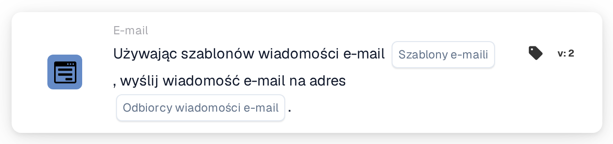

# Wyślij e-mail

<figure><figcaption>
Wersja 2
</figcaption></figure>

## Cel:

Ta karta przepływu pracy wysyła wiadomość e-mail na podstawie jednego lub kilku szablonów e-maili. Odbiorcy nie są wprowadzani jako stałe adresy: są wybierani według ich roli w przepływie pracy, na przykład użytkownik lub grupa, do których przypisany jest dokument, albo użytkownicy i grupy zwróceni przez tabelę decyzyjną. Dzięki temu przepływ pracy pozostaje aktualny, gdy zmieniają się osoby pełniące te role.

Aby zamiast tego wysłać wiadomość e-mail do wybranych grup użytkowników, można użyć karty **Send Email to Groups**, zobacz [Send Email to Groups](send-email-groups-guide.md).

## Komponenty karty:

1. **Szablony e-maili**
   * **Opis:** Szablony e-maili używane dla wiadomości.
   * **Szczegóły:** Można wybrać jeden lub kilka szablonów e-maili organizacji. Każdy wybrany szablon jest wysyłany do każdego odbiorcy. Gdy przepływ pracy działa dla dokumentu, szablon skonfigurowany dla określonego typu dokumentu jest wysyłany tylko wtedy, gdy dokument ma ten typ dokumentu.
2. **Odbiorcy wiadomości e-mail**
   * **Opis:** Kto otrzymuje wiadomość e-mail.
   * **Opcje:** Można wybrać jedną lub kilka z następujących opcji:
     * **Przypisany użytkownik/grupa dokumentu:** Użytkownik lub grupa, do których dokument jest aktualnie przypisany.
     * **Zwrócony użytkownik/grupa tabeli decyzyjnej:** Użytkownicy i grupy zwróceni przez tabelę decyzyjną ocenianą wcześniej w tym samym przepływie pracy, na przykład za pomocą karty **Decision Table has Returns**.
     * **Użytkownik przypisany do dostawcy:** Przypisany użytkownik dostawcy, w przepływach pracy uruchamianych przez zmianę statusu dostawcy.
     * **Polecający dostawcę:** Osoba polecająca dostawcę, w przepływach pracy uruchamianych przez zmianę statusu dostawcy.

## Funkcjonalność:

* **Zbieranie odbiorców:** Karta zbiera odbiorców ze wszystkich wybranych opcji. Odbiorca wynikający z więcej niż jednej opcji otrzymuje wiadomość e-mail tylko raz.
* **Wykonanie akcji:** Wiadomość e-mail jest wysyłana z użyciem wybranych szablonów. Gdy przepływ pracy działa dla dokumentu, szablony mogą wykorzystywać wartości pól dokumentu. Wynik jest zapisywany w dzienniku przepływu pracy wraz z nazwami odbiorców.
* **Bez dokumentu:** Karta może działać również w przepływach pracy, które nie są uruchamiane dla dokumentu, na przykład w przepływach pracy uruchamianych przez zmianę statusu dostawcy. W takim przepływie pracy opcja **Przypisany użytkownik/grupa dokumentu** nie dodaje odbiorcy.
* **Brakujące dane:**
  * Jeśli na karcie nie wybrano szablonu e-maila lub żadnej opcji odbiorców, karta nie jest wykonywana i zgłasza brakujące dane w dzienniku przepływu pracy.
  * Jeśli wybrana opcja nie prowadzi do żadnej osoby, na przykład dlatego, że dokument nie ma osoby przypisanej lub tabela decyzyjna nikogo nie zwróciła, ta opcja nie dodaje odbiorcy.
* **Błędy:** Jeśli usługa e-mail odrzuci żądanie lub nie odpowie na czas, karta kończy się błędem.

## Instalacja i konfiguracja:

* Szablony e-maili powinny zostać skonfigurowane w organizacji, zanim będzie można je wybrać na karcie.
* Kartę można dodać z kategorii **E-mail**. Następnie w polu **Szablony e-maili** wybiera się jeden lub kilka szablonów, a w polu **Odbiorcy wiadomości e-mail** jedną lub kilka opcji.
* Dla opcji **Zwrócony użytkownik/grupa tabeli decyzyjnej** tabela decyzyjna powinna zostać oceniona wcześniej w tym samym przepływie pracy.

## Podsumowanie:

Karta przepływu pracy „Send Email” automatycznie informuje osoby zaangażowane w proces dotyczący dokumentu lub dostawcy, korzystając z przygotowanych szablonów. Ponieważ odbiorcy są wybierani według roli, ten sam przepływ pracy nadal dociera do właściwych osób, gdy zmieniają się przypisania.
