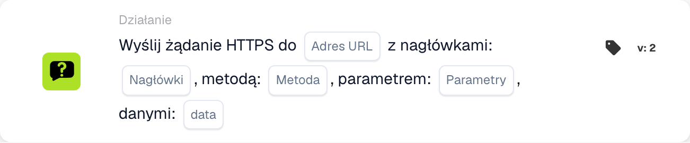

# Wyślij żądanie HTTPS do

<figure><figcaption>
Pola karty w pokazanej wersji. Pola nie są jeszcze skonfigurowane.
</figcaption></figure>

## Cel:

Karta przepływu pracy **"Send HTTPS Request"** umożliwia użytkownikom wysyłanie żądań HTTPS do określonego adresu URL z konfigurowalnymi nagłówkami, parametrami i ładunkiem danych. Ta karta jest idealna do integracji zewnętrznych interfejsów API lub usług sieciowych bezpośrednio z przepływem pracy.

## Komponenty karty:

1. **Adres URL**
   * **Opis:** Określa punkt końcowy, do którego zostanie wysłane żądanie HTTPS.
   * **Szczegóły:** Wprowadź pełny adres URL API lub usługi sieciowej, z którą chcesz się połączyć.
2. **Nagłówki**
   * **Opis:** Definiuje nagłówki, które mają zostać uwzględnione w żądaniu HTTPS.
   * **Szczegóły:** Podaj **pary klucz-wartość** w **prawidłowym formacie JSON**, aby określić nagłówki, takie jak tokeny uwierzytelniania lub typy treści. Przykład: {"Authorization": "Bearer example\_value"}
3. **Metoda**
   * **Opis:** Określa metodę HTTP, która ma być użyta w żądaniu.
   * **Opcje:**
     * **GET:** Pobiera dane z punktu końcowego.
     * **POST:** Wysyła dane do punktu końcowego w celu utworzenia lub aktualizacji zasobów.
     * **PUT:** Aktualizuje istniejące zasoby w punkcie końcowym.
     * **DELETE:** Usuwa zasoby z punktu końcowego.
4. **Parametry**
   * **Opis:** Pary klucz-wartość, które mają zostać uwzględnione w adresie URL jako parametry zapytania.
   * **Szczegóły:** Użyj tego, aby wysłać filtry lub dodatkowe dane wymagane przez punkt końcowy w prawidłowym formacie JSON. Zobacz przykład dla Headers.
5. **Dane**
   * **Opis:** Treść żądania HTTPS.
   * **Szczegóły:** Podaj ładunek w prawidłowym formacie JSON. Zobacz przykład dla Headers.

## Funkcjonalność:

* **Ocena warunku:** Karta wysyła żądanie HTTPS tylko wtedy, gdy sekcje **„Kiedy”** i **„I”** są prawdziwe.
  * Jeśli którykolwiek z warunków jest fałszywy, żądanie nie jest wysyłane.
* **Wykonanie żądania:**
  * Gdy warunki są spełnione, system wysyła żądanie HTTPS z określonymi konfiguracjami.

## Konfiguracja:

1. **Define URL:** Wprowadź punkt końcowy, do którego ma zostać wysłane żądanie HTTPS.
2. **Ustaw nagłówki:** Podaj wymagane nagłówki jako pary klucz-wartość.
3. **Wybierz metodę HTTP:** Wybierz odpowiednią metodę (**GET**, **POST**, **PUT** lub **DELETE**) na podstawie akcji do wykonania.
4. **Add Parameters:** Określ wszelkie parametry zapytania wymagane przez punkt końcowy.
5. **Podaj ładunek danych:** Wprowadź treść żądania w wymaganym formacie (np. JSON), jeśli jest to potrzebne.
6. **Konfiguracja warunków:** Zdefiniuj sekcje **„Kiedy”** i **„I”**, aby zapewnić, że żądanie jest wysyłane tylko wtedy, gdy spełnione są określone warunki.

## Przykładowa karta:

<figure><figcaption>
Pola karty w pokazanej wersji. Pola nie są jeszcze skonfigurowane.
</figcaption></figure>

## Podsumowanie:

Karta przepływu pracy **"Send HTTPS Request"** upraszcza integrację API, umożliwiając użytkownikom wykonywanie niestandardowych żądań do usług zewnętrznych bezpośrednio z ich przepływów pracy. Automatyzując proces wysyłania żądań HTTPS i zarządzania odpowiedziami, karta ta zwiększa elastyczność i funkcjonalność przepływu pracy.
