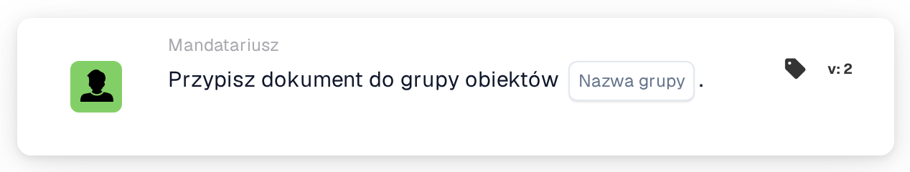

# Przypisz dokument do grupy obiektu

<figure><figcaption>
Wersja 2
</figcaption></figure>

## Cel:

Ta karta przepływu pracy przypisuje dokument do grupy odpowiedzialnej za obiekt jego zamówienia zakupu. Obiekt nie jest wybierany na karcie: jest pobierany z zamówień zakupu, z którymi dokument został dopasowany. Następnie karta wyszukuje grupę użytkowników, której nazwa zawiera zarówno nazwę grupy wprowadzoną na karcie, jak i kod obiektu, i przypisuje dokument do tej grupy.

Jest to przydatne, gdy ten sam rodzaj zespołu istnieje raz na każdy obiekt, na przykład jedna grupa zatwierdzająca na zakład lub magazyn, a każdy dokument powinien trafić do zespołu obiektu, dla którego złożono zamówienie.

Do przypisania, które zamiast bezpośrednio jest dodawane do sekwencji osób zatwierdzających, można użyć karty **Assign Sequentially to Facility Group**.

## Komponenty karty:

1. **Nazwa grupy**
   * **Opis:** Część nazwy wspólna dla grup obiektów.
   * **Szczegóły:** Tekst porównywany z nazwami grup użytkowników organizacji. Grupa jest zgodna, jeśli jej nazwa zawiera ten tekst oraz kod obiektu zamówienia zakupu. Porównanie nie uwzględnia wielkości liter. Na przykład przy nazwie grupy **Approver** i zamówieniu zakupu dla obiektu **1000** zgodna byłaby grupa o nazwie **Approver 1000**.

## Funkcjonalność:

* **Ustalanie obiektu:** Karta odczytuje zamówienia zakupu, z którymi dopasowano dokument, i zbiera kod obiektu (lokalizację zamówienia zakupu) każdego z nich.
* **Ustalanie grupy:** Dla każdego kodu obiektu karta wyszukuje grupy użytkowników, których nazwa zawiera zarówno **Nazwa grupy** z karty, jak i kod obiektu. Kody obiektów, dla których nie znaleziono grupy, są wymieniane w dzienniku przepływu pracy.
* **Wykonanie akcji:** Dokument zostaje przypisany do zgodnej grupy. Jeśli zgodnych jest kilka grup, na przykład dlatego, że dokument jest dopasowany do zamówień zakupu różnych obiektów, dokument zostaje przypisany tylko do jednej z nich; karta nie określa, do której.
* **Brakujące dane:**
  * Jeśli na karcie nie wprowadzono nazwy grupy, karta nie jest wykonywana i zgłasza brakujące dane w dzienniku przepływu pracy.
  * Jeśli dokument nie jest dopasowany do zamówienia zakupu, karta zgłasza brakujące dane zamiast przypisać dokument.
  * Jeśli żadna grupa nie odpowiada żadnemu z kodów obiektów, dokument nie zostaje przypisany, a dziennik przepływu pracy odnotowuje, że nie znaleziono zgodnej grupy.

## Instalacja i konfiguracja:

* Grupy użytkowników powinny mieć takie nazwy, aby każda zawierała wspólną część nazwy oraz kod obiektu, na przykład **Approver 1000**, **Approver 2000**.
* Kartę można dodać z kategorii **Mandatariusz**. Następnie wspólną część nazwy grup wprowadza się w polu **Nazwa grupy**.
* Ponieważ obiekt pochodzi z dopasowanych zamówień zakupu, kartę najlepiej stosować w przepływach pracy dla dokumentów, które zostały już dopasowane do zamówienia zakupu.

## Podsumowanie:

Karta przepływu pracy „Assign Document to Facility Group” kieruje dokumenty do zespołu obiektu, dla którego złożono zamówienie. Jedna karta obejmuje wszystkie obiekty, o ile grupy użytkowników stosują spójny schemat nazewnictwa z kodem obiektu w nazwie.
