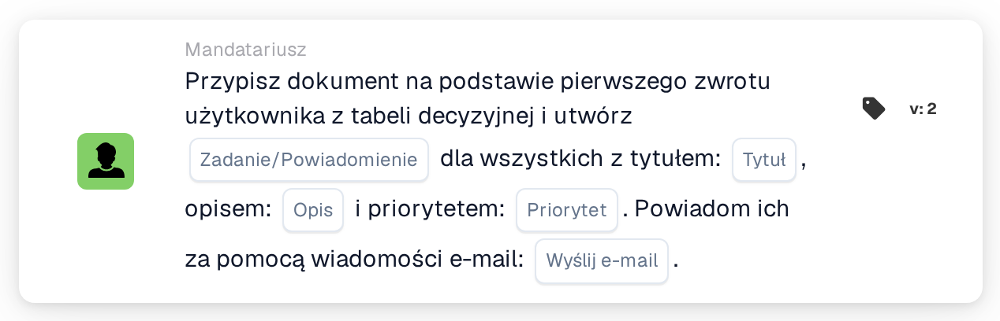

# Przypisz dokument do pierwszego użytkownika z tabeli decyzyjnej i utwórz zadania

<figure><figcaption>
Wersja 2
</figcaption></figure>

## Cel:

Ta karta przepływu pracy wykorzystuje użytkowników zwróconych przez tabelę decyzyjną na dwa sposoby: dokument zostaje przypisany do pierwszego zwróconego użytkownika, a każdy zwrócony użytkownik, łącznie z pierwszym, otrzymuje zadanie lub powiadomienie dotyczące dokumentu. W ten sposób jedna osoba staje się odpowiedzialna za dokument, a pozostałe zostają poinformowane lub również poproszone o działanie.

Użytkownicy pochodzą z tabeli decyzyjnej ocenianej wcześniej w tym samym przepływie pracy, na przykład za pomocą karty **Decision Table has Returns** ustawionej tak, aby zwrócone dane były używane w kolejnych kartach.

## Komponenty karty:

1. **Zadanie/Powiadomienie**
   * **Opis:** Określa, czy dla zwróconych użytkowników tworzone jest zadanie, czy powiadomienie.
   * **Opcje:**
     * **Zadanie:** Dla każdego użytkownika tworzone jest zadanie.
     * **Powiadomienie:** Dla każdego użytkownika tworzone jest powiadomienie.
2. **Tytuł**
   * **Opis:** Tytuł zadania lub powiadomienia.
   * **Szczegóły:** Krótki tekst identyfikujący zadanie lub powiadomienie.
3. **Opis**
   * **Opis:** Dodatkowe szczegóły dotyczące zadania lub powiadomienia.
   * **Szczegóły:** Tekst opisujący, co powinno zostać zrobione lub dlaczego użytkownicy są informowani.
4. **Priorytet**
   * **Opis:** Pilność zadania lub powiadomienia.
   * **Opcje:**
     * **duża waga:** Zadanie lub powiadomienie jest tworzone z wysokim priorytetem.
     * **średnia waga:** Zadanie lub powiadomienie jest tworzone ze średnim priorytetem.
     * **niska waga:** Zadanie lub powiadomienie jest tworzone z niskim priorytetem.
5. **Wyślij e-mail**
   * **Opis:** Określa, czy użytkownicy są dodatkowo informowani o zadaniu lub powiadomieniu e-mailem.
   * **Opcje:**
     * **PRAWDA:** Wysyłane jest powiadomienie e-mail.
     * **FAŁSZ:** Powiadomienie e-mail nie jest wysyłane.

## Funkcjonalność:

* **Odczyt tabeli decyzyjnej:** Karta odczytuje użytkowników zwróconych przez tabelę decyzyjną wcześniej w przepływie pracy. Uwzględniani są wyłącznie zwróceni użytkownicy, a nie grupy.
* **Przypisanie dokumentu:** Dokument zostaje przypisany do pierwszego zwróconego użytkownika.
* **Tworzenie zadań:** Dla każdego zwróconego użytkownika tworzone jest zadanie lub powiadomienie z tytułem, opisem i priorytetem z karty. Każdy użytkownik otrzymuje własne zadanie. Zadania są tworzone nawet wtedy, gdy przypisanie dokumentu się nie powiodło; dziennik przepływu pracy pokazuje wynik przypisania i każdego zadania.
* **Wartości domyślne:** Jeśli priorytet nie jest ustawiony, używana jest **średnia waga**. Jeśli **Wyślij e-mail** nie jest ustawione, e-mail nie jest wysyłany. Jeśli **Zadanie/Powiadomienie** nie jest ustawione, tworzone jest zadanie, a dziennik przepływu pracy odnotowuje brakujące ustawienie.
* **Brakujące dane:**
  * Jeśli tabela decyzyjna nie zwróciła żadnego użytkownika, nic nie zostaje przypisane, a karta zgłasza brakujące dane w dzienniku przepływu pracy.
  * Jeśli tytuł lub opis jest pusty, dokument nie zostaje przypisany, żadne zadanie nie jest tworzone, a karta zgłasza brakujące dane.

## Instalacja i konfiguracja:

* Tabela decyzyjna zwracająca użytkowników powinna zostać oceniona wcześniej w przepływie pracy, na przykład za pomocą karty **Decision Table has Returns**. Kolejność zwróconych użytkowników ma znaczenie, ponieważ dokument otrzymuje pierwszy z nich.
* Kartę można dodać z kategorii **Mandatariusz**. Następnie można skonfigurować typ (**Zadanie** lub **Powiadomienie**), tytuł, opis, priorytet i ustawienie e-mail.

## Podsumowanie:

Karta przepływu pracy „Assign Document to First Decision Table User and Create Tasks” łączy jasną odpowiedzialność za dokument z informacją dla wszystkich osób wskazanych przez tabelę decyzyjną. Jest przydatna, gdy jedna osoba powinna być właścicielem dokumentu, a pozostałe powinny być zaangażowane lub informowane na bieżąco.
