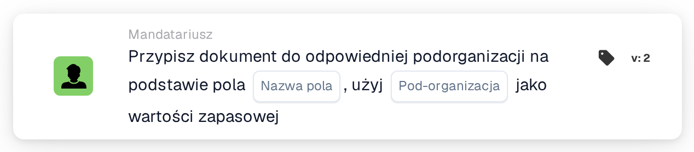

# Przypisz dokument do pasującej organizacji podrzędnej

<figure><figcaption>
Wersja 2
</figcaption></figure>

## **Cel:**

Karta przepływu pracy **„Przypisz dokument do pasującej podorganizacji na podstawie pola”** dynamicznie przypisuje dokument do sub-organizacji na podstawie określonego pola w dokumencie. Jeśli nie zostanie znaleziona pasująca sub-organizacja, karta używa predefiniowanej zapasowej sub-organizacji.

## **Komponenty karty:**

1. **Nazwa pola**
   * **Opis:** Określa pole dokumentu, które ma być użyte do ustalenia pasującej sub-organizacji.
   * **Szczegóły:** Karta wyszukuje wartość w określonym polu, aby dopasować ją do dostępnej sub-organizacji.
2. **Podorganizacja (awaryjna)**
   * **Opis:** Definiuje zapasową sub-organizację, która ma być użyta, jeśli nie zostanie znalezione dopasowanie w określonym polu.
   * **Szczegóły:** Jeśli wartość pola nie pasuje do żadnej sub-organizacji, dokument zostanie przypisany do wybranej zapasowej sub-organizacji.

## **Funkcjonalność:**

* **Ocena warunku:**\
  Karta wykonuje swoją akcję tylko wtedy, gdy zarówno **„Kiedy”**, jak i **„I sekcje”** są prawdziwe.
* **Dynamiczne przypisanie:**\
  Karta sprawdza wartość określonego pola i przypisuje dokument do sub-organizacji, która odpowiada tej wartości.
* **Mechanizm zapasowy:**\
  Jeśli nie zostanie znaleziona pasująca sub-organizacja, dokument jest przypisywany do zapasowej sub-organizacji.

## **Konfiguracja:**

* **Wybierz nazwę pola:**\
  Wybierz pole z dokumentu zawierające wartość do dopasowania do sub-organizacji.
* **Wybierz podorganizację zastępczą:**\
  Wybierz sub-organizację, która zostanie użyta, jeśli nie zostanie znalezione dopasowanie w polu dokumentu.

## **Podsumowanie:**

Karta przepływu pracy **„Przypisz dokument do pasującej podorganizacji na podstawie pola”** oferuje elastyczność, dynamicznie kierując dokumenty do odpowiedniej sub-organizacji, z dodatkową opcją zapasową, aby zapewnić, że żaden dokument nie pozostanie nieprzypisany.

<!-- workflow-card-practical-example-20261021 -->

## Praktyczny przykład

**Kiedy używać:** Wybierz jednostkę biznesową z wyodrębnionego pola routingu.

**Konfiguracja:** Ustaw pole routingu `business_unit` na skonfigurowaną nazwę podorganizacji `Demo North` i wybierz `Demo Default` jako rezerwę.

**Oczekiwany wynik i kontrprzykład:** Pasująca wartość pola wybiera `Demo North`. Nieznana nazwa używa `Demo Default`; przetestuj rezerwę przed włączeniem przepływu pracy.

To jest ilustracyjna konfiguracja i oczekiwany wynik. Korzystaj z pól, użytkowników i grup skonfigurowanych w Twojej organizacji testowej; nie jest to twierdzenie, że ten przykład został wykonany.
