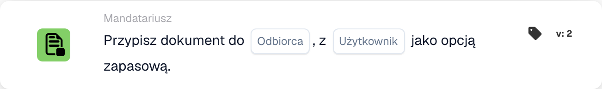

# Przypisz dokument do odbiorcy

<figure><figcaption>
Pola karty w pokazanej wersji. Pola nie są jeszcze skonfigurowane. Niektóre etykiety tej wersji interfejsu nie są jeszcze przetłumaczone lub mają nieprawidłowe tłumaczenie. Objaśnienia na tej stronie używają właściwych terminów; obraz przedstawia rzeczywisty interfejs.
</figcaption></figure>

## **Cel:**

Karta przepływu pracy **„Przypisz dokument do dysponenta/nabywcy”** przypisuje dokument do **Disponenta** lub **Zakup**. Jeśli nie zostanie znaleziony prawidłowy użytkownik, wybierany jest użytkownik zapasowy, aby zapewnić, że dokument jest zawsze do kogoś przypisany.

## **Komponenty karty:**

1. **Disponent / Nabywca**
   * **Opis:** Określa, czy dokument zostanie przypisany do Disponenta, czy Purchasera.
   * **Opcje:**
     * **Disponent:** Przypisz dokument do Disponenta.
     * **Kupujący:** Przypisz dokument do Purchasera.
2. **Użytkownik rezerwowy**
   * **Opis:** Określa użytkownika zapasowego na wypadek, gdyby dokumentu nie można było przypisać do wybranego Disponenta lub Purchasera.
   * **Szczegóły:** Lista rozwijana dostępnych użytkowników umożliwia wybór użytkownika zapasowego, aby zapewnić, że dokument zostanie przypisany, nawet jeśli podstawowego użytkownika nie można ustalić.

## **Funkcjonalność:**

* **Ocena warunku:**\
  Karta wykonuje swoją akcję tylko wtedy, gdy zarówno **„Kiedy”**, jak i **„I sekcje”** są prawdziwe.
* **Przypisanie dokumentu:**\
  Karta przypisuje dokument do **Disponenta** lub **Zakup** zgodnie z wyborem. Jeśli wybrana osoba jest niedostępna lub nieprawidłowa, dokument jest przypisywany do użytkownika zapasowego.

## **Konfiguracja:**

* **Wybierz sprzedawcę/nabywcę:**\
  Wybierz, czy przypisać dokument do **Disponenta**, czy **Zakup**.
* **Wybierz użytkownika zastępczego:**\
  Wybierz użytkownika zapasowego z listy rozwijanej, który otrzyma dokument, jeśli podstawowe przypisanie nie będzie możliwe.

## **Podsumowanie:**

Karta przepływu pracy **„Przypisz dokument do dysponenta/nabywcy”** zapewnia, że dokument jest zawsze przypisany, albo do wybranego Disponenta/Purchasera, albo, w razie potrzeby, do użytkownika zapasowego. Minimalizuje to zakłócenia w przepływie pracy i zapewnia płynne kontynuowanie przetwarzania dokumentów.

<!-- workflow-card-practical-example-20261021 -->

## Praktyczny przykład

**Kiedy używać:** Przypisz dokument do ustalonego odbiorcy, korzystając z bezpiecznego rozwiązania awaryjnego.

**Konfiguracja:** Wybierz źródło odbiorcy i użytkownika rezerwowego `Demo Reviewer A`.

**Oczekiwany wynik i kontrprzykład:** Rozwiązalny odbiorca otrzymuje zadanie. Jeśli nie można rozpoznać odbiorcy, używana jest skonfigurowana opcja zastępcza. Sprawdź obie ścieżki.

To jest ilustracyjna konfiguracja i oczekiwany wynik. Korzystaj z pól, użytkowników i grup skonfigurowanych w Twojej organizacji testowej; nie jest to twierdzenie, że ten przykład został wykonany.
