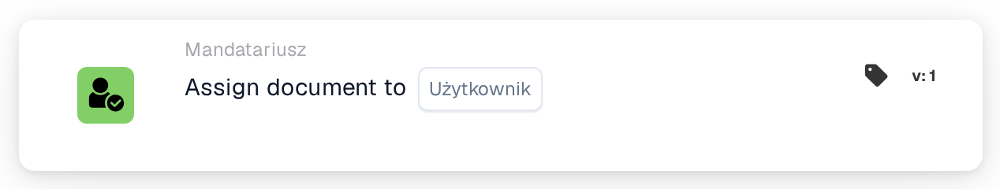
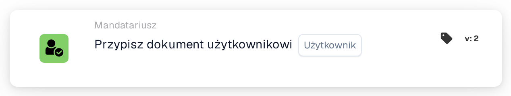
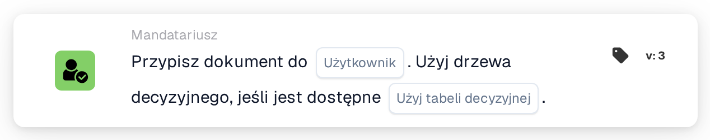

# Przypisz dokument do Użytkownika

<figure><figcaption>
Wersja 1
</figcaption></figure>

<figure><figcaption>
Wersja 2
</figcaption></figure>

<figure><figcaption>
Wersja 3
</figcaption></figure>

## **Cel:**

Karta przepływu pracy **"Assign Document to User"** umożliwia użytkownikom przypisanie dokumentu do określonego użytkownika, zapewniając płynne zarządzanie przepływem pracy poprzez kierowanie dokumentów do odpowiedniej osoby. Version 3 dodaje możliwość użycia drzewa decyzyjnego do dynamicznego określania przypisania użytkownika na podstawie dostępnych warunków.

## **Komponenty karty:**

1. **Użytkownik**
   * **Opis:** Określa użytkownika, do którego zostanie przypisany dokument.
   * **Szczegóły:** Do wyboru udostępniana jest lista rozwijana wszystkich dostępnych użytkowników. Wybrany użytkownik otrzyma dokument do dalszego działania.

## **Dodatkowe komponenty w Version 3:**

1. **Użyj drzewa decyzyjnego**
   * **Opis:** Jeśli włączone, karta używa drzewa decyzyjnego do dynamicznego określania przypisania użytkownika.
   * **Opcje:**
     * **True:** Używa drzewa decyzyjnego do dynamicznego przypisania użytkownika.
     * **False:** Przypisuje dokument do wybranego użytkownika bez używania drzewa decyzyjnego.

## **Funkcjonalność:**

* **Ocena warunku:**\
  Karta wykonuje swoją akcję tylko wtedy, gdy zarówno **„Kiedy”**, jak i **„I sekcje”** są prawdziwe.
* **Przypisanie dokumentu:**\
  Karta przypisuje dokument do wybranego użytkownika, zapewniając, że zadanie jest kierowane do odpowiedniej osoby do działania. Pomaga to w odpowiedzialności i efektywnym zarządzaniu dokumentami.
* **Drzewo decyzyjne (Version 3):**\
  Jeśli drzewo decyzyjne jest włączone, karta ocenia warunki zdefiniowane w drzewie, aby dynamicznie wybrać użytkownika do przypisania dokumentu.

## **Konfiguracja:**

* **Wybierz użytkownika:**\
  Wybierz **użytkownika** z listy rozwijanej, do którego zostanie przypisany dokument.
* **Użyj drzewa decyzyjnego (wersja 3):**\
  Włącz lub wyłącz użycie drzewa decyzyjnego do dynamicznego wyboru użytkownika.

## **Podsumowanie:**

Karta przepływu pracy **"Assign Document to User"** ułatwia efektywne kierowanie dokumentów, przypisując je do wybranego użytkownika, z dodatkową elastycznością w Version 3 umożliwiającą dynamiczne określanie użytkownika za pomocą drzewa decyzyjnego. Zapewnia to bardziej adaptacyjny i efektywny proces przepływu pracy.

<!-- workflow-card-practical-example-20261021 -->

## Praktyczny przykład

**Kiedy używać:** Wysyłaj faktury wymagające ręcznego przeglądu do jednej odpowiedzialnej osoby.

**Konfiguracja:** Wybierz skonfigurowanego użytkownika `Demo Reviewer A`.

**Oczekiwany wynik i kontrprzykład:** Dokument jest przypisany do tego użytkownika. Potwierdź wynikowe przypisanie dokumentu; ta karta sama w sobie nie tworzy osobnego zadania przeglądu.

To jest ilustracyjna konfiguracja i oczekiwany wynik. Korzystaj z pól, użytkowników i grup skonfigurowanych w Twojej organizacji testowej; nie jest to twierdzenie, że ten przykład został wykonany.
