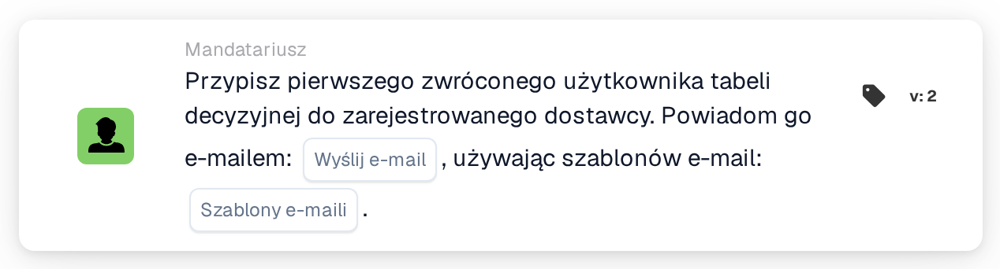

# Przypisz pierwszego użytkownika z tabeli decyzyjnej do dostawcy

<figure><figcaption>
Wersja 2
</figcaption></figure>

## Cel:

Ta karta przepływu pracy ustawia przypisanego użytkownika zarejestrowanego dostawcy na podstawie tabeli decyzyjnej. Pierwszy użytkownik zwrócony przez tabelę decyzyjną staje się przypisanym użytkownikiem dostawcy, czyli wewnętrzną osobą kontaktową odpowiedzialną za dostawcę. Zwróceni użytkownicy mogą również zostać poinformowani e-mailem.

Podobnie jak **Assign User to Supplier** karta nie działa na dokumencie: jest przeznaczona dla przepływów pracy uruchamianych przez zmianę statusu dostawcy, na przykład kartą When **Supplier status changed**. Użytkownik jest ustalany przez tabelę decyzyjną ocenianą wcześniej w tym samym przepływie pracy, na przykład za pomocą karty **Decision Table has Returns**, a nie wybierany na karcie.

## Komponenty karty:

1. **Wyślij e-mail**
   * **Opis:** Ustawienie e-mail karty.
   * **Opcje:** **PRAWDA** lub **FAŁSZ**.
   * **Szczegóły:** Przy **PRAWDA** wiadomości e-mail są wysyłane z użyciem wybranych szablonów e-maili. Przy **FAŁSZ** e-mail nie jest wysyłany. Jeśli **Wyślij e-mail** nie jest ustawione, e-mail również nie jest wysyłany.
2. **Szablony e-maili**
   * **Opis:** Szablony e-maili używane dla wiadomości.
   * **Szczegóły:** Można wybrać jeden lub kilka szablonów e-maili organizacji. Szablony są używane, gdy **Wyślij e-mail** ma wartość **PRAWDA**.

## Funkcjonalność:

* **Odczyt tabeli decyzyjnej:** Karta odczytuje użytkowników zwróconych przez tabelę decyzyjną wcześniej w przepływie pracy. Uwzględniani są wyłącznie zwróceni użytkownicy, a nie grupy.
* **Powiadomienie e-mail:** Wysyłane wiadomości e-mail trafiają do wszystkich użytkowników zwróconych przez tabelę decyzyjną, a nie tylko do pierwszego. Wiadomości e-mail są wysyłane przed przypisaniem użytkownika do dostawcy.
* **Wykonanie akcji:** Pierwszy zwrócony użytkownik zostaje zapisany jako przypisany użytkownik dostawcy, którego status się zmienił. Jeśli dostawca ma już przypisanego użytkownika, zostaje on zastąpiony. Wynik jest zapisywany w dzienniku przepływu pracy.
* **Brakujące dane:**
  * Jeśli tabela decyzyjna nie zwróciła żadnego użytkownika, nic nie zostaje przypisane, a karta zgłasza brakujące dane w dzienniku przepływu pracy.
  * Jeśli **Wyślij e-mail** ma wartość **PRAWDA**, ale nie wybrano szablonu e-maila, karta zatrzymuje się bez przypisania użytkownika i zgłasza brakujące dane.
  * Jeśli **Wyślij e-mail** nie jest ustawione, dziennik przepływu pracy odnotowuje brakujące ustawienie, a użytkownik zostaje przypisany bez wiadomości e-mail.
* **Błędy:** Jeśli usługa e-mail lub usługa dostawców odrzuci żądanie lub nie odpowie na czas, karta kończy się błędem. Jeśli wysyłanie wiadomości e-mail się nie powiedzie, użytkownik nie zostaje przypisany do dostawcy.

## Instalacja i konfiguracja:

* Kartę można stosować w przepływie pracy uruchamianym przez zmianę statusu dostawcy. Tabela decyzyjna zwracająca użytkowników powinna zostać oceniona wcześniej w tym samym przepływie pracy.
* Kartę można dodać z kategorii **Mandatariusz**. Następnie można ustawić **Wyślij e-mail** i wybrać jeden lub kilka szablonów e-maili.

## Podsumowanie:

Karta przepływu pracy „Assign First Decision Table User to Supplier” przypisuje dostawcy odpowiedzialną osobę kontaktową zgodnie z regułami zapisanymi w tabeli decyzyjnej. Opcjonalna wiadomość e-mail od razu informuje zwróconych użytkowników o dostawcy.
