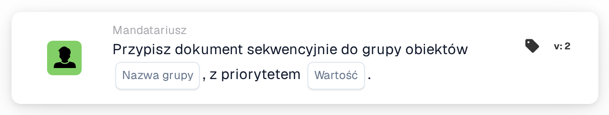

# Przypisz sekwencyjnie do grupy obiektu

<figure><figcaption>
Wersja 2
</figcaption></figure>

## Cel:

Ta karta przepływu pracy dodaje grupę odpowiedzialną za obiekt zamówienia zakupu dokumentu do sekwencyjnego przypisania dokumentu. Podobnie jak **Assign Document to Facility Group** ustala grupę na podstawie kodu obiektu dopasowanych zamówień zakupu. Zamiast od razu przypisywać dokument, dodaje grupę do kolejności osób zatwierdzających z określonym priorytetem, dzięki czemu kilka kart sekwencyjnych w jednym przepływie pracy może utworzyć łańcuch przypisań.

## Komponenty karty:

1. **Nazwa grupy**
   * **Opis:** Część nazwy wspólna dla grup obiektów.
   * **Szczegóły:** Tekst porównywany z nazwami grup użytkowników organizacji. Grupa jest zgodna, jeśli jej nazwa zawiera ten tekst oraz kod obiektu zamówienia zakupu. Porównanie nie uwzględnia wielkości liter. Na przykład przy nazwie grupy **Approver** i zamówieniu zakupu dla obiektu **1000** zgodna byłaby grupa o nazwie **Approver 1000**.
2. **Wartość**
   * **Opis:** Priorytet grupy w ramach sekwencyjnego przypisania.
   * **Szczegóły:** Liczba całkowita. Niższe liczby mają pierwszeństwo, przy czym 0 oznacza najwyższy priorytet. Jeśli nie wprowadzono wartości lub wprowadzono wartość ujemną, używany jest priorytet 1.

## Funkcjonalność:

* **Ustalanie obiektu:** Karta odczytuje zamówienia zakupu, z którymi dopasowano dokument, i zbiera kod obiektu (lokalizację zamówienia zakupu) każdego z nich.
* **Ustalanie grupy:** Dla każdego kodu obiektu karta wyszukuje grupy użytkowników, których nazwa zawiera zarówno **Nazwa grupy** z karty, jak i kod obiektu. Kody obiektów, dla których nie znaleziono grupy, są wymieniane w dzienniku przepływu pracy.
* **Wykonanie akcji:** Każda zgodna grupa zostaje dodana do sekwencyjnego przypisania z priorytetem z pola **Wartość**. Samo przypisanie następuje na końcu przebiegu przepływu pracy: jako pierwszy przypisywany jest wpis z najniższym numerem priorytetu, a wszystkie wpisy, łącznie z pierwszym, są zapisywane w dokumencie jako jego prośby o zatwierdzenie. Kolejne kroki sekwencji są z nich pobierane w rosnącej kolejności priorytetu. Jeśli w tym samym przebiegu inna karta przypisała już dokument bezpośrednio, to pierwsze przypisanie sekwencyjne jest pomijane.
* **Brakujące dane:**
  * Jeśli na karcie nie wprowadzono nazwy grupy, karta nie jest wykonywana i zgłasza brakujące dane w dzienniku przepływu pracy.
  * Jeśli dokument nie jest dopasowany do zamówienia zakupu, karta zgłasza brakujące dane zamiast dodać grupę.
  * Jeśli żadna grupa nie odpowiada żadnemu z kodów obiektów, żadna grupa nie zostaje dodana, a dziennik przepływu pracy odnotowuje, że nie znaleziono zgodnej grupy.

## Instalacja i konfiguracja:

* Grupy użytkowników powinny mieć takie nazwy, aby każda zawierała wspólną część nazwy oraz kod obiektu, na przykład **Approver 1000**, **Approver 2000**.
* Kartę można dodać z kategorii **Mandatariusz**. Następnie wspólną część nazwy grup wprowadza się w polu **Nazwa grupy**, a priorytet w polu **Wartość**.
* Aby utworzyć łańcuch osób zatwierdzających, można połączyć w przepływie pracy kilka kart sekwencyjnych, każdą z własnym priorytetem, na przykład grupę obiektu z priorytetem 1 i grupę centralną z priorytetem 2.

## Podsumowanie:

Karta przepływu pracy „Assign Sequentially to Facility Group” umieszcza odpowiedzialny zespół obiektu w określonym miejscu sekwencyjnego zatwierdzania. W połączeniu z innymi kartami sekwencyjnymi umożliwia tworzenie łańcuchów zatwierdzeń, w których zespół obiektu jest jednym z kilku kroków.
