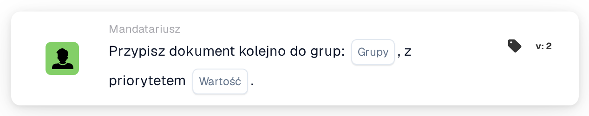

# Przypisz sekwencyjnie do grup

<figure><figcaption>
Wersja 2
</figcaption></figure>

## **Cel**

Karta przepływu pracy "**Przypisz dokument sekwencyjnie do grup**" umożliwia sekwencyjne przypisywanie dokumentów do jednej lub więcej wybranych grup. Wartość priorytetu określa kolejność przypisywania, przy czym niższe liczby reprezentują wyższy priorytet.

## **Komponenty karty**

1. **Grupa**
   * **Opis**: Określa grupy, które otrzymają przypisanie dokumentu.
   * **Szczegóły**: Menu rozwijane, w którym można wybrać jedną lub wiele grup do przypisania dokumentu.
2. **Priorytet (wartość)**
   * **Opis**: Numeryczne pole wprowadzania, w którym można ustawić poziom priorytetu dla grup.
   * **Szczegóły**: Niższe liczby oznaczają wyższy priorytet, zapewniając przypisywanie dokumentów do grup w rosnącej kolejności priorytetu.

## **Funkcjonalność**

* **Przypisanie dokumentu**:\
  Karta przypisuje dokumenty sekwencyjnie do wybranych grup na podstawie ich wartości priorytetu.\
  Jeśli wiele grup ma ten sam priorytet, dokumenty są przypisywane w kolejności, w jakiej grupy zostały wybrane.

## **Konfiguracja**

1. Dodaj kartę **Przypisz dokument sekwencyjnie** do swojego przepływu pracy.
2. Skonfiguruj pole **Grupa**:
   * Wybierz jedną lub wiele grup z menu rozwijanego.
3. Skonfiguruj pole **Priorytet (wartość)**:
   * Wprowadź wartość liczbową, aby ustawić priorytet przypisania.
4. Zapisz i aktywuj przepływ pracy, aby zastosować konfigurację.

## **Podsumowanie**

Karta przepływu pracy "Assign the Document Sequentially to Groups" zapewnia efektywną alokację dokumentów do jednej lub więcej grup na podstawie priorytetu. Funkcja ta wspiera elastyczne i zorganizowane przetwarzanie dokumentów w wielu zespołach lub działach.

<!-- workflow-card-practical-example-20261021 -->

## Praktyczny przykład

**Kiedy używać:** Nadaj priorytet przydzielaniu dokumentów zespołom recenzującym.

**Konfiguracja:** Wybierz skonfigurowane grupy demonstracyjne i ustaw wymagany priorytet, na przykład `10`.

**Oczekiwany wynik i kontrprzykład:** Dokument otrzymuje wybrane przypisania grupowe z tym priorytetem. Przetestuj drugi priorytet osobno, gdy grupy muszą zajmować różne etapy.

To jest ilustracyjna konfiguracja i oczekiwany wynik. Korzystaj z pól, użytkowników i grup skonfigurowanych w Twojej organizacji testowej; nie jest to twierdzenie, że ten przykład został wykonany.
