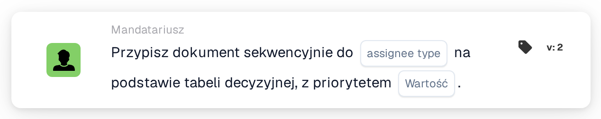

# Przypisz sekwencyjnie do użytkownika/grupy

<figure><figcaption>
Wersja 2
</figcaption></figure>

<figure><figcaption>
Przypisz dokument sekwencyjnie do Użytkownika/Grupy na podstawie tabeli decyzyjnej. — Wersja 2
</figcaption></figure>

## **Cel**

Karta przepływu pracy "**Przypisz dokument sekwencyjnie do użytkownika/grupy na podstawie tabeli decyzyjnej**" dynamicznie przypisuje dokumenty do użytkownika lub grupy, w zależności od oceny tabeli decyzyjnej. Zapewnia to, że dokumenty są odpowiednio kierowane na podstawie predefiniowanych reguł.

## **Komponenty karty**

1. **Priorytet (wartość)**
   * **Opis**: Określa poziom priorytetu dla przypisań, gdzie niższe liczby reprezentują wyższy priorytet.
   * **Szczegóły**: Numeryczne pole wprowadzania, w którym można ustawić wartość priorytetu w celu kontrolowania kolejności przypisywania.

## **Funkcjonalność**

* **Ocena tabeli decyzyjnej**:\
  Tabela decyzyjna ocenia predefiniowane warunki, aby zdecydować, czy dokument jest przypisany do użytkownika, czy grupy.
* **Przypisanie dokumentu**:
  * Jeśli tabela decyzyjna zwraca użytkownika, dokument jest przypisywany bezpośrednio do tego użytkownika.
  * Jeśli tabela decyzyjna zwraca grupę, dokument jest przypisywany do grupy sekwencyjnie, z poszanowaniem określonej wartości priorytetu.

## **Konfiguracja**

1. Dodaj kartę **Przypisz dokument sekwencyjnie** do swojego przepływu pracy.
2. Skonfiguruj pole **Priorytet (wartość)**:
   * Wprowadź wartość liczbową, aby ustawić priorytet przypisania.
3. Zapisz i aktywuj przepływ pracy, aby zastosować konfigurację.

## **Podsumowanie**

Karta przepływu pracy "**Przypisz dokument sekwencyjnie do użytkownika/grupy na podstawie tabeli decyzyjnej**" zapewnia efektywne i dynamiczne kierowanie dokumentów. Wykorzystując logikę tabeli decyzyjnej i wartości priorytetu, karta ułatwia dokładne przypisanie do użytkownika lub grupy, usprawniając przepływy pracy dokumentów.

<!-- workflow-card-practical-example-20261021 -->

## Praktyczny przykład

**Kiedy używać:** Użyj tabeli decyzyjnej, aby wybrać osobę, która ma mieć przypisany dokument.

**Konfiguracja:** Skonfiguruj pasującą regułę tabeli decyzyjnej wersji demonstracyjnej, zwracającą zamierzonego użytkownika lub grupę, a następnie wybierz tę tabelę na karcie.

**Oczekiwany wynik i kontrprzykład:** Zwrócony cesjonariusz jest używany do sekwencyjnego przypisywania dokumentów. W przypadku braku pasującego zwrotu nie zakładaj domyślnego cesjonariusza; sprawdź wynik i skonfigurowane zachowanie awaryjne tej wersji.

To jest ilustracyjna konfiguracja i oczekiwany wynik. Korzystaj z pól, użytkowników i grup skonfigurowanych w Twojej organizacji testowej; nie jest to twierdzenie, że ten przykład został wykonany.
