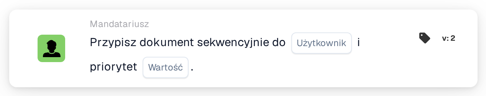

# Przypisz sekwencyjnie do użytkownika

<figure><figcaption>
Wersja 2
</figcaption></figure>

## **Cel**

Karta przepływu pracy "**Przypisz sekwencyjnie do użytkownika**" automatyzuje przypisywanie dokumentów do wybranego użytkownika w sposób sekwencyjny. Wartość priorytetu określa kolejność przypisywania, przy czym niższe liczby reprezentują wyższy priorytet.

## **Komponenty karty**

1. **Użytkownik**
   * **Opis**: Wybrany użytkownik otrzyma dokument na podstawie sekwencji przepływu pracy.
   * **Szczegóły**: Menu rozwijane, które wymienia wszystkich dostępnych użytkowników do przypisania.
2. **Priorytet (wartość)**
   * **Opis**: Numeryczne pole wprowadzania, w którym można ustawić poziom priorytetu dla użytkownika.
   * **Szczegóły**: Niższe liczby oznaczają wyższy priorytet. Dokumenty są przypisywane do użytkowników w rosnącej kolejności priorytetu.

## **Funkcjonalność**

* **Przypisanie dokumentu**:\
  Karta przypisuje dokumenty do wybranego użytkownika sekwencyjnie, uwzględniając poziom priorytetu.\
  Jeśli wielu użytkowników ma ten sam priorytet, dokumenty są przypisywane w kolejności, w jakiej użytkownicy pojawiają się w menu rozwijanym.

## **Konfiguracja**

1. Dodaj kartę **Przypisz dokument sekwencyjnie** do swojego przepływu pracy.
2. Skonfiguruj pole **Użytkownik**:
   * Wybierz użytkownika z menu rozwijanego.
3. Skonfiguruj pole **Priorytet (wartość)**:
   * Wprowadź wartość liczbową, aby ustawić priorytet przypisania.
4. Zapisz i aktywuj przepływ pracy, aby zastosować konfigurację.

## **Podsumowanie**

Karta przepływu pracy "Assign the Document Sequentially to User" zapewnia zorganizowaną dystrybucję dokumentów poprzez przypisywanie ich w sekwencji opartej na priorytetach. Zwiększa to zarządzanie zadaniami i redukuje opóźnienia w przetwarzaniu.

<!-- workflow-card-practical-example-20261021 -->

## Praktyczny przykład

**Kiedy używać:** Dodaj użytkownika do priorytetowej sekwencji zatwierdzania dokumentów.

**Konfiguracja:** Wybierz `Demo Reviewer A` i priorytet `10`. Dodaj osobne zadanie z priorytetem `20`, jeśli potrzebny będzie późniejszy recenzent.

**Oczekiwany wynik i kontrprzykład:** Przypisania mają skonfigurowane priorytety; niższa wartość liczbowa ma wyższy priorytet. Sprawdź kolejność przypisań, a nie tylko kolejność kart na płótnie.

To jest ilustracyjna konfiguracja i oczekiwany wynik. Korzystaj z pól, użytkowników i grup skonfigurowanych w Twojej organizacji testowej; nie jest to twierdzenie, że ten przykład został wykonany.
