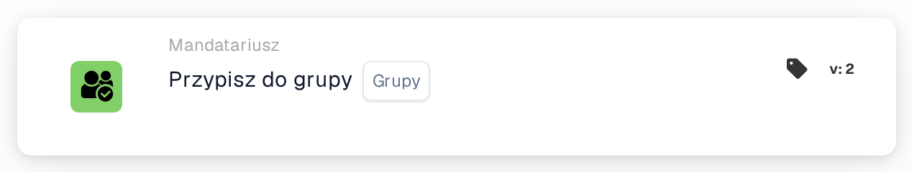
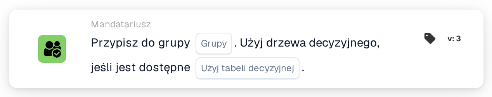

# Przypisz do grupy

<figure><figcaption>
Wersja 2
</figcaption></figure>

<figure><figcaption>
Wersja 3
</figcaption></figure>

## Cel:

Karta przepływu pracy **"Assign to Group"** ułatwia przypisywanie dokumentów do określonej **grupy** w systemie. Zapewnia to, że dokument jest przetwarzany przez odpowiedni zespół, usprawniając przepływ pracy. Rozszerzona w późniejszych wersjach, wprowadza funkcjonalność drzewa decyzyjnego do dynamicznego przypisywania grup.

## Komponenty karty:

1. **Grupy**
   * **Opis:** Określa **grupę**, do której zostanie przypisany dokument.
   * **Szczegóły:** Wybierana z listy rozwijanej dostępnych **grup**.

## **Dodatkowe komponenty w Version 3**

1. **Decision Tree (tylko Version 3)**
   * **Opis:** Umożliwia użycie drzewa decyzyjnego do dynamicznego określania **grupy**, do której powinien zostać przypisany dokument.
   * **Opcje:**
     * **True:** Włącza przetwarzanie drzewa decyzyjnego.
     * **False:** Wyłącza przetwarzanie drzewa decyzyjnego.

## Funkcjonalność:

* **Ocena warunku:** Karta wykonuje swoją akcję tylko wtedy, gdy zarówno **„Kiedy”**, jak i **„I sekcje”** są prawdziwe.
* **Przypisanie dokumentu:** Przypisuje dokument do wybranej **grupy**. W **Wersja 3** **drzewo decyzyjne** dynamicznie określa grupę docelową, jeśli jest włączone.

## Konfiguracja:

* **Wybierz grupę:** Wybierz **grupę** z listy rozwijanej, aby przypisać dokument.
* **Użyj drzewa decyzyjnego (tylko wersja 3):** Włącz tę opcję, jeśli **drzewo decyzyjne** ma być używane do dynamicznego przypisywania.

## Podsumowanie:

Karta przepływu pracy **"Assign to Group"** automatyzuje przypisywanie dokumentów do predefiniowanych **grup**, zwiększając koordynację zespołu. **Wersja 3** wprowadza możliwość dynamicznego przypisywania grup na podstawie logiki drzewa decyzyjnego.

<!-- workflow-card-practical-example-20261021 -->

## Praktyczny przykład

**Kiedy używać:** Umieść dokument w udostępnionej kolejce recenzji.

**Konfiguracja:** Wybierz skonfigurowaną grupę `Demo Finance`.

**Oczekiwany wynik i kontrprzykład:** Dokument jest przypisany do wybranej grupy. To jest przypisanie dokumentu, a nie obietnica utworzenia dodatkowego zadania lub e-maila.

To jest ilustracyjna konfiguracja i oczekiwany wynik. Korzystaj z pól, użytkowników i grup skonfigurowanych w Twojej organizacji testowej; nie jest to twierdzenie, że ten przykład został wykonany.
