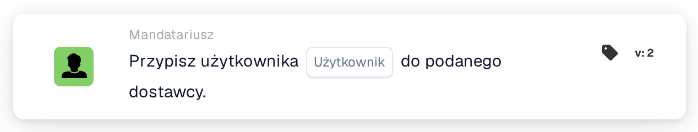

# Przypisz użytkownika do dostawcy

<figure><figcaption>
Wersja 2
</figcaption></figure>

## Cel:

Ta karta przepływu pracy ustawia przypisanego użytkownika zarejestrowanego dostawcy. Przypisany użytkownik to wewnętrzna osoba kontaktowa odpowiedzialna za dostawcę. Karta nie działa na dokumencie: jest przeznaczona dla przepływów pracy uruchamianych przez zmianę statusu dostawcy, na przykład kartą When **Supplier status changed**. Dostawca, którego status się zmienił, jest dostawcą, do którego przypisywany jest użytkownik.

## Komponenty karty:

1. **Użytkownik**
   * **Opis:** Użytkownik, który staje się przypisanym użytkownikiem dostawcy.
   * **Szczegóły:** Można wybrać jednego użytkownika organizacji. Jeśli dostawca ma już przypisanego użytkownika, zostaje on zastąpiony.

## Funkcjonalność:

* **Wykonanie akcji:** Karta pobiera dostawcę z przebiegu przepływu pracy i zapisuje wybranego użytkownika jako przypisanego użytkownika dostawcy. Wynik jest zapisywany w dzienniku przepływu pracy.
* **Użycie z wiadomościami e-mail:** Po przypisaniu użytkownika wiadomości e-mail można adresować do tego użytkownika za pomocą opcji **Użytkownik przypisany do dostawcy**, na przykład w karcie **Send Email**.
* **Brakujące dane:** Jeśli na karcie nie wybrano użytkownika, karta nie jest wykonywana i zgłasza brakujące dane w dzienniku przepływu pracy.
* **Błędy:** Jeśli usługa dostawców odrzuci żądanie lub nie odpowie na czas, karta kończy się błędem.

## Instalacja i konfiguracja:

* Kartę można stosować w przepływie pracy uruchamianym przez zmianę statusu dostawcy.
* Kartę można dodać z kategorii **Mandatariusz**. Następnie w polu **Użytkownik** wybiera się użytkownika, który powinien być odpowiedzialny za dostawcę.

## Podsumowanie:

Karta przepływu pracy „Assign User to Supplier” automatycznie nadaje każdemu dostawcy odpowiedzialną osobę kontaktową, gdy zmienia się jego status, na przykład po rejestracji. Na tym przypisaniu mogą opierać się dalsze kroki, takie jak wiadomości e-mail do przypisanego użytkownika.
