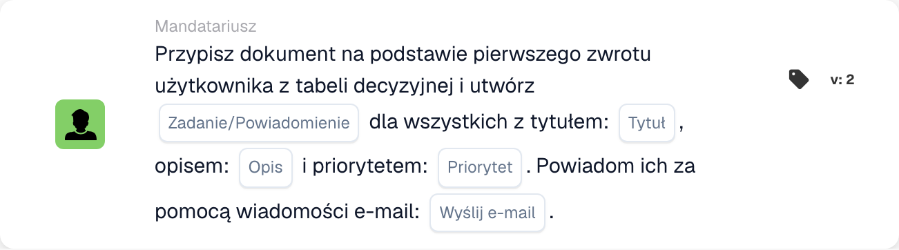
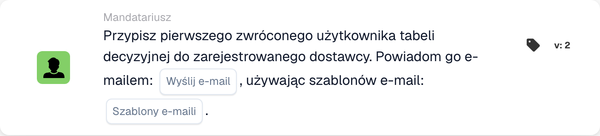

# Przypisywanie dokumentów i karty użytkownika

## Przypisywanie dokumentów i karty użytkownika — kompletny przewodnik

**Okładki:** 13 kart zadań i użytkowników

***

Karty na tej stronie należą do grupy **Wtedy** Kreatora przepływu pracy — akcje wykonywane po spełnieniu warunków Kiedy/I:

<figure><figcaption><p>Niezapisany przykład z kartami Kiedy, I oraz Wtedy. Uzupełnij wszystkie pola przed uruchomieniem. Niektóre etykiety tej wersji interfejsu nie są jeszcze przetłumaczone lub mają nieprawidłowe tłumaczenie. Objaśnienia na tej stronie używają właściwych terminów; obraz przedstawia rzeczywisty interfejs.</p></figcaption></figure>

***

### 📌 Informacje o wersji

**Karty z wieloma wersjami:** DOC\_USER\_ASSIGN (v2 najnowsza, v3 wycofana), DOC\_GROUP\_ASSIGN (najnowsza wersja 2, v3 wycofana), OC\_ASSIGN\_DOC (v2)

**Ważne:** Wersje v3 dodały obsługę drzewa decyzyjnego, ale są teraz przestarzałe **Zalecenie:** Użyj wersji 2 zarówno dla DOC\_USER\_ASSIGN, jak i DOC\_GROUP\_ASSIGN

📖 [Pełna historia wersji](../../release.md) | [Wersje kart i zachowanie](../../cards-overview/card-versions-guide.md)

***

## Podstawowe przypisanie dokumentów

### Karta: DOC\_USER\_ASSIGN / Przypisz dokument do użytkownika

#### Cel

Przypisuje dokument do konkretnej osoby w celu wykonania jej działania

#### Kiedy stosować

* Dokument wymaga sprawdzenia przez konkretną osobę
* Przekazanie indywidualnemu członkowi zespołu
* Śledzenie odpowiedzialności
* Przypisz pracę wskazanej osobie

#### Jak to działa

```
Document is "assigned to" = John Smith
Only John can see it as assigned to him
John is responsible for this document
```

#### Przykład

```
Invoice arrives
    ↓
Assign Document to: John Smith (Finance Manager)
    ↓
Only John sees "Assigned to Me"
John must take action on it
```

#### Parametry

```
User: [Select which person]
```

#### Uwaga

Przypisywanie oznacza:

* Dokument jest oznaczony jako „przypisany do mnie” dla tej osoby
* Ta osoba jest odpowiedzialna
* Inni nadal mogą widzieć dokument (ale nie w formie przypisanej do nich)
* Jedno zadanie na raz na dokument

***

### Karta: DOC\_GROUP\_ASSIGN / Przypisz dokument do grupy

#### Cel

Przypisuje dokument do grupy (wszyscy członkowie widzą go jako przypisany do nich)

#### Kiedy stosować

* Dokument dla zespołu, a nie jednostki
* Wiele osób może sobie z tym poradzić
* Wspólna odpowiedzialność
* Dystrybucja obciążenia zespołu

#### Jak to działa

```
Document is "assigned to" = Finance Team (10 people)
All 10 team members see "Assigned to My Group"
Any team member can take action
```

#### Przykład

```
New vendor invoice
    ↓
Assign Document to: Procurement Team
    ↓
All procurement team members see it
First available person handles it
```

#### Parametry

```
Group: [Select which group]
```

#### Różnica

```
Individual Assignment:
- One person responsible
- That person sees "Assigned to Me"
- Others don't see assignment

Group Assignment:
- Team responsible
- All members see "Assigned to My Group"
- Anyone can claim/process
```

***

### Karta: ACTION\_ASSIGN\_DOC\_BASED\_ON\_DECISION\_TABLE

#### Cel

Przypisuje dokument w oparciu o logikę tabeli decyzyjnej

#### Kiedy stosować

* Różni dostawcy potrzebują różnych osób zajmujących się obsługą
* Przydział na podstawie kwoty
* Złożona logika routingu
* Wiele warunków przypisania

#### Jak to działa

```
Decision Table Logic:
  If Supplier = "ABC Corp" → Assign to: Procurement Team
  If Supplier = "XYZ Inc" → Assign to: Direct Manager
  If Amount > €10000 → Assign to: Finance Director

Document arrives
    ↓
Check: Which condition matches?
    ↓
Assign accordingly
```

#### Przykład: Przypisanie na podstawie kwoty

```
Invoice: €2000 from ABC Corp

Decision Table checks:
  Is amount > €10000? NO
  Is amount > €5000? NO
  Is amount > €1000? YES

Result: Assign to: Finance Manager
```

#### Przykład: Przypisanie na podstawie dostawcy

```
Invoice from: Preferred Supplier

Decision Table:
  If preferred supplier → Finance Team
  If new supplier → Procurement Manager
  If blacklisted → Director Review

Result: Assign to: Finance Team
```

#### Parametry

```
Decision Table: [Select decision table]
(Decision table contains assignment logic)
```

***

### Karta: ACTION\_ASSIGN\_DOC\_DECISION\_TABLE\_SEQUENTIAL

#### Cel

Przypisuje dokument sekwencyjnie na podstawie tabeli decyzyjnej z priorytetami

#### Kiedy stosować

* Wiele kolejnych zatwierdzeń
* Różni ludzie na różnych poziomach
* Łańcuch zatwierdzania na podstawie kwoty
* Ścieżka eskalacji

#### Jak to działa

```
First Decision: Who approves first?
    ↓
Assign to: Person 1
    ↓
Person 1 approves
    ↓
Second Decision: Who approves next?
    ↓
Assign to: Person 2
    ↓
Person 2 approves (final)
    ↓
Document Complete
```

#### System priorytetowy

```
Priority 1: First assignment
Priority 2: Second assignment
Priority 3: Third assignment
(etc.)

Each must complete before next begins
```

#### Przykład: Zatwierdzenie wielopoziomowe

```
Invoice: €50,000

Decision Table:
  €1k-€5k → Assign to: Finance Manager (Priority 1)
  €5k-€20k → Then: Assign to: Finance Director (Priority 2)
  €20k+ → Then: Assign to: CFO (Priority 3)

Invoice Flow:
1. Finance Manager reviews → approves
2. Finance Director reviews → approves
3. CFO reviews → approves final

Each step depends on previous completion
```

#### Parametry

```
Decision Table: [Select]
Priority Order: [Determined by decision table]
```

***

### Karta: ACTION\_ASSIGN\_DOC\_TO\_USER\_SEQUENTIAL

#### Cel

Przypisuje dokument do użytkownika z priorytetem sekwencyjnym

#### Kiedy stosować

* Dokument wymaga konkretnej osoby
* Wyczyść przetwarzanie sekwencyjne
* Pojedyncze zlecenie z zamówieniem

#### Jak to działa

```
Assign Document to: User A (Priority 1)
    ↓
User A processes
    ↓
Then: Assign to User B (Priority 2)
    ↓
User B processes
```

#### Przykład

```
Invoice processing:
1. Assign to: Accounts Payable Clerk
2. Then: Assign to: Finance Manager
3. Then: Assign to: Director

Each person has their turn
```

***

### Karta: ACTION\_ASSIGN\_DOC\_TO\_GROUP\_SEQUENTIAL

#### Cel

Przypisuje dokument sekwencyjnie do grup

#### Kiedy stosować

* Wiele zatwierdzeń grupowych
* Na każdym etapie różne działy
* Przetwarzanie sekwencyjne w oparciu o zespół

#### Jak to działa

```
Step 1: Assign to Group A (Quality Team)
        Quality verifies
    ↓
Step 2: Assign to Group B (Finance Team)
        Finance reviews
    ↓
Step 3: Assign to Group C (Procurement)
        Procurement approves
```

#### Przykład

```
New Supplier Onboarding:

Step 1: Quality Team
  - Evaluate supplier capability
  - Check certifications

Step 2: Finance Team
  - Check payment terms
  - Verify pricing

Step 3: Procurement Team
  - Approve supplier
  - Set up in system

Document passes through all three
```

***

### Karta: ACTION\_ASSIGN\_DOC\_TO\_FACILITY\_GROUP

<!-- workflow-facility-example-direct-20261022 -->

Ta akcja workflow przypisuje dokument do grupy na podstawie lokalizacji powiązanych z nim zamówień zakupu. W wersji 2 `group_name` jest fragmentem tekstu wyszukiwanym w nazwach grup.

Przykład: dokument syntetyczny jest powiązany z zamówieniem `DEMO-PO-100`, dla którego `location_id=BERLIN`. Skonfigurowane grupy to `Receiving BERLIN` i `Receiving MUNICH`. W polu `group_name` wpisz `Receiving`. Nazwa grupy musi zawierać zarówno ten fragment, jak i lokalizację zamówienia; wielkość liter nie ma znaczenia.

Oczekiwany wynik: dokument zostaje przypisany bezpośrednio do `Receiving BERLIN`, jeśli jego status na to pozwala. Bez powiązanego zamówienia lub pasującej grupy przypisanie nie kończy się sukcesem; sprawdź logi workflow. Unikaj niejednoznacznych nazw: gdy pasuje kilka grup, ta karta nie gwarantuje stałej kolejności wyboru.

To przykładowa konfiguracja; nie uruchomiono workflow.

***

### Karta: ACTION\_ASSIGN\_DOC\_TO\_FACILITY\_GROUP\_SEQUENTIAL

<!-- workflow-facility-example-sequential-20261022 -->

Ta akcja workflow dodaje pasujące grupy lokalizacji do kolejki sekwencyjnego przypisywania z ustawionym priorytetem. Nie odwzorowuje przemieszczania towarów między fabrykami lub magazynami.

Przykład: użyj tego samego syntetycznego zamówienia, lokalizacji i grup co powyżej. Ustaw `group_name=Receiving` i priorytet `value=10`. Wersja 2 odczytuje lokalizację z powiązanego zamówienia i znajduje `Receiving BERLIN`.

Oczekiwany wynik: żądanie przypisania do tej grupy zostaje dodane do kolejki z priorytetem `10`. Jeśli pasuje kilka grup, otrzymują ten sam priorytet; ich nazwy nie określają kolejności przetwarzania. Osobno sprawdź kolejkę i późniejsze zatwierdzenie. Bez dopasowania nie powstaje pomyślne przypisanie.

To przykładowa konfiguracja; nie uruchomiono workflow.

***

### Karta: ACTION\_ASSIGN\_DOC\_TO\_PROCUREMENT\_GROUP

#### Cel

Przypisuje dokument do działu zakupów

#### Kiedy stosować

* Obsługa zespołu zakupowego
* Praca związana z dostawcami
* Związane z zamówieniem

#### Przykład

```
Vendor evaluation document
    ↓
Assign to: Procurement Group
    ↓
Procurement team evaluates vendor
```

***

### Karta: ACTION\_ASSIGN\_DOC\_TO\_PROCUREMENT\_GROUP\_SEQUENTIAL

#### Cel

Przydział sekwencyjny w ramach zakupów

#### Kiedy stosować

* Wieloetapowy proces zakupowy
* Łańcuch akceptacji w zakupach

#### Przykład

```
Purchase Requisition:

Step 1: Buyer (Creates PO)
Step 2: Approver (Reviews)
Step 3: Director (Final sign-off)

Each step in sequence
```

***

### Karta: ACTION\_CHANGE\_DOC\_SUBORG / Podorganizacja dokumentu zmiany

#### Cel

Przypisuje dokument do innej podorganizacji

#### Kiedy stosować

* Wybrano niewłaściwą organizację
* Trzeba przenieść do odpowiedniego działu
* Restrukturyzacja organizacyjna

#### Jak to działa

```
Current Sub-Org: Finance Department
    ↓
Change to: Accounting Department
    ↓
Document now belongs to Accounting
```

#### Przykład

```
Document for: Berlin Office
    ↓
Realize should be: Munich Office
    ↓
Change Sub-Organization to: Munich Office
```

***

### Karta: ACTION\_CHANGE\_DOC\_SUBORG\_BY\_FIELD\_TEXT

#### Cel

Zmienia podorganizację na podstawie wartości pola dokumentu

#### Kiedy stosować

* Podorganizacja przechowywana w polu
* Dopasuj lokalizację dokumentu do pola
* Automatyczne przypisanie organizacji

#### Jak to działa

```
Document Field: "Delivery_Location" = "Berlin"
    ↓
Decision Table:
  If location = "Berlin" → Assign to: Berlin Sub-Org
  If location = "Munich" → Assign to: Munich Sub-Org

    ↓
Document assigned to: Berlin Sub-Org
```

#### Przykład

```
Invoice field: "Cost Center: CC-Berlin-001"
    ↓
System recognizes: Berlin location
    ↓
Change document to: Berlin Sub-Organization
```

***

### Karta: ACTION\_ASSIGN\_USER\_FROM\_FIELD\_WITH\_FALLBACK

#### Cel

Przypisuje dokument do użytkownika z pola, z możliwością powrotu w przypadku nie znalezienia użytkownika

#### Kiedy stosować

* Nazwa użytkownika przechowywana w polu dokumentu
* Może nie istnieć w systemie
* Potrzebujesz kopii zapasowej, jeśli użytkownik jest niedostępny

#### Jak to działa

```
Document Field: "Approver: John Smith"
    ↓
Try to assign to: John Smith
    ↓
If John doesn't exist:
    ↓
Use Fallback: Sarah Johnson (Manager)
    ↓
Document assigned to: Sarah Johnson
```

#### Parametry

```
Source Field: [Field containing user name]
Fallback User: [If source user not found]
```

#### Przykład

```
Invoice has field: "Contact Person: Mike Johnson"

Try to assign to: Mike Johnson
    ↓
If Mike not in system:
    ↓
Fallback to: Finance Manager (Robert)
```

***

### Karta: ACTION\_ASSIGN\_USER\_TO\_SUPPLIER

#### Cel

Przypisuje dokument użytkownikowi zarządzającemu tym dostawcą

#### Kiedy stosować

* Użytkownik powiązany z dostawcą
* Menedżer konta dostawcy
* Właściciel relacji z dostawcą

#### Jak to działa

```
Document Supplier: ABC Corp
    ↓
System checks: Who manages ABC Corp?
    ↓
Assign to: John Smith (ABC Corp Account Manager)
```

***

## Drzewa decyzyjne przydziałów

### Tabela decyzyjna Przykład 1: Na podstawie kwoty

```
Amount ≤ €1000
  → Assign to: Finance Team

Amount €1000-€5000
  → Assign to: Finance Manager

Amount €5000-€20000
  → Assign to: Finance Director

Amount > €20000
  → Assign to: CFO
```

### Tabela decyzyjna Przykład 2: Oparta na dostawcy

```
Supplier Type = "Preferred"
  → Assign to: Account Manager

Supplier Type = "New"
  → Assign to: Procurement Manager

Supplier Type = "Problem"
  → Assign to: Procurement Director
```

### Tabela decyzyjna Przykład 3: Na podstawie typu dokumentu

```
Document Type = "Invoice"
  → Assign to: Accounts Payable Team

Document Type = "Credit Memo"
  → Assign to: Finance Manager

Document Type = "PO"
  → Assign to: Procurement Team
```

***

## Przykłady przepływu pracy przy przypisaniu

### Przykład 1: Proste wyznaczanie tras

```
Document Arrives
    ↓
Check: Supplier = "ABC Corp"? YES
    ↓
Assign to: John Smith
(John handles ABC Corp)
    ↓
John reviews and approves
```

### Przykład 2: Zatwierdzenie sekwencyjne

```
Document Arrives
    ↓
Assign to: Finance Manager (Step 1)
    ↓
Manager reviews
    ↓
Passes to: Finance Director (Step 2)
    ↓
Director reviews
    ↓
Passes to: CFO (Step 3)
    ↓
CFO approves final
```

### Przykład 3: Routing na podstawie kwoty

```
Invoice: €50,000
    ↓
Decision Table: Amount > €20k?
    ↓
YES → Assign to: CFO
    ↓
CFO approves directly
```

### Przykład 4: Oparta na obiekcie

```
Shipment for: Berlin Office
    ↓
Assign to: Berlin Warehouse Team
    ↓
Then assign to: Berlin Distribution Team
    ↓
Both teams process in sequence
```

***

## Najlepsze praktyki przydziału

✅ **Wykonaj:**

* Zachowaj prostotę tabel decyzyjnych
* Przetestuj logikę routingu na przykładach
* Upewnij się, że wszystkie ścieżki gdzieś prowadzą
* Mają rezerwę dla brakujących użytkowników
* Decyzje dotyczące trasowania dokumentów

❌ **Nie:**

* Utwórz przypisania cykliczne (A → B → A)
* Przypisz do nieistniejących użytkowników (bez możliwości powrotu)
* Spraw, aby routing był zbyt skomplikowany
* Zapomnij o przetestowaniu routingu
* Przypisz do niedostępnych osób

***

## Rozwiązywanie problemów z zadaniem

### „Dokument nie przypisany”

**Przyczyna:** Warunek nie jest spełniony lub użytkownik nie istnieje

**Rozwiązanie:**

* Sprawdź, czy warunek jest prawdziwy
* Sprawdź, czy użytkownik istnieje w systemie
* Sprawdź ustawienia awaryjne
* Przejrzyj logikę tabeli decyzyjnej

### „Przypisano niewłaściwą osobę”

**Przyczyna:** Nieprawidłowa tabela decyzyjna lub logika routingu

**Rozwiązanie:**

* Tabela decyzyjna testu
* Sprawdź warunki
* Sprawdź mapowanie użytkowników
* Przejrzyj wartości pól

### „Wydaje się, że zadanie kogoś pominęło”

**Przyczyna:** Nieprawidłowa kolejność

**Rozwiązanie:**

* Sprawdź numery priorytetowe
* Sprawdź, czy sekwencja jest prawidłowa
* Przetestuj z próbką
* Przejrzyj kolejność w tabeli decyzyjnej

***

## Porównanie kart przydziałów

| Karta                                                    | Przypisuje do               | Typ trasy  | Przypadek użycia                   |
| ------------------------------------------------------- | ------------------------ | ----------- | -------------------------- |
| DOC\_USER\_ASSIGN                                       | Indywidualny               | Bezpośrednie      | Proste zadanie          |
| DOC\_GROUP\_ASSIGN                                      | Grupa                    | Bezpośrednie      | Przydział zespołu            |
| ACTION\_ASSIGN\_DOC\_BASED\_ON\_DECISION\_TABLE         | Wynik decyzji          | Warunkowe | Złożone trasowanie            |
| ACTION\_ASSIGN\_DOC\_DECISION\_TABLE\_SEQUENTIAL        | Wiele (sekwencyjne)    | Warunkowe | Łańcuch zatwierdzeń             |
| ACTION\_ASSIGN\_DOC\_TO\_USER\_SEQUENTIAL               | Użytkownik (sekwencyjny)        | Zamówione     | Sekwencyjne kroki użytkownika      |
| ACTION\_ASSIGN\_DOC\_TO\_GROUP\_SEQUENTIAL              | Grupy (sekwencyjne)      | Zamówione     | Sekwencyjne kroki grupowe     |
| ACTION\_ASSIGN\_DOC\_TO\_FACILITY\_GROUP                | Grupa Obiektów           | Bezpośrednie      | Specyficzne dla obiektu          |
| ACTION\_ASSIGN\_DOC\_TO\_FACILITY\_GROUP\_SEQUENTIAL    | Udogodnienia (sekwencyjne)  | Zamówione     | Wieloobiektowy             |
| ACTION\_ASSIGN\_DOC\_TO\_PROCUREMENT\_GROUP             | Zakupy              | Bezpośrednie      | Przebieg zaopatrzenia       |
| ACTION\_ASSIGN\_DOC\_TO\_PROCUREMENT\_GROUP\_SEQUENTIAL | Zaopatrzenie (sekwencyjne) | Zamówione     | Łańcuch zatwierdzania zamówień publicznych |
| ACTION\_CHANGE\_DOC\_SUBORG                             | Podorganizacja         | Bezpośrednie      | Zmiana działu          |
| ACTION\_CHANGE\_DOC\_SUBORG\_BY\_FIELD\_TEXT            | Podorganizacja według pola         | Warunkowe | Przypisanie w terenie     |
| ACTION\_ASSIGN\_USER\_FROM\_FIELD\_WITH\_FALLBACK       | Pole/awaria           | Warunkowe | Dynamiczne przypisywanie użytkowników    |

***

## Powiązane karty

* **ACTION\_CREATE\_TASK\_FOR\_USER** – Przypisz zadanie tej samej osobie
* **ACTION\_SEND\_EMAIL** - Powiadom przydzieloną osobę
* **CONDITION\_USER\_IS\_ISNOT** - Sprawdź, czy przypisano właściwą osobę
* **CONDITION\_GROUP\_IS\_ISNOT** - Sprawdź, czy przypisano prawidłową grupę

<!-- workflow-card-example-action_assign_doc_to_first_user_and_tasks-20261021 -->

### Przypisz dokument do pierwszego zwróconego użytkownika i utwórz zadania

<figure><figcaption><p>Pola karty w pokazanej wersji. Pola nie są jeszcze skonfigurowane. Niektóre etykiety tej wersji interfejsu nie są jeszcze przetłumaczone lub mają nieprawidłowe tłumaczenie. Objaśnienia na tej stronie używają właściwych terminów; obraz przedstawia rzeczywisty interfejs.</p></figcaption></figure>

`ACTION_ASSIGN_DOC_TO_FIRST_USER_AND_TASKS` · wersja 2

Użyj reguły tabeli decyzyjnej wersji demonstracyjnej, która zwraca skonfigurowanych użytkowników `Demo Reviewer A` i `Demo Reviewer B` w tej kolejności. Wybierz opcję zadania/powiadomienia, tytuł `Review invoice`, opis, priorytet i preferencje e-mail. Pierwszy zwrócony użytkownik jest celem przypisania dokumentu, a skonfigurowane zadania/powiadomienia są skierowane do zwróconych użytkowników. Sprawdź oba wyjścia; pustego zwrotu nie można traktować jako cesji.

<!-- workflow-card-example-action_assign_supplier_user_first_return_of_dt-20261021 -->

### Przypisz pierwszego zwróconego użytkownika do dostawcy

<figure><figcaption><p>Pola karty w pokazanej wersji. Pola nie są jeszcze skonfigurowane. Niektóre etykiety tej wersji interfejsu nie są jeszcze przetłumaczone lub mają nieprawidłowe tłumaczenie. Objaśnienia na tej stronie używają właściwych terminów; obraz przedstawia rzeczywisty interfejs.</p></figcaption></figure>

`ACTION_ASSIGN_SUPPLIER_USER_FIRST_RETURN_OF_DT` · wersja 2

Użyj zarejestrowanego dostawcy wersji demonstracyjnych i reguły tabeli decyzyjnej, której pierwszym wynikiem użytkownika jest `Demo Supplier Owner`. Wybierz tabelę decyzyjną i, jeśli to konieczne, szablony wiadomości e-mail. Stowarzyszenie dostawca-użytkownik korzysta z pierwszego zwróconego użytkownika; nie jest to ta sama operacja, co przypisanie dokumentu. Sprawdź oddzielnie wynik dostawcy i przetestuj pusty zwrot reguły.
