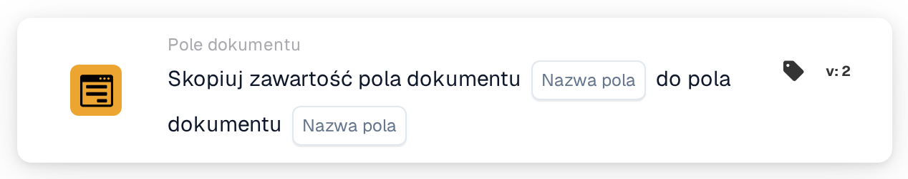

# Skopiuj pole dokumentu do pola dokumentu

<figure><figcaption>
Wersja 2
</figcaption></figure>

## Cel:

Ta karta przepływu pracy kopiuje zawartość jednego pola dokumentu do innego pola dokumentu tego samego dokumentu. Można jej użyć na przykład do wypełnienia pola potrzebnego do eksportu lub dla późniejszej karty wartością, która została już wyodrębniona do innego pola.

## Komponenty karty:

1. **Nazwa pola** (pierwsze)
   * **Opis:** Pole dokumentu, którego zawartość jest kopiowana.
   * **Szczegóły:** Nazwa pola dokumentu. Nazwa jest porównywana dokładnie, z uwzględnieniem wielkości liter. Samo pole nie jest zmieniane.
2. **Nazwa pola** (drugie)
   * **Opis:** Pole dokumentu, do którego kopiowana jest zawartość.
   * **Szczegóły:** Nazwa pola dokumentu. Jego bieżąca zawartość zostaje zastąpiona skopiowaną zawartością.

## Funkcjonalność:

* **Odczyt wartości:** Karta wyszukuje pierwsze pole wśród pól dokumentu i odczytuje jego wartość. Znaleziona wartość jest odnotowywana w dzienniku przepływu pracy.
* **Wykonanie akcji:** Wartość zostaje zapisana w drugim polu, a dokument zostaje zapisany. Skopiowana wartość jest przejmowana w niezmienionej postaci, bez konwersji. Jeśli drugie pole nie istnieje jeszcze w dokumencie, zostaje dodane. Po udanym skopiowaniu późniejsze karty w przepływie pracy pracują z nową wartością.
* **Brakujące dane:**
  * Jeśli jedna z dwóch nazw pól nie jest ustawiona na karcie, karta nie jest wykonywana i zgłasza brakujące dane w dzienniku przepływu pracy.
  * Jeśli dokument nie ma pola o pierwszej nazwie, nic nie jest kopiowane, a karta zgłasza, że pola nie znaleziono w dokumencie.
* **Błędy:** Jeśli dokumentu nie można zapisać, na przykład dlatego, że jego bieżący status nie pozwala na zmiany, karta kończy się błędem, a drugie pole zachowuje dotychczasową zawartość.

## Instalacja i konfiguracja:

* Kartę można dodać z kategorii **Pole dokumentu**. Następnie pole, z którego kopiowana jest wartość, ustawia się w pierwszym miejscu **Nazwa pola**, a pole docelowe w drugim.
* Ponieważ wartość jest kopiowana bez konwersji, oba pola powinny zawierać ten sam rodzaj danych, na przykład tekst do tekstu lub datę do daty.

## Podsumowanie:

Karta przepływu pracy „Copy Document Field into Document Field” przenosi wartości między polami bez ręcznej pracy. Utrzymuje spójność powiązanych pól i pozwala dalszym krokom przepływu pracy używać wartości pod nazwą pola, której oczekują.
