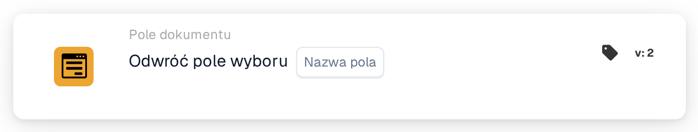

# Odwróć pole wyboru

<figure><figcaption>
Wersja 2
</figcaption></figure>

## **Cel:**

Ta karta przepływu pracy służy do odwrócenia bieżącego stanu pola wyboru. Jeśli pole wyboru jest zaznaczone (true), zostanie odznaczone (false) i odwrotnie. Odwrócenie następuje na podstawie warunków ustawionych w sekcjach **„Kiedy”** i **„I sekcje”.** Ta karta pomaga zautomatyzować przepływy pracy, w których warunek wymaga przełączania pola wyboru na podstawie określonych kryteriów.

## **Komponenty karty:**

1. **Nazwa pola**
   * **Opis**: Określa pole wyboru, które ma zostać odwrócone.
   * **Szczegóły**: Wybrane pole wyboru będzie miało przełączony stan z true na false lub z false na true na podstawie jego bieżącego stanu.

## **Funkcjonalność:**

* **Ocena warunku**: System ocenia warunki zdefiniowane w sekcjach **„Kiedy”** i **„I sekcje”**:
  * Jeśli **oba warunki są prawdziwe**, zostanie wykonana akcja **„Wtedy sekcja”**, co w tym przypadku oznacza przełączenie pola wyboru.
  * Jeśli **którykolwiek z warunków jest fałszywy**, karta nie zostanie wykonana i nie zostanie wprowadzona żadna zmiana w polu wyboru.
* **Wykonanie akcji**: Jeśli warunki w sekcjach **„Kiedy”** i **„I sekcje”** są prawdziwe, stan pola wyboru zostanie odwrócony:
  * Jeśli pole wyboru jest zaznaczone (true), zostanie odznaczone (false).
  * Jeśli pole wyboru jest odznaczone (false), zostanie zaznaczone (true).

## **Konfiguracja:**

Aby skonfigurować tę kartę, użytkownicy muszą:

1. **Wybrać pole wyboru** (Field Name), które zostanie odwrócone. Dostępne pola wyboru w dokumencie są wymienione do wyboru.
2. Pole wyboru zostanie odwrócone tylko wtedy, gdy warunki w sekcjach **„Kiedy”** i **„I sekcje”** są prawdziwe.

## **Podsumowanie:**

Karta przepływu pracy **"Invert checkbox \[Field Name]"** oferuje proste, ale potężne narzędzie automatyzacji do przełączania wartości pól wyboru na podstawie określonych warunków. Redukując potrzebę ręcznego dostosowywania pól wyboru, karta ta zwiększa efektywność przetwarzania dokumentów i zapewnia spójność w przepływach pracy.

<!-- workflow-card-practical-example-20261021 -->

## Praktyczny przykład

**Kiedy używać:** Przełącz wartość logiczną, gdy jest to zamierzona operacja biznesowa.

**Konfiguracja:** Zaznacz pole wyboru `demo_flag` z wartością początkową `false`.

**Oczekiwany wynik i kontrprzykład:** Jedno wykonanie daje `true`; drugie wykonanie sprawia, że ​​jest to ponownie `false`. Zamiast tego użyj pola wyboru Ustaw, jeśli ponowne próby muszą zawsze pozostawiać tę samą wartość.

To jest ilustracyjna konfiguracja i oczekiwany wynik. Korzystaj z pól, użytkowników i grup skonfigurowanych w Twojej organizacji testowej; nie jest to twierdzenie, że ten przykład został wykonany.
