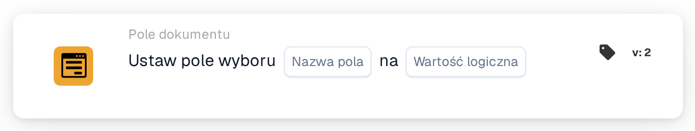

# Ustaw pole wyboru na

<figure><figcaption>
Wersja 2
</figcaption></figure>

## **Cel:**

Ta karta przepływu pracy służy do ustawienia pola wyboru na określoną wartość (true lub false) na podstawie warunków zdefiniowanych w sekcjach **„Kiedy”** i **„I”**. Zapewnia prosty, ale skuteczny sposób automatyzacji aktualizacji pól wyboru, gdy spełnione są określone kryteria, zapewniając usprawnione przetwarzanie dokumentów.

## **Komponenty karty:**

1. **Nazwa pola:**
   * **Opis**: Określa pole, w którym zostanie ustawione pole wyboru.
   * **Szczegóły**: Pole wyboru do aktualizacji jest identyfikowane przez nazwę pola.
2. **Wartość logiczna**
   * **Opis**: Definiuje wartość, na którą zostanie ustawione pole wyboru, gdy warunki w sekcjach **Gdzie** i **I** są oba prawdziwe.
   * **Opcje**:
     * **True**: Pole wyboru zostanie ustawione na **true**, jeśli warunki są spełnione.
     * **False**: Pole wyboru zostanie ustawione na **false**, jeśli warunki są spełnione.

## **Funkcjonalność:**

* **Ocena warunku**: System ocenia warunki zarówno w sekcji **„Kiedy”**, jak i **„I”**
* **Wykonanie akcji**: Jeśli zarówno **„Kiedy”**, jak i **„I sekcje”** są prawdziwe, pole wyboru zostanie zaktualizowane do określonej wartości (true lub false). Jeśli którykolwiek z warunków jest fałszywy, nie są podejmowane żadne akcje, a pole wyboru pozostaje bez zmian.

## **Konfiguracja:**

Aby skonfigurować tę kartę, użytkownicy muszą:

1. **Określić docelowe pole wyboru**, które zostanie ustawione na true lub false, gdy warunki są spełnione.
2. **Wybrać wartość (true lub false)**, na którą zostanie ustawione pole wyboru po ocenie warunku.
3. Karta wykonuje swoją akcję tylko wtedy, gdy oba warunki w sekcjach **„Kiedy”** i **„I sekcje”** są prawdziwe.

## **Podsumowanie:**

Karta przepływu pracy **"Set Checkbox"** jest prostym i skutecznym narzędziem automatyzacji do aktualizacji pól wyboru na podstawie określonych warunków. Zapewniając, że zarówno **„Kiedy”**, jak i **„I sekcje”** są spełnione, umożliwia użytkownikom automatyzację procesów i redukcję ręcznej interwencji, zapewniając płynniejsze i bardziej efektywne przetwarzanie dokumentów.

<!-- workflow-card-practical-example-20261021 -->

## Praktyczny przykład

**Kiedy używać:** Oznacz pomyślną walidację wyraźną flagą.

**Konfiguracja:** Zaznacz pole wyboru `review_complete` i ustaw je na `true`.

**Oczekiwany wynik i kontrprzykład:** Pole zostaje zaznaczone. Uruchom akcję za pomocą `false` w oddzielnym teście, gdy chcesz wyczyścić flagę.

To jest ilustracyjna konfiguracja i oczekiwany wynik. Korzystaj z pól, użytkowników i grup skonfigurowanych w Twojej organizacji testowej; nie jest to twierdzenie, że ten przykład został wykonany.
