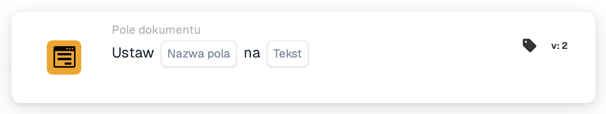

# Ustaw na

<figure><figcaption>
Wersja 2
</figcaption></figure>

## **Cel:**

Ta karta przepływu pracy służy do automatycznego ustawienia określonego pola w dokumencie na predefiniowaną wartość tekstową na podstawie warunków zdefiniowanych w sekcjach **„Kiedy”** i **„I sekcje”.** Umożliwia użytkownikom usprawnienie wprowadzania danych poprzez zapewnienie, że pola są wypełniane spójnymi wartościami, gdy spełnione są określone kryteria.

## **Komponenty karty:**

1. **Nazwa pola**
   * **Opis**: Określa pole, które zostanie zaktualizowane wartością tekstową.
   * **Szczegóły**: Wybrane pole zostanie zaktualizowane określoną wartością tekstową, jeśli warunki w sekcjach **„Kiedy”** i **„I sekcje”** są spełnione.
2. **Tekst**
   * **Opis**: Definiuje wartość tekstową, która zostanie ustawiona w polu docelowym, gdy warunki są prawdziwe.
   * **Szczegóły**: Może to być niestandardowa wiadomość, status lub predefiniowana wartość, którą użytkownik chce wpisać do pola. Tekst powinien być zgodny z oczekiwanym formatem wejściowym pola (np. alfanumeryczny, data lub inne typy informacji tekstowych).

## **Funkcjonalność:**

* **Ocena warunku**: System ocenia warunki w sekcjach **„Kiedy”** i **„I sekcje”**:
  * Jeśli **oba warunki są prawdziwe**, zostaną wykonane akcje zdefiniowane w **„Wtedy sekcja”**. W szczególności pole docelowe (Field Name) zostanie wypełnione określonym tekstem.
  * Jeśli **sekcja "Where" lub "And" jest fałszywa**, nie jest podejmowana żadna akcja, a pole pozostaje bez zmian. Akcje **Następnie Sekcja** są całkowicie pomijane, jeśli którykolwiek z warunków jest fałszywy.
* **Wykonanie akcji**: Jeśli oba warunki w sekcjach **„Kiedy”** i **„I sekcje”** są spełnione, system automatycznie wypełnia określone pole wybraną wartością tekstową. Jeśli warunki nie są spełnione, nie są wprowadzane żadne zmiany w polu.

## **Konfiguracja:**

Aby skonfigurować tę kartę:

1. **Wybierz pole** (Field Name), które zostanie zaktualizowane wartością tekstową. Dostępne pola w dokumencie są wymienione do wyboru.
2. **Określ wartość tekstową**, która zostanie wpisana do pola docelowego, gdy warunki są prawdziwe.
3. Akcja zostanie wykonana tylko wtedy, gdy warunki w sekcjach **„Kiedy”** i **„I sekcje”** są prawdziwe.

## **Podsumowanie:**

Karta przepływu pracy **„Ustaw pole na tekst”** oferuje prosty sposób automatyzacji wypełniania wartości tekstowych w określonych polach dokumentu na podstawie predefiniowanych warunków. Redukuje to ręczne wprowadzanie danych i zapewnia spójność w przetwarzaniu dokumentów, czyniąc ją przydatnym narzędziem do automatyzacji przepływów pracy i zwiększania efektywności.

<!-- workflow-card-practical-example-20261021 -->

## Praktyczny przykład

**Kiedy używać:** Zapisz wynik routingu w polu dokumentu.

**Konfiguracja:** Wybierz pole tekstowe `routing_result` i ustaw tekst na `manual review`.

**Oczekiwany wynik i kontrprzykład:** Pole zawiera dokładnie `manual review`. Kolejny warunek równości może użyć tej wartości; jest to raczej pole dokumentu niż zmienna organizacyjna.

To jest ilustracyjna konfiguracja i oczekiwany wynik. Korzystaj z pól, użytkowników i grup skonfigurowanych w Twojej organizacji testowej; nie jest to twierdzenie, że ten przykład został wykonany.
