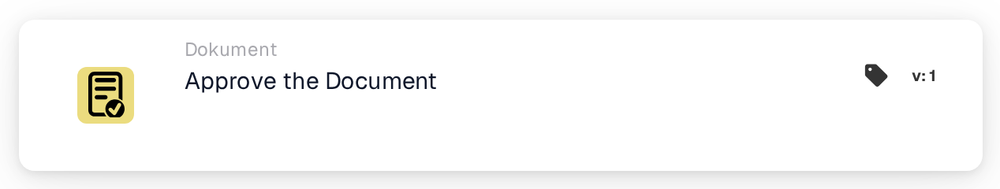
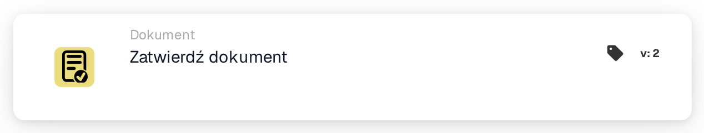

# Zatwierdź dokument

<figure><figcaption>
Wersja 1
</figcaption></figure>

<figure><figcaption>
Wersja 2
</figcaption></figure>

## **Cel:**

Karta przepływu pracy **„Zatwierdź dokument”** służy do oznaczenia dokumentu jako zatwierdzonego. Umożliwia dokumentowi przejście do następnego etapu w przepływie pracy, umożliwiając wykonanie zautomatyzowanego przetwarzania lub przepływów zatwierdzania. Ta karta pomaga usprawnić procesy zarządzania dokumentami, zapewniając, że tylko zatwierdzone dokumenty są kierowane do dalszych akcji.

## **Komponenty karty:**

1. **Stan zatwierdzenia**
   * **Opis**: Ten komponent oznacza dokument jako zatwierdzony.
   * **Szczegóły**: Gdy ta karta jest wyzwalana, status zatwierdzenia dokumentu jest aktualizowany w celu wskazania zatwierdzenia. Akcja ta może być ustawiona na podstawie warunków zdefiniowanych w sekcjach **„Kiedy”** i **„I sekcje”.**

## **Funkcjonalność:**

* **Ocena warunku**: System ocenia warunki ustawione w sekcjach **„Kiedy”** i **„I sekcje”**.
  * Jeśli **oba warunki są prawdziwe**, dokument zostanie oznaczony jako zatwierdzony.
  * Jeśli **którykolwiek z warunków jest fałszywy**, karta nie zostanie wykonana, a status zatwierdzenia dokumentu pozostanie bez zmian.
* **Wykonanie akcji**: Gdy warunki są spełnione, dokument zostaje zatwierdzony. Zmiana ta jest odzwierciedlona w statusie dokumentu, umożliwiając jego dalsze przejście w przepływie pracy.

## **Podsumowanie:**

Karta przepływu pracy **„Zatwierdź dokument”** jest kluczowym komponentem do automatyzacji zatwierdzania dokumentów w przepływach pracy biznesowych. Zapewniając, że tylko dokumenty spełniające określone kryteria są zatwierdzane, pomaga utrzymać spójność, redukuje ręczny nadzór i umożliwia płynniejsze przetwarzanie dokumentów.

<!-- workflow-card-practical-example-20261021 -->

## Praktyczny przykład

**Kiedy używać:** Zatwierdź dokument po spełnieniu wszystkich wymaganych warunków przeglądu.

**Konfiguracja:** Umieść tę akcję po sprawdzeniu warunków w pomyślnej gałęzi. Użyj dokumentu demonstracyjnego oczekującego na zatwierdzenie.

**Oczekiwany wynik i kontrprzykład:** Akcja zatwierdza ten dokument. Dokument, który nie spełnia wcześniejszego warunku, nigdy nie osiąga tego działania; Samo zatwierdzenie nie jest dowodem ukończenia eksportu do systemu ERP.

To jest ilustracyjna konfiguracja i oczekiwany wynik. Korzystaj z pól, użytkowników i grup skonfigurowanych w Twojej organizacji testowej; nie jest to twierdzenie, że ten przykład został wykonany.
