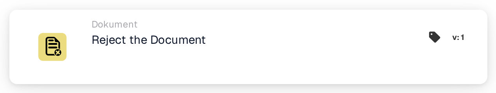
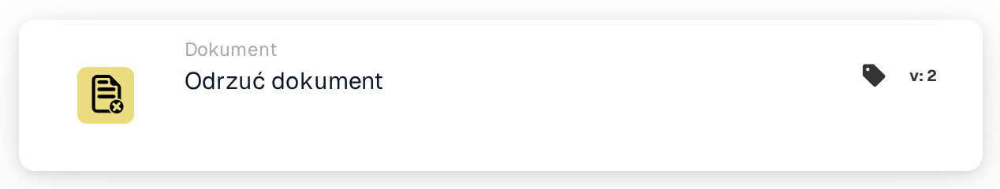

# Odrzuć dokument

<figure><figcaption>
Wersja 1
</figcaption></figure>

<figure><figcaption>
Wersja 2
</figcaption></figure>

## **Cel:**

Karta przepływu pracy **„Odrzuć dokument”** służy do oznaczenia dokumentu jako odrzuconego w ramach przepływu pracy. Akcja ta wstrzymuje postęp dokumentu i uniemożliwia mu przejście do następnego etapu w przepływie pracy. Zapewnia, że dokumenty, które nie spełniają niezbędnych warunków lub kryteriów, są oznaczane i blokowane przed dalszym przetwarzaniem.

## **Komponenty karty:**

1. **Stan odrzucenia**
   * **Opis**: Ten komponent oznacza dokument jako odrzucony, sygnalizując, że nie spełnił wymaganych warunków zatwierdzenia.
   * **Szczegóły**: Po wyzwoleniu ta karta aktualizuje status dokumentu na "rejected". Decyzja ta jest podejmowana na podstawie warunków ustawionych w sekcjach **„Kiedy”** i **„I sekcje”.**

## **Funkcjonalność:**

* **Ocena warunku**: System ocenia warunki ustawione w sekcjach **„Kiedy”** i **„I sekcje”**.
  * Jeśli **oba warunki są prawdziwe**, dokument zostanie odrzucony.
  * Jeśli **którykolwiek z warunków jest fałszywy**, karta nie zostanie wykonana, a status dokumentu pozostanie bez zmian.
* **Wykonanie akcji**: Gdy warunki są spełnione, dokument zostaje oznaczony jako odrzucony. Akcja ta zapewnia, że tylko dokumenty spełniające określone kryteria są kierowane dalej, podczas gdy inne są oznaczane i wstrzymywane do przeglądu lub korekty.

## **Podsumowanie:**

Karta przepływu pracy **„Odrzuć dokument”** jest niezbędnym narzędziem do kontrolowania przepływu dokumentów w zautomatyzowanych procesach. Umożliwiając odrzucanie niezgodnych dokumentów, zapewnia, że tylko prawidłowe i dokładne dokumenty są kontynuowane w przepływie pracy, poprawiając efektywność i dokładność w zarządzaniu dokumentami.

<!-- workflow-card-practical-example-20261021 -->

## Praktyczny przykład

**Kiedy używać:** Odrzuć dokument spełniający zdefiniowaną regułę odrzucania.

**Konfiguracja:** Do tej akcji kieruj celowo nieprawidłowy dokument demonstracyjny, na przykład po wyraźnej decyzji o odrzuceniu.

**Oczekiwany wynik i kontrprzykład:** Dokument został odrzucony. Ważny dokument musi podążać za inną gałęzią i nie może wykonywać tej akcji.

To jest ilustracyjna konfiguracja i oczekiwany wynik. Korzystaj z pól, użytkowników i grup skonfigurowanych w Twojej organizacji testowej; nie jest to twierdzenie, że ten przykład został wykonany.
